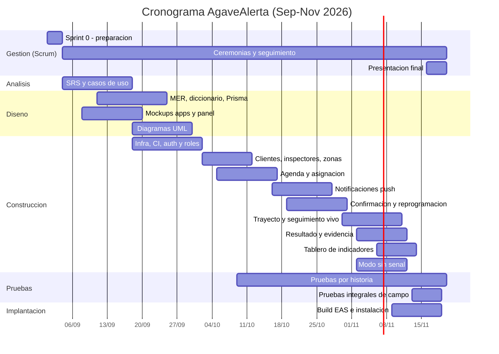

# Plan de Proyecto
## Sistema de Alerta y Seguimiento de Inspecciones de Techo — Agave Roofing (AgaveAlerta)

**Universidad Autónoma de Nuevo León — Facultad de Ingeniería Mecánica y Eléctrica**
**Unidad de aprendizaje:** Proyecto Integrador I
**Semestre:** Agosto – Diciembre 2026
**Catedrática:** Raquel Martínez Martínez
**Equipo:** 01

| Matrícula | Nombre completo | Carrera |
|-----------|-----------------|---------|
| 2177912 | Marco Antonio Méndez Sánchez | ITS |
| 2056182 | Mario Martínez González | ITS |
| 2071973 | Jorge Alberto Barbosa García | ITS |
| 1905467 | Anuar Guadalupe Hernández Hernández | ITS |
| 2014834 | Jesús Mario Bazaldúa Bustos | ITS |

---

## 1. Introducción

Este documento define el plan de trabajo para el desarrollo de **AgaveAlerta**, el sistema de alerta y seguimiento de llegada de inspectores de **Agave Roofing**, empresa que verifica el estado del techo de las casas de sus clientes.

**Problemática.** Hoy el aviso de la visita se hace **por correo electrónico**: se le informa al cliente únicamente el día en que recibirá al inspector. Como la mayoría de los clientes no revisa su correo, ocurre que **no se encuentran en su hogar** o **reciben al inspector por sorpresa**. Al no existir una confirmación del cliente, el inspector debe **volver una segunda vez** al mismo domicilio, lo que genera **pérdidas económicas** por horas-hombre, combustible y capacidad de agenda desperdiciada.

**Solución.** Sustituir el aviso por correo con un sistema de **tres servicios conectados**: un **panel de administración** donde se programa y asigna la inspección, una **aplicación móvil para el inspector** que le da su ruta del día y le permite avisar al cliente que va en camino, y una **aplicación móvil para el cliente** que lo alerta con **notificaciones directas en su teléfono** —el día programado, unas horas antes y cuando el inspector ya va en camino—, le permite **confirmar** su disponibilidad, **mover la cita** si no puede, **ver en el mapa dónde va el inspector y en cuánto tiempo llega**, y **confirmar que ya se encuentra en su casa**.

## 2. Objetivos

### 2.1 Objetivo general

Desarrollar e implementar un sistema de tres servicios —panel de administración web, aplicación móvil del inspector y aplicación móvil del cliente— que alerte al cliente de Agave Roofing mediante **notificaciones directas al teléfono**, le permita **confirmar o reprogramar** su cita y **seguir en tiempo real la llegada del inspector**, con el fin de **eliminar las visitas fallidas** y las pérdidas económicas que provoca tener que inspeccionar dos veces el mismo domicilio.

### 2.2 Objetivos específicos

1. Analizar y documentar los requerimientos funcionales y no funcionales de los tres servicios (administrador, inspector y cliente).
2. Diseñar la arquitectura del sistema (dos apps móviles, panel web y API) y el modelo de base de datos relacional central normalizado.
3. Implementar la autenticación y el control de acceso por rol (Administrador, Inspector y Cliente).
4. Implementar la gestión de clientes, domicilios georreferenciados, inspectores y zonas de servicio.
5. Implementar la **agenda de inspecciones**: programación, asignación de inspector y ventana de atención.
6. Implementar el **motor de notificaciones push** con sus tres momentos: aviso del día programado, recordatorio previo y aviso de "el inspector va en camino".
7. Implementar la **confirmación de disponibilidad del cliente** desde la notificación y desde la app.
8. Implementar la **reprogramación de la cita** solicitada por el cliente, con horarios disponibles y aprobación del administrador.
9. Implementar el **seguimiento en vivo del trayecto** del inspector (ubicación en el mapa y tiempo estimado de llegada).
10. Implementar la **confirmación de presencia del cliente** ("ya estoy en mi casa") y el aviso de llegada del inspector.
11. Implementar el **registro del resultado de la inspección** con evidencia fotográfica y su entrega al cliente.
12. Implementar la **comunicación directa inspector–cliente** (mensaje en la app y llamada).
13. Implementar el **tablero de indicadores** del administrador: confirmaciones, reprogramaciones, visitas fallidas y puntualidad.
14. Implementar el **modo con conectividad intermitente** en la app del inspector (registrar el resultado sin señal y sincronizar al reconectar).
15. Realizar pruebas de funcionamiento y validar la solución con el responsable de operaciones de Agave Roofing.

## 3. Justificación

Cada visita fallida cuesta dos veces: el traslado que se perdió y el que habrá que repetir. Al depender del correo electrónico —un canal que el cliente no revisa a tiempo— la empresa no tiene forma de saber si el cliente estará o no en su domicilio, y descubre el problema hasta que el inspector ya está frente a la puerta.

Una **notificación push** llega directo al teléfono, se lee en minutos y admite **respuesta inmediata** ("sí estaré" / "necesito moverla"). Con eso la empresa sabe **antes de salir** si la visita procede, puede reasignar el espacio de agenda cuando el cliente no puede, y reduce los traslados en vano. El **seguimiento en vivo** elimina además la espera indefinida: el cliente ve el avance del inspector y su tiempo estimado de llegada, lo que aumenta la probabilidad de que esté presente y mejora la percepción del servicio.

## 4. Alcance

### 4.1 Incluido

- Autenticación con Supabase Auth y control de acceso por rol: **Administrador**, **Inspector** y **Cliente**.
- Gestión de **clientes** y **domicilios georreferenciados** (dirección + coordenadas), y de **inspectores** y **zonas de servicio**.
- **Agenda de inspecciones**: programación con fecha y ventana horaria, asignación de inspector y vista de calendario por inspector y por zona.
- **Notificaciones push** al cliente en tres momentos: (a) día programado, (b) recordatorio horas antes de la ventana, (c) el inspector va en camino con tiempo estimado de llegada. Respaldo por SMS y correo cuando la push falla.
- **Confirmación de disponibilidad** del cliente, con fecha y hora del acuse.
- **Reprogramación** de la cita a solicitud del cliente, eligiendo entre horarios disponibles; aprobación y reasignación por el administrador.
- **Seguimiento en vivo**: el inspector inicia el trayecto, comparte su ubicación y el cliente lo ve en un mapa con el tiempo estimado de llegada.
- **Confirmación de presencia** del cliente ("estoy en casa") y registro de llegada del inspector.
- **Registro del resultado de la inspección** (hallazgos, estado del techo, fotografías) y entrega del reporte al cliente en su app.
- Registro de **cliente ausente** con evidencia, para medir y cobrar la visita fallida.
- **Comunicación inspector–cliente**: mensaje dentro de la app y llamada telefónica desde la app.
- **Tablero de indicadores** del administrador: citas por estado, tasa de confirmación, reprogramaciones, visitas fallidas, puntualidad y tiempo de traslado.
- **Modo con conectividad intermitente** en la app del inspector: registrar llegada, resultado y fotos sin señal y sincronizarlos al reconectar.

### 4.2 Excluido (fuera de alcance para esta entrega)

- Cotización, contratación y facturación de los trabajos de reparación del techo.
- Cobro en línea o pasarela de pagos.
- Optimización automática de rutas de todo un día (se asigna y ordena manualmente).
- Nómina, control de asistencia y comisiones de los inspectores.
- Inventario de materiales y gestión de cuadrillas de reparación.
- Portal web público de autoservicio para el cliente (el cliente usa la app móvil).
- Integración con el CRM corporativo existente de Agave Roofing.

## 5. Metodología de desarrollo — Scrum

Se empleará **Scrum** con adaptaciones al contexto académico.

### 5.1 Roles Scrum

| Rol Scrum | Responsable | Notas |
|-----------|-------------|-------|
| Product Owner | Marco Antonio Méndez Sánchez | Interlocutor con el responsable de operaciones de Agave Roofing; prioriza el Product Backlog. |
| Scrum Master | Marco Antonio Méndez Sánchez | Facilita ceremonias y remueve impedimentos (rol compartido con PO por el tamaño del equipo). |
| Equipo de Desarrollo | Mario, Jorge, Anuar, Jesús | Autoorganizado; todos programan y prueban. |

### 5.2 Eventos

- **Sprints de 2 semanas.** 6 sprints en total (ver cronograma).
- **Sprint Planning** el primer día de cada sprint: se selecciona el Sprint Backlog.
- **Daily Scrum** de 10 min, 3 veces por semana (lun–mié–vie), presencial o por chat.
- **Sprint Review** el jueves de cierre de sprint: se demuestra el incremento al PO y, cuando aplique, al cliente.
- **Sprint Retrospective** después del Review: qué salió bien, qué mejorar, acciones.
- **Refinamiento del backlog** semanal (1 h).

### 5.3 Artefactos

- **Product Backlog:** historias de usuario derivadas del SRS, con criterios de aceptación y estimación en puntos (escala Fibonacci).
- **Sprint Backlog:** historias comprometidas del sprint, desglosadas en tareas.
- **Incremento:** software potencialmente entregable al final de cada sprint, desplegado en el ambiente de pruebas (panel en Vercel y apps distribuidas con Expo).
- **Tablero** en GitHub Projects (columnas: Backlog → Por hacer → En curso → En revisión → Hecho).
- **Definición de Terminado (DoD):** historia con criterios de aceptación cumplidos; código en Pull Request revisado por otro integrante y fusionado a `main`; pruebas (unitarias/manuales) del caso ejecutadas **en dispositivo real**; sin errores conocidos de severidad alta; documentación y tablero actualizados; incremento desplegado.

## 6. Recursos

### 6.1 Tecnológicos (stack del proyecto)

| Capa | Tecnología | Detalle |
|------|-----------|---------|
| App del Cliente | **React Native + Expo + TypeScript** | App móvil Android/iOS. Notificaciones push, mapa de seguimiento, confirmación y reprogramación. |
| App del Inspector | **React Native + Expo + TypeScript** | App móvil Android/iOS. Ruta del día, ubicación en segundo plano, cámara para evidencia, modo sin señal. |
| Panel de administración | **React 18 + TypeScript + Vite** | Aplicación web desplegada en **Vercel**. Agenda, asignación y tablero. |
| UI / componentes | React Native Paper (móvil) y shadcn/ui o Material UI (web) | Lenguaje visual consistente entre los tres servicios. |
| API / backend | **Node.js 20 + Express + TypeScript** | API REST única para las tres aplicaciones; concentra la lógica de negocio (agenda, estados de la cita, notificaciones, ETA). |
| Acceso a datos | **Prisma ORM** | Modelo de datos tipado, migraciones versionadas. |
| Base de datos | **PostgreSQL 15 (gestionada por Supabase)** | Una sola base central. |
| Autenticación | **Supabase Auth** (JWT) | Correo/contraseña para Administrador e Inspector; teléfono con código (OTP) para el Cliente. |
| Notificaciones push | **Expo Push Notifications** sobre FCM (Android) y APNs (iOS) | Tres tipos de alerta con acciones (Confirmar / Reprogramar). |
| Respaldo de notificación | SMS (Twilio) y correo (Resend) | Si la push no se entrega en el plazo configurado. |
| Seguimiento en vivo | **Supabase Realtime** (canal por inspección) | Publicación de la ubicación del inspector y recepción en la app del cliente. |
| Ubicación en segundo plano | `expo-location` (background updates) | Solo mientras el trayecto está activo. |
| Mapas y ETA | `react-native-maps` (Google Maps) y **Google Directions API** | Mapa del cliente e inspector; cálculo del tiempo estimado de llegada. |
| Almacenamiento de archivos | Supabase Storage | Fotografías de evidencia y reportes PDF. |
| Modo sin señal (inspector) | SQLite (`expo-sqlite`) + cola de sincronización | Llegada, resultado y fotos en local; se envían al reconectar. |
| Reportes / PDF | Generación en la API (pdfkit) | Reporte de inspección para el cliente. |
| Control de versiones | **Git + GitHub** | Rama `main` protegida, ramas por historia, Pull Requests. |
| Integración continua | GitHub Actions | Lint + build + pruebas en cada PR; build de las apps con EAS. |
| Gestión del proyecto | GitHub Projects | Product Backlog y tablero. |
| Modelado | draw.io / Mermaid / PlantUML | Diagramas del proyecto. |

### 6.2 Humanos — Roles del equipo

| Integrante | Rol principal | Responsabilidades |
|------------|---------------|-------------------|
| Marco Antonio Méndez Sánchez | Product Owner / Scrum Master + Panel de administración | Backlog, priorización, ceremonias, comunicación con el cliente, gestión de riesgos, presentación; construcción del **panel web de administración** (agenda, asignación, tablero) |
| Mario Martínez González | Analista / Documentación / QA | SRS, historias de usuario, casos de uso, diagramas UML, manual de usuario, casos de prueba, actas |
| Jorge Alberto Barbosa García | Arquitecto / Backend + Base de datos + DevOps | API Express, modelo Prisma, PostgreSQL/Supabase, migraciones, máquina de estados de la cita, **motor de notificaciones push**, canal de seguimiento en vivo, despliegues, CI |
| Anuar Guadalupe Hernández Hernández | Desarrollador Móvil — **App del Inspector** | Ruta del día, inicio de trayecto, ubicación en segundo plano, llegada, resultado con fotos, contacto con el cliente, modo sin señal |
| Jesús Mario Bazaldúa Bustos | Desarrollador Móvil — **App del Cliente** + Pruebas | Recepción de notificaciones, confirmación, reprogramación, mapa de seguimiento con ETA, "estoy en casa", reporte de inspección, ejecución del plan de pruebas |

*Todos los integrantes participan en programación y pruebas; los roles indican la responsabilidad de coordinación de cada área.*

> **Nota sobre el reparto de roles:** como el sistema tiene **tres servicios**, el Product Owner asume además la construcción del **panel de administración**, que es el servicio más ligero (altas, agenda y tablero sobre endpoints ya existentes). Mario lo apoya con las pruebas de ese servicio. Si el equipo prefiere otro reparto, basta intercambiar las líneas LP y MI en los checklists.

### 6.3 Materiales

- Un **teléfono Android** por integrante para pruebas en dispositivo real (mínimo Android 10) y, de ser posible, un iPhone del equipo para verificar iOS.
- Una PC por integrante para desarrollo (Windows 10/11, 64 bits).
- Cuenta de **Expo (EAS)** para compilar y distribuir las apps de prueba.
- Cuenta de **Google Cloud** con Maps SDK y Directions API habilitadas (crédito gratuito).
- Cuentas gratuitas de Supabase, Vercel y GitHub; cuenta de prueba de Twilio para SMS.
- Plan de datos móviles para las pruebas de campo (seguimiento en vivo y modo sin señal).

## 7. Estructura de Descomposición del Trabajo (WBS)

```
1. Gestión del proyecto (Scrum)
   1.1 Product Backlog y plan de proyecto
   1.2 Ceremonias y actas
   1.3 Cierre y presentación final
2. Análisis
   2.1 Levantamiento de requerimientos (los tres servicios)
   2.2 Documento SRS
   2.3 Historias de usuario y casos de uso
3. Diseño
   3.1 Arquitectura (apps móviles, panel, API) y decisiones técnicas (ADR)
   3.2 Modelo de base de datos (MER + diccionario + esquema Prisma + SQL PostgreSQL)
   3.3 Diagramas UML (clases, secuencia, actividad, estados, componentes, despliegue)
   3.4 Diseño de interfaz (mockups de las dos apps y del panel)
4. Construcción
   4.1 Infraestructura: repos, Supabase, Vercel, Expo/EAS, CI, esqueletos de los tres clientes
   4.2 Autenticación y roles (Supabase Auth + guardas en API y clientes)
   4.3 Clientes, domicilios, inspectores y zonas
   4.4 Agenda de inspecciones y asignación (panel)
   4.5 Motor de notificaciones push (los tres momentos) y registro de dispositivos
   4.6 Confirmación de disponibilidad del cliente
   4.7 Reprogramación de la cita
   4.8 Trayecto y seguimiento en vivo (ubicación + ETA)
   4.9 Llegada, "estoy en casa" y ejecución de la inspección con evidencia
   4.10 Comunicación inspector–cliente
   4.11 Tablero de indicadores del administrador
   4.12 Modo con conectividad intermitente y sincronización
5. Pruebas
   5.1 Plan de pruebas
   5.2 Pruebas por historia / módulo (unitarias y manuales en dispositivo)
   5.3 Pruebas integrales de campo y de aceptación
6. Implantación
   6.1 Manual de usuario e instalación
   6.2 Compilación de las apps (EAS) y despliegue de API/panel
   6.3 Instalación con inspectores y clientes piloto, y capacitación
```

## 8. Cronograma (Septiembre – Noviembre 2026)

Duración: **12 semanas** con **entregas de avance todos los jueves** (ver `05_Calendario_Entregas.md`), organizadas en **6 sprints de 2 semanas**.

| Sprint | Entregas | Fechas | Objetivo del sprint |
|--------|----------|--------|---------------------|
| Sprint 0 | Prep. + E01 | 01–03 sep | Backlog, repositorios, cuentas Supabase/Vercel/Expo/Google Maps, decisión de stack (ADR), tablero |
| Sprint 1 | E02–E03 | 04–17 sep | SRS y casos de uso; MER y diccionario de datos; mockups de los tres servicios; alcance validado y congelado |
| Sprint 2 | E04–E05 | 18 sep–01 oct | Diseño técnico cerrado; infraestructura y CI; autenticación y roles; esquema Prisma en PostgreSQL |
| Sprint 3 | E06–E07 | 02–15 oct | Clientes, domicilios, inspectores y zonas; agenda de inspecciones y asignación |
| Sprint 4 | E08–E09 | 16–29 oct | Motor de notificaciones push (3 momentos); confirmación del cliente; reprogramación de la cita |
| Sprint 5 | E10–E11 | 30 oct–12 nov | Trayecto y seguimiento en vivo con ETA; llegada y "estoy en casa"; resultado con evidencia; tablero; modo sin señal; manuales |
| Sprint 6 | E12 | 13–19 nov | Pruebas integrales de campo, compilación e instalación, capacitación, aceptación y presentación final |

### 8.1 Diagrama de Gantt (Mermaid)



## 9. Gestión de riesgos

| # | Riesgo | Prob. | Impacto | Estrategia de mitigación |
|---|--------|-------|---------|--------------------------|
| R1 | Requerimientos incompletos o cambiantes del negocio | Media | Alto | Validar SRS con el responsable de operaciones en el Sprint 1; congelar alcance; cambios entran al backlog priorizados por el PO |
| R2 | Integrante con baja disponibilidad por carga académica | Alta | Medio | Historias pequeñas; tablero visible; pair programming; el Scrum Master rebalancea el Sprint Backlog |
| R3 | Curva de aprendizaje de React Native / Expo / Prisma / Supabase | Media | Medio | Spikes técnicos en Sprint 0–1; guía de arranque; plantillas de código |
| R4 | **La notificación push no se entrega** (permiso denegado, token vencido, teléfono apagado, app desinstalada) | Alta | Alto | Registro de estado de cada envío; **reintentos** y **respaldo por SMS y correo**; el panel marca "cliente no alcanzado" y el administrador llama; el permiso de notificaciones se pide explicándolo en el primer arranque |
| R5 | Consumo de batería y datos por la ubicación en segundo plano | Alta | Medio | Publicar solo durante el trayecto activo, con intervalo configurable (15 s) y filtro por distancia; apagado automático al llegar o a los 90 min |
| R6 | Costo/cuota de Google Directions y Maps | Media | Medio | Calcular el ETA a intervalos, no en cada punto; caché por trayecto; alternativa Mapbox; monitorear el crédito gratuito |
| R7 | **Privacidad**: el cliente ve la ubicación del inspector y la empresa guarda rastros GPS | Media | Alto | Consentimiento explícito de ambas partes; la ubicación solo es visible mientras el trayecto está activo y solo para el cliente de esa cita; retención de puntos GPS de 30 días; aviso de privacidad en las dos apps |
| R8 | Cobertura celular deficiente en el domicilio del cliente | Media | Medio | Modo sin señal en la app del inspector (llegada, resultado y fotos en cola); el cliente conserva el último punto y ETA conocidos con su hora |
| R9 | Publicación en tiendas (App Store / Play Store) tardada o rechazada | Media | Medio | Distribución interna con **EAS Build / Expo Go** y APK directo para la demo; la publicación en tienda queda fuera del alcance evaluable |
| R10 | Límites del plan gratuito de Supabase/Vercel (proyecto en pausa, cuotas) | Media | Medio | Mantener actividad; respaldos periódicos con `pg_dump`; documentar cómo recrear el proyecto |
| R11 | Adopción: clientes que no instalan la app | Media | Alto | Respaldo por SMS con enlace corto de confirmación; el administrador puede registrar la confirmación por llamada |
| R12 | Pérdida de código o datos | Baja | Alto | GitHub, migraciones versionadas, respaldos de la base |

## 10. Entregables del proyecto

1. Plan de proyecto (este documento).
2. Documento de Especificación de Requerimientos de Software (SRS).
3. Diseño de base de datos: MER, diccionario de datos, esquema Prisma y script SQL para PostgreSQL.
4. Diagramas UML: casos de uso, clases, secuencia, actividad, estados, componentes y despliegue.
5. Código fuente en el repositorio: API (Express), panel (React), app del inspector y app del cliente (React Native + Expo).
6. Plan y evidencias de pruebas, incluida la **prueba de campo** de una inspección real de principio a fin.
7. Manual de usuario e instalación (los tres servicios).
8. Compilados de las apps (APK / build de EAS) y despliegue del panel y la API.
9. Presentación final y demostración del sistema.

## 11. Criterios de éxito

- El cliente recibe la **notificación del día programado** en su teléfono y puede **confirmar en menos de 3 toques** desde la propia notificación.
- Al menos el **80 %** de las citas de la prueba piloto quedan **confirmadas o reprogramadas** antes de la fecha de la visita.
- El cliente que solicita mover su cita **elige un nuevo horario disponible** sin llamar a la empresa.
- Cuando el inspector inicia el trayecto, el cliente **ve su avance en el mapa** y un **tiempo estimado de llegada** que se actualiza al menos cada minuto.
- El cliente puede **confirmar que está en su casa** y el inspector lo ve reflejado en su app antes de llegar.
- El inspector registra el **resultado de la inspección con fotografías** aunque no tenga señal, y el reporte llega al cliente al sincronizar.
- El tablero del administrador muestra con datos reales la **tasa de confirmación y las visitas fallidas**, evidenciando la reducción frente al proceso por correo.
- Todos los requerimientos funcionales de prioridad "Alta" del SRS quedan implementados y probados.
