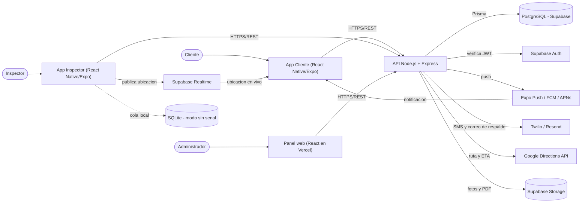

# Especificación de Requerimientos de Software (SRS)
## Sistema de Alerta y Seguimiento de Inspecciones de Techo — Agave Roofing (AgaveAlerta)

**Basado en la estructura del estándar IEEE 830.**
**Universidad Autónoma de Nuevo León — FIME**
**Proyecto Integrador I — Equipo 01 — Agosto–Diciembre 2026**

---

## 1. Introducción

### 1.1 Propósito

Especificar de manera completa y verificable los requerimientos funcionales y no funcionales del sistema de alerta y seguimiento de llegada de inspectores de Agave Roofing. Está dirigido al equipo de desarrollo (Equipo 01), a la catedrática de la unidad de aprendizaje y al responsable de operaciones de Agave Roofing como cliente del sistema.

### 1.2 Alcance del producto

**Nombre:** AgaveAlerta.

El sistema sustituye el aviso por correo electrónico de la visita del inspector por un **sistema de alertas directas al teléfono del cliente**, con **confirmación**, **reprogramación** y **seguimiento en vivo** de la llegada del inspector.

El producto se compone de **tres servicios**:

1. **Servicio del Administrador** — panel web. Da de alta clientes, domicilios, inspectores y zonas; **programa y asigna** las inspecciones; vigila el estado de cada cita; aprueba reprogramaciones; consulta el tablero de indicadores.
2. **Servicio del Inspector** — app móvil. Le muestra su **ruta del día**, le permite **iniciar el trayecto** (con lo que el cliente recibe el aviso "va en camino" y empieza a verlo en el mapa), **ponerse en contacto** con el cliente, **registrar su llegada**, **capturar el resultado** de la inspección con fotografías y marcar **cliente ausente**.
3. **Servicio del Cliente** — app móvil. Recibe la **notificación del día programado**, **confirma** su disponibilidad, puede **mover la cita** a otro horario disponible, recibe el **recordatorio previo**, el aviso de que **el inspector va en camino**, **ve en el mapa dónde va y en cuánto tiempo llega**, **confirma que se encuentra en su casa** y consulta el **reporte de la inspección**.

Los tres servicios se apoyan en una **API** única y una **base de datos central**.

**No** contempla cotización ni facturación de reparaciones, cobro en línea, optimización automática de rutas, nómina, inventario de materiales, portal web público del cliente ni integración con el CRM corporativo.

**Beneficios:** eliminar las visitas fallidas y el costo de repetir la inspección, dar certeza al cliente sobre cuándo llega el inspector y medir objetivamente el cumplimiento de la agenda.

### 1.3 Definiciones, acrónimos y abreviaturas

| Término | Definición |
|---------|------------|
| Inspección / cita | Visita programada de un inspector al domicilio de un cliente para verificar el estado del techo. |
| Ventana de atención | Rango horario dentro del día en que el inspector se compromete a llegar (p. ej. 10:00–12:00). |
| Notificación push | Aviso que aparece directamente en la pantalla del teléfono, sin necesidad de abrir la app. |
| Token de dispositivo | Identificador que emite el sistema operativo del teléfono para poder enviarle notificaciones push. |
| Confirmación | Respuesta del cliente indicando que **sí estará** en su domicilio el día y ventana programados. |
| Reprogramación | Cambio de la fecha u hora de la cita a solicitud del cliente o del administrador. |
| Trayecto | Recorrido del inspector desde que pulsa "Voy en camino" hasta que registra su llegada. |
| ETA | Tiempo estimado de llegada (*Estimated Time of Arrival*). |
| Visita fallida | Traslado en el que el cliente no se encontraba en el domicilio; obliga a repetir la inspección. |
| Evidencia | Fotografías y notas que el inspector captura como respaldo del resultado. |
| Zona | Agrupación geográfica de domicilios que se asigna a uno o varios inspectores. |
| Modo sin señal | Operación de la app del inspector sin datos móviles, con sincronización posterior. |
| API | Interfaz de programación (servicio REST) entre las aplicaciones y la base de datos. |
| JWT | Token de sesión firmado (*JSON Web Token*), emitido por Supabase Auth. |
| OTP | Código de un solo uso enviado por SMS para autenticar al cliente. |
| RF / RNF | Requerimiento funcional / Requerimiento no funcional. |
| CU / MER | Caso de uso / Modelo entidad-relación. |

### 1.4 Referencias

- Documento *Propuesta – Alerta de llegada de inspector*, Agave Roofing, Equipo 01.
- IEEE Std 830-1998, *Recommended Practice for Software Requirements Specifications*.
- Documentos del proyecto: `01_Plan_de_Proyecto.md`, `03_Diseno_Base_de_Datos.md`, `04_Diagramas_UML.md`, `05_Calendario_Entregas.md`.

### 1.5 Descripción general del documento

La sección 2 presenta una visión general del producto y sus restricciones. La sección 3 detalla los requerimientos específicos. La sección 4 incluye la matriz de trazabilidad.

---

## 2. Descripción general

### 2.1 Perspectiva del producto

AgaveAlerta es un producto **nuevo**, con arquitectura **cliente–servidor de cuatro partes** (tres clientes + un servidor):

- **App del Cliente (móvil):** React Native + Expo. Recibe notificaciones push, confirma, reprograma, sigue el trayecto en un mapa y consulta el reporte.
- **App del Inspector (móvil):** React Native + Expo. Ruta del día, inicio de trayecto con ubicación en segundo plano, contacto con el cliente, llegada, resultado con fotos; opera con señal intermitente.
- **Panel del Administrador (web):** React desplegado en Vercel. Altas, agenda, asignación, aprobación de reprogramaciones y tablero.
- **API (Node.js + Express):** servicio REST único que concentra la lógica de negocio (máquina de estados de la cita, disparo de notificaciones, cálculo de ETA) y el acceso a la **base de datos central PostgreSQL** (Supabase). La autenticación la provee **Supabase Auth**; el seguimiento en vivo viaja por **Supabase Realtime**.

### 2.2 Funciones del producto (resumen)

- Autenticación y control de acceso por rol (Administrador, Inspector, Cliente).
- Gestión de clientes, domicilios georreferenciados, inspectores y zonas.
- Agenda de inspecciones: programación, asignación y calendario.
- Motor de notificaciones push en tres momentos, con respaldo por SMS y correo.
- Confirmación de disponibilidad del cliente.
- Reprogramación de la cita con horarios disponibles.
- Trayecto del inspector con seguimiento en vivo y ETA.
- Confirmación de presencia del cliente y registro de llegada.
- Resultado de la inspección con evidencia fotográfica y reporte al cliente.
- Registro de cliente ausente (visita fallida).
- Comunicación inspector–cliente por mensaje y llamada.
- Tablero de indicadores del administrador.
- Modo con conectividad intermitente en la app del inspector.

### 2.3 Características de los usuarios

| Usuario       | Perfil                                                                            | Conocimientos                                                                                             |
| ------------- | --------------------------------------------------------------------------------- | --------------------------------------------------------------------------------------------------------- |
| Cliente       | Propietario de la casa a inspeccionar; edad y alfabetización digital muy variadas | Uso básico del teléfono; debe poder confirmar con un toque desde la notificación, sin capacitación        |
| Inspector     | Personal de campo de Agave Roofing                                                | Uso básico de apps móviles; capacitación de 1 sesión; trabaja de pie, a la intemperie y a veces sin señal |
| Administrador | Coordinador de operaciones de Agave Roofing                                       | Manejo de computadora y de agendas; interesa el cumplimiento de la ruta y las visitas fallidas            |

### 2.4 Restricciones

- RES-01: Las apps del Cliente y del Inspector son aplicaciones móviles para **Android 10 o superior** e **iOS 14 o superior**, construidas con React Native + Expo.
- RES-02: El panel de administración es una aplicación web compatible con las últimas versiones de Chrome y Edge.
- RES-03: Base de datos relacional **PostgreSQL 15** (gestionada por Supabase). La lógica de negocio reside en la **API Node.js + Express**; el acceso a datos usa **Prisma**.
- RES-04: La autenticación se realiza con **Supabase Auth** (JWT): correo y contraseña para Administrador e Inspector, teléfono con **código OTP** para el Cliente. La API valida el token en cada petición.
- RES-05: Las notificaciones push se envían con **Expo Push Notifications** sobre FCM y APNs; el sistema **no puede garantizar** la entrega, por lo que debe registrar el estado de cada envío y contar con **respaldo por SMS y correo**.
- RES-06: La **ubicación del inspector solo se comparte mientras el trayecto está activo** y únicamente con el cliente de esa inspección.
- RES-07: La app del Inspector debe **poder registrar llegada, resultado y fotos sin conexión** y sincronizarlos al reconectar.
- RES-08: Las coordenadas se almacenan como `NUMERIC(9,6)` (latitud y longitud); las distancias en metros y los tiempos en segundos (`INT`).
- RES-09: El proyecto debe concluirse dentro del periodo septiembre–noviembre 2026 (entrega final: jueves 19 de noviembre de 2026).
- RES-10: Metodología **Scrum**; el software se construye por incrementos.
- RES-11: El reporte de inspección es un documento **informativo**, sin valor de dictamen pericial ni de contrato.

### 2.5 Suposiciones y dependencias

- El cliente cuenta con un teléfono inteligente con datos móviles y acepta instalar la app y otorgar el permiso de notificaciones.
- El inspector cuenta con un teléfono de la empresa o propio, con GPS y plan de datos, y acepta compartir su ubicación **durante la jornada y solo en trayectos activos**.
- Existen cuentas activas y con cuota suficiente en Supabase, Vercel, Expo (EAS), Google Cloud (Maps/Directions) y Twilio.
- Agave Roofing proporcionará la lista inicial de clientes con su domicilio y teléfono, y la lista de inspectores y zonas.
- Las direcciones de los clientes se pueden georreferenciar (geocodificar) con una precisión aceptable; cuando no, el administrador ajusta el punto en el mapa manualmente.
- La hora de las operaciones se toma del reloj del servidor (API); las apps envían también su hora local para las operaciones registradas sin conexión.
- El horario de operación para programar inspecciones es de lunes a sábado, de 8:00 a 18:00 (configurable).

---

## 3. Requerimientos específicos

### 3.1 Requerimientos de interfaces externas

- **IU-01 Interfaz de usuario (App del Cliente):** interfaz móvil de lectura fácil, con tipografía grande y acciones principales en un solo toque; pantalla de seguimiento con mapa a pantalla completa.
- **IU-02 Interfaz de usuario (App del Inspector):** interfaz móvil operable con una sola mano y a la intemperie (alto contraste, botones grandes); acceso rápido a la cámara y al teléfono del cliente.
- **IU-03 Interfaz de usuario (Panel):** interfaz web responsiva con calendario, tablas y tablero de indicadores.
- **IU-04 Interfaz de hardware:** GPS y cámara del teléfono del inspector; receptor de notificaciones del teléfono del cliente.
- **IU-05 Interfaz de software:** API REST sobre HTTPS en formato JSON; PostgreSQL vía Prisma; Supabase Auth, Realtime y Storage; Expo Push Notifications; Google Maps SDK y Directions API; Twilio (SMS) y Resend (correo).
- **IU-06 Interfaz de comunicación:** Internet móvil (HTTPS) entre apps y API; canal **Realtime** por inspección para la ubicación en vivo; la app del inspector mantiene una **cola local** de operaciones pendientes.

### 3.2 Requerimientos funcionales

Prioridad: **A** = Alta (imprescindible), **M** = Media, **B** = Baja (deseable).

#### Módulo 1 — Seguridad y acceso

| ID | Requerimiento | Prioridad |
|----|---------------|-----------|
| RF-01 | El sistema debe permitir iniciar sesión mediante Supabase Auth: **correo y contraseña** para Administrador e Inspector, y **teléfono con código OTP** para el Cliente. | A |
| RF-02 | El sistema debe restringir las funciones según el rol del usuario: **ADMINISTRADOR**, **INSPECTOR** o **CLIENTE**. | A |
| RF-03 | El sistema debe asociar cada usuario de rol Cliente con **un cliente** y cada usuario de rol Inspector con **un inspector**, de modo que solo accedan a sus propias inspecciones. | A |
| RF-04 | El Administrador debe poder dar de alta, modificar, activar y desactivar usuarios (inspectores y administradores) y asignarles su zona. | A |
| RF-05 | El sistema debe permitir cerrar sesión; en las apps móviles la sesión debe persistir entre aperturas mientras el token sea válido. | M |
| RF-06 | El sistema debe registrar en bitácora las operaciones sensibles (cambio de estado de una inspección, reprogramación, cancelación, reasignación de inspector, baja de usuarios, acceso a rastros de ubicación). | M |
| RF-07 | La API debe validar el JWT y el rol en cada petición y **rechazar el acceso a inspecciones ajenas**: un Cliente solo ve las suyas, un Inspector solo las que tiene asignadas. | A |
| RF-08 | La app del Cliente y la del Inspector deben solicitar de forma explícita el **permiso de notificaciones** y, en el caso del inspector, el de **ubicación en segundo plano**, explicando para qué se usan. | A |

#### Módulo 2 — Clientes, domicilios, inspectores y zonas

| ID | Requerimiento | Prioridad |
|----|---------------|-----------|
| RF-09 | El Administrador debe poder **registrar clientes** con nombre, teléfono, correo y notas, y darlos de baja lógica. | A |
| RF-10 | El Administrador debe poder registrar uno o varios **domicilios** por cliente con calle, número, colonia, ciudad, código postal, **latitud y longitud**, referencias de acceso y notas (perro, portón, etc.). | A |
| RF-11 | El sistema debe **geocodificar** la dirección capturada para obtener las coordenadas y permitir al Administrador **ajustar el punto en el mapa** cuando el resultado no sea exacto. | M |
| RF-12 | El Administrador debe poder **registrar inspectores** (nombre, teléfono, correo, zona principal) y activarlos o desactivarlos. | A |
| RF-13 | El Administrador debe poder administrar **zonas de servicio** (nombre, descripción, municipios o colonias que abarca). | M |
| RF-14 | El Administrador debe poder definir la **disponibilidad** de cada inspector (días y ventanas horarias) y el número máximo de inspecciones por día. | M |
| RF-15 | El sistema debe permitir la carga inicial de clientes y domicilios desde un archivo CSV con una plantilla definida. | B |

#### Módulo 3 — Agenda de inspecciones (Administrador)

| ID | Requerimiento | Prioridad |
|----|---------------|-----------|
| RF-16 | El Administrador debe poder **programar una inspección** indicando cliente, domicilio, **fecha**, **ventana de atención** (hora de inicio y fin) e inspector asignado. | A |
| RF-17 | El sistema debe **impedir asignar** a un inspector dos inspecciones cuyas ventanas se traslapen, y advertir si excede su máximo diario. | A |
| RF-18 | El sistema debe asignar a cada inspección un **folio único** legible (p. ej. `INS-2026-000123`). | A |
| RF-19 | El Administrador debe poder **reasignar** una inspección a otro inspector y **mover** su fecha u hora, notificando al cliente del cambio. | A |
| RF-20 | El Administrador debe poder **cancelar** una inspección con motivo obligatorio, notificando al cliente. | A |
| RF-21 | El Administrador debe poder ver la **agenda en calendario** (día, semana) filtrando por inspector y por zona, y la **lista de inspecciones** filtrando por estado, fecha, cliente y zona. | A |
| RF-22 | El sistema debe mostrar al Administrador el **estado de cada inspección** y, cuando aplique, quién y cuándo confirmó, y si existe una solicitud de reprogramación pendiente. | A |
| RF-23 | El Administrador debe poder **ordenar la ruta del día** de un inspector (secuencia de visitas). | M |
| RF-24 | El sistema debe permitir registrar una **inspección de reintento** ligada a una visita fallida previa, conservando la referencia a la inspección original. | M |

#### Módulo 4 — Notificaciones y alertas al cliente

| ID | Requerimiento | Prioridad |
|----|---------------|-----------|
| RF-25 | El sistema debe registrar el **token de dispositivo** de cada usuario al iniciar sesión y actualizarlo cuando cambie; un usuario puede tener varios dispositivos. | A |
| RF-26 | El sistema debe enviar al cliente una **notificación push del día programado** al programarse la inspección y, si no ha confirmado, un recordatorio al día siguiente. La notificación incluye fecha, ventana horaria y **acciones directas: Confirmar / Reprogramar**. | A |
| RF-27 | El sistema debe enviar al cliente una **notificación de recordatorio** un número configurable de horas antes del inicio de la ventana (por defecto 3 h). | A |
| RF-28 | El sistema debe enviar al cliente una **notificación de "el inspector va en camino"** en cuanto el inspector inicia el trayecto, incluyendo el **tiempo estimado de llegada** y un enlace para abrir el seguimiento en el mapa. | A |
| RF-29 | El sistema debe enviar una **notificación de "está por llegar"** cuando el inspector se encuentre a menos de una distancia o tiempo configurables (por defecto 5 minutos). | M |
| RF-30 | El sistema debe enviar al cliente una **notificación con el resultado** cuando el inspector cierre la inspección, con acceso al reporte. | M |
| RF-31 | El sistema debe **registrar el estado de cada notificación** (PENDIENTE, ENVIADA, ENTREGADA, FALLIDA, LEÍDA) con su fecha y hora. | A |
| RF-32 | Si una notificación push resulta FALLIDA o no se lee en un plazo configurable, el sistema debe **reenviarla por SMS y por correo** con el mismo contenido y un enlace corto para confirmar. | A |
| RF-33 | El Administrador debe poder **reenviar manualmente** cualquier notificación de una inspección y ver el historial de envíos. | M |
| RF-34 | El Administrador debe poder editar las **plantillas de texto** de cada tipo de notificación. | B |
| RF-35 | El sistema debe respetar un **horario de silencio** configurable (por defecto 21:00–8:00): las notificaciones no urgentes se programan para el siguiente horario hábil. | M |

#### Módulo 5 — Confirmación y reprogramación (Cliente)

| ID | Requerimiento | Prioridad |
|----|---------------|-----------|
| RF-36 | El Cliente debe poder **confirmar su disponibilidad** desde la propia notificación (acción directa) o desde la app, en **un solo toque**; el sistema registra la fecha y hora de la confirmación. | A |
| RF-37 | El Cliente debe poder indicar que **no estará disponible** y **solicitar mover la cita**, eligiendo entre los **horarios disponibles** que ofrece el sistema para su zona. | A |
| RF-38 | El sistema debe calcular los **horarios disponibles** a partir de la disponibilidad del inspector de la zona, su carga del día y el horario de operación. | A |
| RF-39 | El sistema debe permitir configurar si la reprogramación elegida por el cliente se aplica **automáticamente** o requiere **aprobación del Administrador**; por defecto, requiere aprobación. | M |
| RF-40 | El sistema debe **notificar al Administrador** cada solicitud de reprogramación y **notificar al Cliente** el resultado (nueva fecha confirmada o propuesta alterna). | A |
| RF-41 | El sistema debe **impedir reprogramar o cancelar** desde la app del cliente cuando el inspector ya inició el trayecto; en ese caso se ofrece **contactar al inspector**. | A |
| RF-42 | El Cliente debe poder ver en la app su **próxima inspección** con fecha, ventana, nombre y foto del inspector, y el **historial** de inspecciones anteriores con su reporte. | A |
| RF-43 | El sistema debe marcar como **SIN_CONFIRMAR** las inspecciones que no reciban respuesta del cliente en el plazo configurado (por defecto 24 h antes) y **alertar al Administrador** para que llame. | A |

#### Módulo 6 — Trayecto y seguimiento en vivo

| ID | Requerimiento | Prioridad |
|----|---------------|-----------|
| RF-44 | El Inspector debe poder **iniciar el trayecto** hacia una inspección desde su app, con lo que la inspección pasa a estado **EN_CAMINO** y se dispara la notificación al cliente (RF-28). | A |
| RF-45 | Durante el trayecto, la app del Inspector debe **publicar su ubicación** (latitud, longitud, exactitud, velocidad) a un intervalo configurable (por defecto 15 s) o cada 50 metros, **incluso con la app en segundo plano**. | A |
| RF-46 | La app del Cliente debe mostrar **en un mapa** la posición del inspector, la del domicilio y el **tiempo estimado de llegada**, actualizados al menos cada minuto. | A |
| RF-47 | El sistema debe **recalcular el ETA** con el servicio de rutas al menos cada 60 segundos mientras el trayecto esté activo, y mostrar también la **distancia restante**. | A |
| RF-48 | La app del Cliente debe indicar de forma visible la **hora del último dato recibido** y, si el inspector pierde señal, mostrar el último punto conocido con la leyenda correspondiente en lugar de un mapa vacío. | M |
| RF-49 | El sistema debe **dejar de compartir la ubicación** automáticamente al registrarse la llegada, al cancelarse el trayecto o tras un tiempo máximo configurable (por defecto 90 minutos). | A |
| RF-50 | El Cliente debe poder **confirmar que se encuentra en su casa** ("Estoy en casa"); el Inspector debe ver esa confirmación en su app. | A |
| RF-51 | El Inspector debe poder **registrar su llegada** al domicilio, con lo que la inspección pasa a **EN_SITIO** y se detiene el seguimiento. | A |
| RF-52 | El sistema debe conservar el **rastro del trayecto** (puntos, distancia y duración) para el tablero, y **eliminarlo automáticamente** al cumplir el periodo de retención configurado (por defecto 30 días). | M |

#### Módulo 7 — Ejecución y resultado de la inspección

| ID | Requerimiento | Prioridad |
|----|---------------|-----------|
| RF-53 | El Inspector debe poder **registrar el resultado** de la inspección: estado general del techo, hallazgos (lista con severidad), observaciones y recomendación. | A |
| RF-54 | El Inspector debe poder **adjuntar fotografías** como evidencia (mínimo una), tomadas desde la cámara o elegidas de la galería, con su descripción. | A |
| RF-55 | Al cerrar la inspección, el sistema debe pasarla a **COMPLETADA**, generar el **reporte** y ponerlo a disposición del Cliente en su app (RF-30). | A |
| RF-56 | El Inspector debe poder marcar **CLIENTE_AUSENTE** cuando no lo reciban, con evidencia fotográfica obligatoria y nota; el sistema notifica al Cliente y al Administrador y marca la visita como **fallida**. | A |
| RF-57 | La app del Inspector debe permitir registrar llegada, resultado y fotografías **sin conexión**, guardarlos en una cola local y **sincronizarlos automáticamente** al recuperar señal, conservando la fecha y hora reales. | A |
| RF-58 | La app del Inspector debe mostrar de forma visible su **estado de conexión** y el número de operaciones pendientes de sincronizar. | M |
| RF-59 | El Administrador debe poder **consultar el reporte** de cualquier inspección y **exportarlo a PDF**. | M |
| RF-60 | El Cliente debe poder **calificar la visita** (1 a 5 estrellas) y dejar un comentario al recibir el reporte. | B |

#### Módulo 8 — Comunicación inspector–cliente

| ID | Requerimiento | Prioridad |
|----|---------------|-----------|
| RF-61 | El Inspector y el Cliente deben poder **intercambiar mensajes de texto** dentro de la app, ligados a la inspección; cada mensaje genera una notificación push al destinatario. | A |
| RF-62 | El Inspector debe poder **llamar por teléfono** al cliente desde la app con un toque; el sistema registra el intento de llamada en la bitácora de la inspección. | M |
| RF-63 | El sistema debe ofrecer **mensajes rápidos predefinidos** ("Voy con 10 minutos de retraso", "Estoy afuera de su domicilio", "No encuentro la entrada") para que el inspector responda sin escribir. | M |
| RF-64 | El hilo de mensajes debe quedar **cerrado a nuevos mensajes** cuando la inspección se completa o se cancela, conservándose como historial. | B |

#### Módulo 9 — Tablero e indicadores (Administrador)

| ID | Requerimiento | Prioridad |
|----|---------------|-----------|
| RF-65 | El panel debe mostrar, para un periodo elegido, el **número de inspecciones por estado** (programadas, confirmadas, sin confirmar, reprogramadas, completadas, fallidas, canceladas). | A |
| RF-66 | El panel debe mostrar la **tasa de confirmación** (confirmadas ÷ programadas) y la **tasa de visitas fallidas** (fallidas ÷ realizadas), por periodo, zona e inspector. | A |
| RF-67 | El panel debe mostrar el **tiempo promedio de traslado** y la **puntualidad** (llegadas dentro de la ventana comprometida ÷ total). | M |
| RF-68 | El panel debe mostrar la **efectividad de las notificaciones**: enviadas, entregadas, leídas y fallidas por tipo y canal. | M |
| RF-69 | El panel debe mostrar el **ahorro estimado** por visitas fallidas evitadas, comparando contra la tasa histórica del proceso por correo (valor configurable). | B |
| RF-70 | El panel debe mostrar un **monitor del día**: inspecciones en curso, inspectores en trayecto sobre un mapa y alertas (sin confirmar, retrasadas, sin señal). | A |
| RF-71 | El panel debe permitir **exportar** cualquier reporte a PDF y CSV. | M |

#### Módulo 10 — Configuración

| ID | Requerimiento | Prioridad |
|----|---------------|-----------|
| RF-72 | El Administrador debe poder configurar los **plazos de las notificaciones**: horas de anticipación del recordatorio, umbral de "está por llegar" y plazo para marcar SIN_CONFIRMAR. | M |
| RF-73 | El Administrador debe poder configurar el **horario de operación**, el **horario de silencio** y la duración estándar de una inspección. | M |
| RF-74 | El Administrador debe poder configurar el **intervalo de publicación de ubicación**, el tiempo máximo de trayecto y el **periodo de retención** de los rastros GPS. | M |
| RF-75 | El Administrador debe poder configurar si la reprogramación del cliente es automática o requiere aprobación (RF-39) y los canales de respaldo activos (SMS, correo). | M |
| RF-76 | El sistema debe permitir generar y descargar un **respaldo** de la base de datos (exportación `pg_dump` a Supabase Storage). | M |

### 3.3 Requerimientos no funcionales

#### Usabilidad
- RNF-01: El Cliente debe poder **confirmar su cita en 3 toques o menos** desde que recibe la notificación, sin capacitación previa.
- RNF-02: La app del Cliente debe usar tipografía de al menos 16 pt para el contenido y botones de al menos 48×48 dp, pensando en usuarios de edad avanzada.
- RNF-03: La app del Inspector debe ser operable **con una sola mano** y legible bajo luz solar directa (alto contraste).
- RNF-04: Los mensajes de error deben ser claros, en español, e indicar la acción correctiva.
- RNF-05: Un inspector nuevo debe poder operar su ruta del día tras **una** sesión de capacitación de 30 minutos.
- RNF-06: El panel debe presentar el monitor del día en una sola pantalla, sin scroll horizontal, en resolución 1366×768 o mayor.

#### Rendimiento
- RNF-07: Una notificación push debe **encolarse y enviarse en ≤ 5 segundos** desde que ocurre el evento que la dispara.
- RNF-08: La pantalla de seguimiento del Cliente debe reflejar una nueva posición del inspector en **≤ 5 segundos** desde su publicación.
- RNF-09: El ETA debe recalcularse al menos **cada 60 segundos** y no desviarse más de **± 5 minutos** en trayectos menores a 30 minutos.
- RNF-10: La consulta de la agenda del día con hasta **200 inspecciones** debe responder en **≤ 2 segundos**.
- RNF-11: La sincronización de operaciones pendientes del inspector debe procesar al menos **20 registros (con hasta 5 fotos cada uno) en ≤ 30 segundos** en red 4G.
- RNF-12: El seguimiento en vivo no debe consumir más del **10 % de batería por hora** de trayecto activo en un dispositivo de gama media.

#### Confiabilidad y disponibilidad
- RNF-13: Los cambios de estado de una inspección y sus notificaciones deben ejecutarse dentro de una **transacción**; no debe quedar una inspección en estado EN_CAMINO sin su trayecto ni una notificación enviada sin su registro.
- RNF-14: El envío de notificaciones debe ser **idempotente**: un mismo evento no puede generar dos notificaciones del mismo tipo para la misma inspección.
- RNF-15: La app del Inspector debe **seguir operando sin señal** sin pérdida de datos (RF-57).
- RNF-16: El sistema debe **reintentar** los envíos push fallidos con retroceso exponencial hasta 3 veces antes de recurrir al canal de respaldo.
- RNF-17: Disponibilidad de la API y el panel en horario de operación ≥ 99 % (excluye mantenimiento programado).

#### Seguridad y privacidad
- RNF-18: Todo el tráfico entre aplicaciones y API es por **HTTPS**.
- RNF-19: La API valida el **JWT** de Supabase en cada petición y aplica autorización por rol y por pertenencia (RF-07).
- RNF-20: La **ubicación del inspector** solo es legible por el cliente de la inspección en curso y por el Administrador; nunca por otros clientes ni por otros inspectores.
- RNF-21: Los rastros GPS se **eliminan automáticamente** al cumplir el periodo de retención (RF-52); cualquier consulta a rastros históricos queda en bitácora.
- RNF-22: Las apps deben mostrar un **aviso de privacidad** en el primer arranque, explicando qué datos de ubicación se recogen, con qué fin y por cuánto tiempo, y solicitar consentimiento.
- RNF-23: El teléfono del cliente no se expone al inspector en texto plano fuera del contexto de una inspección asignada y activa.
- RNF-24: La bitácora de auditoría es de solo lectura desde las interfaces.
- RNF-25: Las claves de servicio (Supabase service key, llaves de Google, Twilio, Expo) se guardan como **variables de entorno**, nunca en el repositorio ni en el cliente móvil.

#### Mantenibilidad y portabilidad
- RNF-26: Arquitectura por capas en la API (rutas → servicios → repositorios Prisma → BD); las dos apps y el panel comparten tipos del dominio y un cliente de API común.
- RNF-27: El modelo de datos se versiona con **migraciones de Prisma**.
- RNF-28: Código en **TypeScript** con linter y formato automático; nomenclatura del dominio en español.
- RNF-29: Parámetros de entorno por ambiente (desarrollo, pruebas, producción); ningún secreto embebido.
- RNF-30: Las apps deben poder distribuirse mediante **EAS Build** (APK/IPA interno) sin configuración manual salvo la URL de la API.
- RNF-31: La lógica de disparo de notificaciones y de cálculo de horarios disponibles debe residir en la API (no en los clientes) para poder cambiarla sin republicar las apps.

#### Restricciones de datos
- RNF-32: Coordenadas en `NUMERIC(9,6)`; distancias en metros (`INT`); duraciones en segundos (`INT`).
- RNF-33: Fechas y horas almacenadas en UTC (`timestamptz`); se muestran en la zona horaria de la zona de servicio.

### 3.4 Reglas de negocio

| ID | Regla |
|----|-------|
| RN-01 | Una inspección solo puede avanzar por los estados definidos en la máquina de estados: `PROGRAMADA → NOTIFICADA → (CONFIRMADA | SIN_CONFIRMAR | REPROG_SOLICITADA) → EN_CAMINO → EN_SITIO → COMPLETADA`, con las salidas `REPROGRAMADA`, `CLIENTE_AUSENTE` y `CANCELADA`. Cualquier otra transición se rechaza. |
| RN-02 | Un inspector **no puede tener dos inspecciones con ventanas traslapadas** el mismo día (RF-17). |
| RN-03 | Un inspector **no puede tener dos trayectos activos** a la vez: para iniciar uno nuevo debe cerrar el anterior (llegada, ausente o cancelado). |
| RN-04 | La **confirmación del cliente** se registra con su fecha y hora y **no se puede deshacer**; si el cliente cambia de opinión, solicita una reprogramación. |
| RN-05 | El cliente **no puede reprogramar ni cancelar** una inspección en estado `EN_CAMINO`, `EN_SITIO` o posterior (RF-41). |
| RN-06 | Una reprogramación **conserva el folio** de la inspección y registra la fecha anterior, la nueva, quién la solicitó y quién la aprobó. La cuenta de reprogramaciones por inspección se limita a **3**; a partir de ahí interviene el Administrador. |
| RN-07 | Una inspección sin respuesta del cliente al cumplirse el plazo configurado pasa a **SIN_CONFIRMAR** y genera alerta al Administrador (RF-43); **no se cancela automáticamente**. |
| RN-08 | La **ubicación del inspector solo se publica y solo es visible** mientras existe un trayecto en estado `ACTIVO` de esa inspección (RES-06, RNF-20). |
| RN-09 | El **ETA** se calcula con el servicio de rutas desde la última posición conocida hasta el domicilio; si el servicio falla, se estima con la distancia en línea recta y una velocidad promedio configurable, marcando el dato como *aproximado*. |
| RN-10 | Una inspección marcada **CLIENTE_AUSENTE** requiere **evidencia fotográfica y nota**, cuenta como **visita fallida** y habilita la creación de una **inspección de reintento** ligada a ella (RF-24). |
| RN-11 | Una inspección **COMPLETADA** requiere al menos **una fotografía** y el estado general del techo capturado. |
| RN-12 | Las operaciones registradas **sin conexión** conservan su **fecha y hora reales** (las del dispositivo) y llevan un identificador local único que garantiza que no se dupliquen al sincronizar. |
| RN-13 | Una notificación **no se envía dos veces** para el mismo par (inspección, tipo), salvo reenvío manual del Administrador (RF-33), que queda marcado como tal. |
| RN-14 | Las notificaciones **no urgentes** (día programado, resultado) no se envían dentro del horario de silencio; se programan para el siguiente horario hábil. Las **urgentes** (va en camino, está por llegar, mensaje del inspector) **sí** se envían siempre. |
| RN-15 | La **baja de clientes, inspectores, domicilios y zonas es lógica** (campo `activo`), nunca física, para preservar el historial. |
| RN-16 | Un **Cliente** solo puede ver y operar sus propias inspecciones; un **Inspector**, solo las que tiene asignadas; el **Administrador**, todas (RF-07). |
| RN-17 | Los **puntos de ubicación** de un trayecto se eliminan al cumplir el periodo de retención; el **resumen** del trayecto (distancia, duración, hora de inicio y fin) se conserva para los indicadores. |

### 3.5 Casos de uso (resumen)

Ver detalle y diagramas en `04_Diagramas_UML.md`.

| ID | Caso de uso | Actor(es) | RF relacionados |
|----|-------------|-----------|-----------------|
| CU-01 | Iniciar sesión | Administrador, Inspector, Cliente | RF-01, RF-02, RF-03 |
| CU-02 | Gestionar usuarios e inspectores | Administrador | RF-04, RF-12, RF-14 |
| CU-03 | Gestionar clientes y domicilios | Administrador | RF-09, RF-10, RF-11, RF-15 |
| CU-04 | Gestionar zonas de servicio | Administrador | RF-13 |
| CU-05 | Programar inspección | Administrador | RF-16, RF-17, RF-18 |
| CU-06 | Reasignar / mover / cancelar inspección | Administrador | RF-19, RF-20 |
| CU-07 | Consultar agenda y estado de las citas | Administrador | RF-21, RF-22, RF-23 |
| CU-08 | Registrar dispositivo para notificaciones | Cliente, Inspector | RF-25, RF-08 |
| CU-09 | Notificar día programado | Sistema (temporizador) | RF-26, RF-31, RF-32, RF-35 |
| CU-10 | Confirmar disponibilidad | Cliente | RF-36 |
| CU-11 | Solicitar reprogramación de la cita | Cliente | RF-37, RF-38, RF-40, RF-41 |
| CU-12 | Aprobar o rechazar reprogramación | Administrador | RF-39, RF-40 |
| CU-13 | Notificar recordatorio previo | Sistema (temporizador) | RF-27, RF-35 |
| CU-14 | Marcar inspecciones sin confirmar | Sistema (temporizador) | RF-43 |
| CU-15 | Consultar ruta del día | Inspector | RF-21, RF-23 |
| CU-16 | Iniciar trayecto y avisar al cliente | Inspector | RF-44, RF-28, RF-45 |
| CU-17 | Seguir la llegada del inspector en el mapa | Cliente | RF-46, RF-47, RF-48, RF-29 |
| CU-18 | Confirmar presencia en el domicilio | Cliente | RF-50 |
| CU-19 | Registrar llegada | Inspector | RF-51, RF-49 |
| CU-20 | Registrar resultado de la inspección | Inspector | RF-53, RF-54, RF-55, RF-30 |
| CU-21 | Registrar cliente ausente | Inspector | RF-56, RF-24 |
| CU-22 | Sincronizar operaciones registradas sin señal | Inspector | RF-57, RF-58 |
| CU-23 | Comunicarse con el cliente / con el inspector | Inspector, Cliente | RF-61, RF-62, RF-63 |
| CU-24 | Consultar reporte de inspección | Cliente, Administrador | RF-42, RF-59, RF-60 |
| CU-25 | Consultar tablero e indicadores | Administrador | RF-65 a RF-71 |
| CU-26 | Configurar el sistema | Administrador | RF-72 a RF-76 |

### 3.6 Caso de uso detallado — CU-16 Iniciar trayecto y avisar al cliente

| Campo | Descripción |
|-------|-------------|
| **Actor principal** | Inspector |
| **Precondiciones** | El inspector tiene sesión iniciada, la inspección está asignada a él para el día en curso y su estado es `CONFIRMADA` o `SIN_CONFIRMAR`; la app tiene permiso de ubicación en segundo plano. |
| **Postcondiciones** | La inspección queda en estado `EN_CAMINO`, existe un trayecto activo, el cliente recibió la notificación "el inspector va en camino" con su ETA y puede ver el mapa en vivo. |
| **Flujo principal** | 1. El inspector abre su ruta del día y selecciona la siguiente inspección. 2. Pulsa **Voy en camino**. 3. La app envía la solicitud a la API con su posición actual. 4. La API valida la transición de estado (RN-01), verifica que no tenga otro trayecto activo (RN-03), crea el trayecto, calcula el ETA con el servicio de rutas y cambia el estado a `EN_CAMINO`, todo en una transacción. 5. La API encola la notificación push al cliente con la ventana y el ETA (RF-28). 6. La app del inspector inicia la publicación de ubicación cada 15 s o cada 50 m. 7. El cliente recibe la notificación, la toca y abre la pantalla de seguimiento. 8. La app del cliente se suscribe al canal de la inspección y dibuja al inspector, el domicilio y el ETA, que se actualiza al menos cada minuto. |
| **Flujos alternativos** | 2a. El inspector no otorgó el permiso de ubicación: la app lo explica y lo lleva a los ajustes; sin permiso no puede iniciar el trayecto. 4a. Ya existe otro trayecto activo: la API rechaza y la app pide cerrarlo primero. 4b. El servicio de rutas falla: se estima el ETA por distancia en línea recta y se marca como *aproximado* (RN-09). 5a. La push falla o no se lee: a los minutos configurados se reenvía por SMS y correo (RF-32). 7a. El cliente no tiene la app instalada: el SMS incluye un enlace corto con el seguimiento en el navegador. |
| **Excepciones** | El inspector pierde señal durante el trayecto: la app guarda los puntos en la cola local; el cliente ve el último punto conocido con su hora (RF-48) y todo se envía al reconectar. |
| **Frecuencia** | Muy alta (una vez por inspección, varias veces al día por inspector). |

### 3.7 Caso de uso detallado — CU-11 Solicitar reprogramación de la cita

| Campo | Descripción |
|-------|-------------|
| **Actor principal** | Cliente |
| **Precondiciones** | El cliente tiene sesión iniciada y una inspección en estado `NOTIFICADA`, `CONFIRMADA` o `SIN_CONFIRMAR`; el inspector aún no inicia el trayecto. |
| **Postcondiciones** | Queda registrada una solicitud de reprogramación con el horario elegido; el administrador fue notificado y, al aprobarla, la inspección queda con nueva fecha y ventana, y el cliente recibió el aviso. |
| **Flujo principal** | 1. El cliente abre la notificación o la app y elige **No puedo ese día**. 2. La app pide a la API los **horarios disponibles** de su zona para los próximos días. 3. La API los calcula con la disponibilidad y carga de los inspectores de la zona (RF-38) y devuelve una lista. 4. El cliente elige uno y confirma. 5. La API crea la solicitud, cambia la inspección a `REPROG_SOLICITADA` y notifica al administrador (RF-40). 6. El administrador la revisa y la aprueba. 7. La API actualiza la fecha y ventana, reasigna el inspector si hace falta, deja la inspección en `REPROGRAMADA` y luego `NOTIFICADA`, y registra el cambio en bitácora (RN-06). 8. El cliente recibe la notificación con la nueva fecha y puede confirmarla. |
| **Flujos alternativos** | 3a. No hay horarios disponibles en el periodo: se ofrece "Que me llamen" y se genera una alerta al administrador. 6a. El administrador **rechaza** la solicitud y propone otro horario: el cliente recibe la propuesta y la acepta o vuelve al paso 2. 6b. La configuración tiene la reprogramación en **automático** (RF-39): se omiten los pasos 5–6 y la cita se mueve de inmediato. 4a. El cliente ya reprogramó 3 veces (RN-06): la app le indica que un asesor lo contactará y genera la alerta. |
| **Excepciones** | El horario elegido se ocupó entre la consulta y la confirmación: la API responde con conflicto y la app refresca la lista de horarios. |
| **Frecuencia** | Media (se estima en 20–30 % de las citas). |

---

## 4. Matriz de trazabilidad (objetivos → requerimientos)

| Objetivo específico (Plan) | Requerimientos funcionales |
|---------------------------|-----------------------------|
| OE-3 Autenticación y control de acceso por rol | RF-01 a RF-08 |
| OE-4 Clientes, domicilios, inspectores y zonas | RF-09 a RF-15 |
| OE-5 Agenda de inspecciones y asignación | RF-16 a RF-24 |
| OE-6 Motor de notificaciones push (3 momentos) | RF-25 a RF-35 |
| OE-7 Confirmación de disponibilidad del cliente | RF-36, RF-43 |
| OE-8 Reprogramación de la cita | RF-37 a RF-41 |
| OE-9 Seguimiento en vivo del trayecto y ETA | RF-44 a RF-49, RF-52 |
| OE-10 Confirmación de presencia y llegada | RF-50, RF-51, RF-29 |
| OE-11 Resultado de la inspección con evidencia | RF-53 a RF-56, RF-59, RF-60 |
| OE-12 Comunicación inspector–cliente | RF-61 a RF-64 |
| OE-13 Tablero de indicadores | RF-65 a RF-71 |
| OE-14 Modo con conectividad intermitente | RF-57, RF-58 |
| Configuración (transversal, deriva de OE-1 y OE-2) | RF-72 a RF-76 |

---

## 5. Aprobación

| Rol | Nombre | Fecha | Firma |
|-----|--------|-------|-------|
| Product Owner / Líder de proyecto | Marco Antonio Méndez Sánchez | | |
| Cliente (responsable de operaciones, Agave Roofing) | | | |
| Catedrática | Raquel Martínez Martínez | | |
