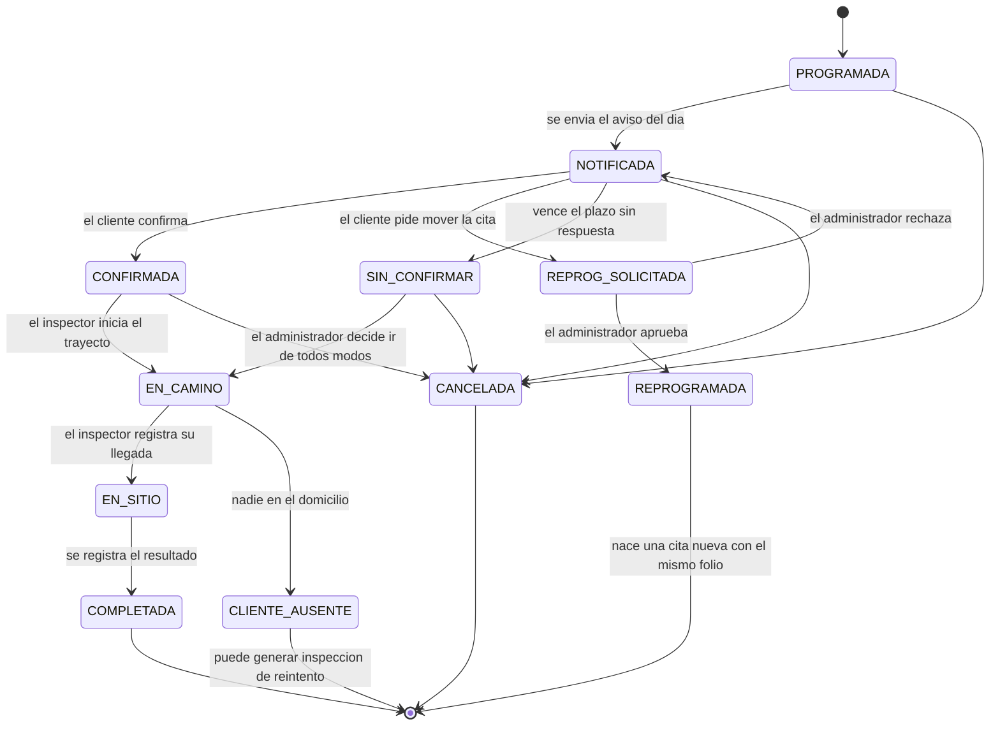

# Diseño de Base de Datos
## Sistema de Alerta y Seguimiento de Inspecciones de Techo — Agave Roofing (AgaveAlerta)

**Universidad Autónoma de Nuevo León — FIME**
**Proyecto Integrador I — Equipo 01 — Agosto–Diciembre 2026**
**Motor:** PostgreSQL 15 (gestionado por Supabase) · **ORM:** Prisma · **Acceso:** API Node.js + Express

---

## 1. Modelo conceptual

La base de datos es **única y central**: la consumen los tres servicios (panel del Administrador, app del Inspector y app del Cliente) a través de la misma API. El modelo gira alrededor de una entidad central, la **inspección**, que es la cita entre un **cliente** (en un **domicilio** georreferenciado) y un **inspector**, y que atraviesa una **máquina de estados** desde que se programa hasta que se completa.

Alrededor de la inspección se organizan cuatro bloques:

1. **Quiénes** — `usuario`, `rol`, `cliente`, `domicilio`, `inspector`, `zona`.
2. **Cuándo** — `inspeccion`, `inspeccion_historial`, `reprogramacion`.
3. **Cómo se avisa** — `dispositivo`, `plantilla_notificacion`, `notificacion`.
4. **Qué pasó** — `trayecto`, `punto_ubicacion`, `resultado_inspeccion`, `evidencia`, `mensaje`.

Más `configuracion` y `bitacora` como tablas transversales.

### 1.1 Decisión de diseño: la inspección como máquina de estados

El corazón del sistema no es un catálogo, es un **flujo**. Por eso la tabla `inspeccion` guarda un campo `estado` controlado por una enumeración, y **toda** transición queda registrada en `inspeccion_historial` (estado anterior, estado nuevo, quién y cuándo). Esto permite:

- Calcular los indicadores del tablero (tasa de confirmación, visitas fallidas, puntualidad) **sin tablas de resumen**, contando transiciones.
- Reconstruir qué pasó con cualquier cita para atender una queja del cliente.
- Impedir saltos inválidos (RN-01): la API valida la transición contra la máquina de estados antes de escribir.



### 1.2 Decisión de diseño: ubicación efímera, resumen permanente

El seguimiento en vivo genera **muchos** registros: un punto GPS cada 15 segundos durante todo el trayecto. Se separan en dos tablas con ciclos de vida distintos:

- `punto_ubicacion` — el rastro fino. Sirve para pintar el mapa en vivo y se **borra a los 30 días** (RN-17 y el compromiso de privacidad del riesgo R7). Es la única tabla que crece rápido.
- `trayecto` — el resumen: cuándo inició, cuándo terminó, cuántos metros, cuántos segundos, cuál fue el ETA inicial. **Se conserva siempre**, porque de ahí salen los indicadores de puntualidad y tiempo de traslado.

Así el tablero histórico no depende de datos de ubicación personales que el proyecto se comprometió a no retener.

### 1.3 Decisión de diseño: la evidencia vive en Storage, la base guarda la ruta

Las fotografías del inspector **no** se guardan como binario en PostgreSQL. Se suben a **Supabase Storage** y en `evidencia` se guarda la ruta del archivo y su tipo. La base se mantiene ligera y la app del inspector puede subir la foto cuando recupere señal, en un segundo momento, sin bloquear el registro del resultado.

### 1.4 Decisión de diseño: identificador local para el modo sin señal

Cuando el inspector registra la llegada o el resultado **sin conexión**, la app le asigna un `id_local` (UUID generado en el teléfono) y lo encola en SQLite. Al sincronizar, la API usa ese `id_local` como **clave de idempotencia** con restricción `UNIQUE`: si la petición se repite porque la red falló a medio camino, la segunda vez no duplica nada y devuelve el registro ya creado (RN-12).

### 1.5 Reglas de cardinalidad

| Relación | Cardinalidad | Lectura |
|----------|--------------|---------|
| `rol` — `usuario` | 1:N | Un rol lo tienen muchos usuarios; un usuario tiene un solo rol. |
| `usuario` — `cliente` | 1:1 (opcional) | Un cliente puede tener cuenta en la app; también puede existir sin ella (lo dio de alta el administrador y aún no la instala). |
| `usuario` — `inspector` | 1:1 | Todo inspector tiene cuenta. |
| `cliente` — `domicilio` | 1:N | Un cliente puede tener más de una propiedad. |
| `zona` — `domicilio` | 1:N | Cada domicilio pertenece a una zona de servicio. |
| `inspector` — `zona` | N:M | Un inspector cubre varias zonas y una zona la cubren varios inspectores (tabla `inspector_zona`). |
| `domicilio` — `inspeccion` | 1:N | Un domicilio se inspecciona muchas veces a lo largo del tiempo. |
| `inspector` — `inspeccion` | 1:N | Un inspector atiende muchas inspecciones. |
| `inspeccion` — `inspeccion_historial` | 1:N | Cada cambio de estado deja un renglón. |
| `inspeccion` — `reprogramacion` | 1:N | Una cita puede moverse hasta 3 veces (RN-06). |
| `inspeccion` — `notificacion` | 1:N | Los tres momentos de aviso, más los de respaldo y los reenvíos. |
| `usuario` — `dispositivo` | 1:N | Una persona puede tener teléfono y tableta. |
| `inspeccion` — `trayecto` | 1:N | Normalmente uno; si el inspector cancela y reinicia el trayecto, hay más de uno. |
| `trayecto` — `punto_ubicacion` | 1:N | El rastro del recorrido. |
| `inspeccion` — `resultado_inspeccion` | 1:1 | Una inspección completada tiene un resultado. |
| `inspeccion` — `evidencia` | 1:N | Varias fotos por visita (también en el caso de cliente ausente). |
| `inspeccion` — `mensaje` | 1:N | La conversación inspector–cliente de esa cita. |
| `inspeccion` — `inspeccion` | 1:N (reflexiva) | `id_inspeccion_origen`: la cita de reintento apunta a la que falló o a la que se reprogramó. |

---

## 2. Modelo Entidad-Relación (MER)

```mermaid
erDiagram
    ROL ||--o{ USUARIO : "tiene"
    USUARIO ||--o| CLIENTE : "es"
    USUARIO ||--o| INSPECTOR : "es"
    USUARIO ||--o{ DISPOSITIVO : "registra"
    USUARIO ||--o{ BITACORA : "genera"

    CLIENTE ||--o{ DOMICILIO : "posee"
    ZONA ||--o{ DOMICILIO : "agrupa"
    ZONA ||--o{ INSPECTOR_ZONA : "es cubierta en"
    INSPECTOR ||--o{ INSPECTOR_ZONA : "cubre"

    DOMICILIO ||--o{ INSPECCION : "es visitado en"
    CLIENTE ||--o{ INSPECCION : "recibe"
    INSPECTOR ||--o{ INSPECCION : "atiende"
    INSPECCION ||--o{ INSPECCION : "origina reintento"

    INSPECCION ||--o{ INSPECCION_HISTORIAL : "registra"
    INSPECCION ||--o{ REPROGRAMACION : "se mueve en"
    INSPECCION ||--o{ NOTIFICACION : "dispara"
    PLANTILLA_NOTIFICACION ||--o{ NOTIFICACION : "da formato a"
    DISPOSITIVO ||--o{ NOTIFICACION : "recibe"

    INSPECCION ||--o{ TRAYECTO : "tiene"
    TRAYECTO ||--o{ PUNTO_UBICACION : "traza"

    INSPECCION ||--o| RESULTADO_INSPECCION : "produce"
    INSPECCION ||--o{ EVIDENCIA : "respalda con"
    INSPECCION ||--o{ MENSAJE : "contiene"

    ROL {
        int id_rol PK
        varchar nombre UK
        varchar descripcion
    }
    USUARIO {
        uuid id_usuario PK
        uuid auth_uid UK "id de Supabase Auth"
        int id_rol FK
        varchar nombre_completo
        varchar correo UK
        varchar telefono UK
        boolean activo
        timestamptz creado_en
    }
    CLIENTE {
        int id_cliente PK
        uuid id_usuario FK "nulo si aun no instala la app"
        varchar nombre
        varchar telefono
        varchar correo
        varchar canal_preferido
        boolean activo
    }
    ZONA {
        int id_zona PK
        varchar nombre UK
        varchar descripcion
        boolean activo
    }
    DOMICILIO {
        int id_domicilio PK
        int id_cliente FK
        int id_zona FK
        varchar calle
        varchar numero
        varchar colonia
        varchar ciudad
        varchar estado
        char codigo_postal
        varchar referencias
        numeric latitud
        numeric longitud
        boolean geocodificado
        boolean activo
    }
    INSPECTOR {
        int id_inspector PK
        uuid id_usuario FK
        varchar nombre
        varchar telefono
        varchar placa_vehiculo
        boolean activo
    }
    INSPECTOR_ZONA {
        int id_inspector PK_FK
        int id_zona PK_FK
    }
    INSPECCION {
        bigint id_inspeccion PK
        varchar folio UK
        int id_cliente FK
        int id_domicilio FK
        int id_inspector FK
        date fecha_programada
        time ventana_inicio
        time ventana_fin
        varchar estado
        varchar motivo_visita
        varchar notas
        bigint id_inspeccion_origen FK
        smallint veces_reprogramada
        timestamptz confirmado_en
        timestamptz presencia_confirmada_en
        uuid creada_por FK
        timestamptz creado_en
    }
    INSPECCION_HISTORIAL {
        bigint id_historial PK
        bigint id_inspeccion FK
        varchar estado_anterior
        varchar estado_nuevo
        uuid id_usuario FK
        varchar origen
        varchar nota
        timestamptz ocurrido_en
    }
    REPROGRAMACION {
        bigint id_reprogramacion PK
        bigint id_inspeccion FK
        date fecha_anterior
        time ventana_inicio_anterior
        date fecha_solicitada
        time ventana_inicio_solicitada
        varchar motivo
        varchar solicitada_por
        varchar estado
        uuid resuelta_por FK
        timestamptz resuelta_en
        timestamptz creado_en
    }
    DISPOSITIVO {
        bigint id_dispositivo PK
        uuid id_usuario FK
        varchar token_push UK
        varchar plataforma
        varchar version_app
        boolean activo
        timestamptz ultimo_uso
    }
    PLANTILLA_NOTIFICACION {
        int id_plantilla PK
        varchar tipo
        varchar canal
        varchar titulo
        varchar cuerpo
        boolean urgente
        boolean activo
    }
    NOTIFICACION {
        bigint id_notificacion PK
        bigint id_inspeccion FK
        int id_plantilla FK
        bigint id_dispositivo FK
        varchar tipo
        varchar canal
        varchar destinatario
        varchar estado
        smallint intentos
        boolean reenvio_manual
        timestamptz programada_para
        timestamptz enviada_en
        timestamptz entregada_en
        varchar error
    }
    TRAYECTO {
        bigint id_trayecto PK
        bigint id_inspeccion FK
        int id_inspector FK
        varchar estado
        timestamptz iniciado_en
        timestamptz finalizado_en
        int eta_inicial_s
        int eta_actual_s
        timestamptz eta_actualizado_en
        boolean eta_aproximado
        int distancia_m
        int duracion_s
    }
    PUNTO_UBICACION {
        bigint id_punto PK
        bigint id_trayecto FK
        numeric latitud
        numeric longitud
        int precision_m
        numeric velocidad_ms
        timestamptz capturado_en
    }
    RESULTADO_INSPECCION {
        bigint id_resultado PK
        bigint id_inspeccion FK UK
        varchar estado_techo
        text hallazgos
        boolean requiere_reparacion
        varchar urgencia
        text recomendaciones
        varchar url_reporte_pdf
        uuid id_local UK
        boolean registrado_sin_senal
        timestamptz registrado_en
        timestamptz sincronizado_en
    }
    EVIDENCIA {
        bigint id_evidencia PK
        bigint id_inspeccion FK
        varchar tipo
        varchar ruta_archivo
        varchar descripcion
        uuid id_local UK
        timestamptz capturada_en
        timestamptz subida_en
    }
    MENSAJE {
        bigint id_mensaje PK
        bigint id_inspeccion FK
        uuid de_usuario FK
        uuid para_usuario FK
        varchar texto
        timestamptz enviado_en
        timestamptz leido_en
    }
    CONFIGURACION {
        varchar clave PK
        varchar valor
        varchar tipo
        varchar descripcion
    }
    BITACORA {
        bigint id_bitacora PK
        uuid id_usuario FK
        varchar accion
        varchar entidad
        varchar id_entidad
        jsonb datos
        varchar ip
        timestamptz ocurrido_en
    }
```

---

## 3. Normalización

El modelo está en **Tercera Forma Normal (3FN)**:

- **1FN** — no hay campos multivaluados. Las zonas que cubre un inspector no se guardan como lista en `inspector`, sino en `inspector_zona`. Las fotos de una visita no son un campo de texto separado por comas, sino renglones de `evidencia`.
- **2FN** — toda tabla tiene clave primaria simple (o compuesta plenamente dependiente, como `inspector_zona`), y ningún atributo depende de una parte de la clave.
- **3FN** — no hay dependencias transitivas. El nombre del cliente no se copia en `inspeccion`, se obtiene por la llave foránea; la zona tampoco, se obtiene por el domicilio.

**Desnormalizaciones deliberadas** (documentadas, no accidentales):

| Campo | Tabla | Por qué se desnormaliza |
|-------|-------|--------------------------|
| `veces_reprogramada` | `inspeccion` | Se podría contar en `reprogramacion`, pero el límite de 3 (RN-06) se valida en cada solicitud; tenerlo como contador evita un `COUNT` en la ruta caliente. |
| `confirmado_en`, `presencia_confirmada_en` | `inspeccion` | Derivables del historial, pero la app del cliente y la del inspector los consultan constantemente para pintar el estado de la pantalla. |
| `distancia_m`, `duracion_s` | `trayecto` | Se calculan al cerrar el trayecto a partir de los puntos, y deben sobrevivir al borrado de esos puntos a los 30 días (§1.2). |
| `destinatario` | `notificacion` | Se guarda el token, teléfono o correo **tal como estaba al momento del envío**, para que el historial no cambie si el cliente actualiza sus datos después. |

---

## 4. Diccionario de datos

### 4.1 rol

| Columna | Tipo | Nulo | Restricción | Descripción |
|---------|------|------|-------------|-------------|
| id_rol | SERIAL | No | PK | Identificador del rol. |
| nombre | VARCHAR(20) | No | UNIQUE | `ADMINISTRADOR`, `INSPECTOR`, `CLIENTE`. |
| descripcion | VARCHAR(120) | Sí | | Texto explicativo. |

### 4.2 usuario

| Columna | Tipo | Nulo | Restricción | Descripción |
|---------|------|------|-------------|-------------|
| id_usuario | UUID | No | PK | Identificador interno. |
| auth_uid | UUID | No | UNIQUE | Identificador del usuario en Supabase Auth; es lo que viene firmado en el JWT. |
| id_rol | INT | No | FK → rol | Rol único del usuario. |
| nombre_completo | VARCHAR(120) | No | | Nombre para mostrar. |
| correo | VARCHAR(120) | Sí | UNIQUE | Obligatorio para Administrador e Inspector. |
| telefono | VARCHAR(20) | Sí | UNIQUE | Obligatorio para el Cliente (autenticación por OTP). |
| activo | BOOLEAN | No | DEFAULT true | Baja lógica (RN-15). |
| creado_en | TIMESTAMPTZ | No | DEFAULT now() | Alta de la cuenta. |

### 4.3 cliente

| Columna | Tipo | Nulo | Restricción | Descripción |
|---------|------|------|-------------|-------------|
| id_cliente | SERIAL | No | PK | Identificador del cliente. |
| id_usuario | UUID | Sí | FK → usuario, UNIQUE | Cuenta de la app. Nulo mientras el cliente no la instale. |
| nombre | VARCHAR(120) | No | | Nombre del propietario. |
| telefono | VARCHAR(20) | No | | Teléfono de contacto y de respaldo por SMS. |
| correo | VARCHAR(120) | Sí | | Correo de respaldo. |
| canal_preferido | VARCHAR(10) | No | CHECK (`PUSH`,`SMS`,`CORREO`), DEFAULT `PUSH` | Canal con el que se le avisa primero. |
| notas | VARCHAR(255) | Sí | | Observaciones del administrador. |
| activo | BOOLEAN | No | DEFAULT true | Baja lógica. |
| creado_en | TIMESTAMPTZ | No | DEFAULT now() | |

### 4.4 zona

| Columna | Tipo | Nulo | Restricción | Descripción |
|---------|------|------|-------------|-------------|
| id_zona | SERIAL | No | PK | Identificador de la zona de servicio. |
| nombre | VARCHAR(60) | No | UNIQUE | Ej. "Norte – Escobedo". |
| descripcion | VARCHAR(160) | Sí | | Colonias o municipios que cubre. |
| activo | BOOLEAN | No | DEFAULT true | |

### 4.5 domicilio

| Columna | Tipo | Nulo | Restricción | Descripción |
|---------|------|------|-------------|-------------|
| id_domicilio | SERIAL | No | PK | Identificador del domicilio. |
| id_cliente | INT | No | FK → cliente | Propietario. |
| id_zona | INT | Sí | FK → zona | Zona de servicio a la que pertenece. |
| alias | VARCHAR(40) | Sí | | "Casa", "Casa de mi mamá". |
| calle | VARCHAR(120) | No | | |
| numero | VARCHAR(20) | No | | Número exterior e interior. |
| colonia | VARCHAR(80) | No | | |
| ciudad | VARCHAR(80) | No | | |
| estado | VARCHAR(60) | No | DEFAULT 'Nuevo León' | |
| codigo_postal | CHAR(5) | No | | |
| referencias | VARCHAR(255) | Sí | | Cómo llegar: color de la casa, entre qué calles. |
| latitud | NUMERIC(9,6) | Sí | CHECK entre -90 y 90 | Coordenada del punto de llegada (RES-08). |
| longitud | NUMERIC(9,6) | Sí | CHECK entre -180 y 180 | |
| geocodificado | BOOLEAN | No | DEFAULT false | `true` si las coordenadas se obtuvieron automáticamente; `false` si el administrador movió el pin a mano. |
| activo | BOOLEAN | No | DEFAULT true | Baja lógica. |

### 4.6 inspector

| Columna | Tipo | Nulo | Restricción | Descripción |
|---------|------|------|-------------|-------------|
| id_inspector | SERIAL | No | PK | Identificador del inspector. |
| id_usuario | UUID | No | FK → usuario, UNIQUE | Su cuenta. |
| nombre | VARCHAR(120) | No | | Nombre que ve el cliente. |
| telefono | VARCHAR(20) | No | | Para la llamada desde la app del cliente. |
| placa_vehiculo | VARCHAR(15) | Sí | | Dato que se le muestra al cliente para identificarlo. |
| url_foto | VARCHAR(255) | Sí | | Fotografía del inspector (confianza del cliente). |
| activo | BOOLEAN | No | DEFAULT true | |

### 4.7 inspector_zona

| Columna | Tipo | Nulo | Restricción | Descripción |
|---------|------|------|-------------|-------------|
| id_inspector | INT | No | PK, FK → inspector | |
| id_zona | INT | No | PK, FK → zona | |

*Clave primaria compuesta `(id_inspector, id_zona)`.*

### 4.8 inspeccion

| Columna | Tipo | Nulo | Restricción | Descripción |
|---------|------|------|-------------|-------------|
| id_inspeccion | BIGSERIAL | No | PK | Identificador de la cita. |
| folio | VARCHAR(16) | No | UNIQUE | Folio visible (`INS-2026-000124`); se conserva al reprogramar (RN-06). |
| id_cliente | INT | No | FK → cliente | |
| id_domicilio | INT | No | FK → domicilio | Domicilio a visitar. |
| id_inspector | INT | Sí | FK → inspector | Nulo mientras no se asigna. |
| fecha_programada | DATE | No | | Día de la visita. |
| ventana_inicio | TIME | No | | Inicio de la ventana de atención. |
| ventana_fin | TIME | No | CHECK > ventana_inicio | Fin de la ventana. |
| estado | VARCHAR(20) | No | CHECK contra la lista de estados, DEFAULT `PROGRAMADA` | Estado actual (RN-01). |
| motivo_visita | VARCHAR(120) | Sí | | Ej. "revisión posterior a granizada". |
| notas | VARCHAR(255) | Sí | | Indicaciones para el inspector. |
| id_inspeccion_origen | BIGINT | Sí | FK → inspeccion | Cita de la que proviene (reintento o reprogramación). |
| veces_reprogramada | SMALLINT | No | DEFAULT 0, CHECK ≤ 3 | Contador (RN-06). |
| confirmado_en | TIMESTAMPTZ | Sí | | Momento en que el cliente confirmó (RN-04). |
| presencia_confirmada_en | TIMESTAMPTZ | Sí | | Momento en que el cliente dijo "ya estoy en mi casa". |
| creada_por | UUID | Sí | FK → usuario | Administrador que la programó. |
| creado_en | TIMESTAMPTZ | No | DEFAULT now() | |
| actualizado_en | TIMESTAMPTZ | No | DEFAULT now() | |

### 4.9 inspeccion_historial

| Columna | Tipo | Nulo | Restricción | Descripción |
|---------|------|------|-------------|-------------|
| id_historial | BIGSERIAL | No | PK | |
| id_inspeccion | BIGINT | No | FK → inspeccion | |
| estado_anterior | VARCHAR(20) | Sí | | Nulo en el primer renglón. |
| estado_nuevo | VARCHAR(20) | No | | |
| id_usuario | UUID | Sí | FK → usuario | Quién provocó el cambio; nulo si fue el temporizador. |
| origen | VARCHAR(12) | No | CHECK (`PANEL`,`APP_INSP`,`APP_CLI`,`SISTEMA`) | Desde dónde se hizo. |
| nota | VARCHAR(255) | Sí | | Motivo o comentario. |
| ocurrido_en | TIMESTAMPTZ | No | DEFAULT now() | |

### 4.10 reprogramacion

| Columna | Tipo | Nulo | Restricción | Descripción |
|---------|------|------|-------------|-------------|
| id_reprogramacion | BIGSERIAL | No | PK | |
| id_inspeccion | BIGINT | No | FK → inspeccion | Cita que se quiere mover. |
| fecha_anterior | DATE | No | | Fecha que tenía. |
| ventana_inicio_anterior | TIME | No | | |
| fecha_solicitada | DATE | No | | Nueva fecha propuesta. |
| ventana_inicio_solicitada | TIME | No | | Nueva ventana propuesta. |
| motivo | VARCHAR(200) | Sí | | Por qué no puede el cliente. |
| solicitada_por | VARCHAR(15) | No | CHECK (`CLIENTE`,`ADMINISTRADOR`) | Quién pidió el cambio. |
| estado | VARCHAR(12) | No | CHECK (`SOLICITADA`,`APROBADA`,`RECHAZADA`), DEFAULT `SOLICITADA` | |
| resuelta_por | UUID | Sí | FK → usuario | Administrador que resolvió. |
| resuelta_en | TIMESTAMPTZ | Sí | | |
| creado_en | TIMESTAMPTZ | No | DEFAULT now() | |

### 4.11 dispositivo

| Columna | Tipo | Nulo | Restricción | Descripción |
|---------|------|------|-------------|-------------|
| id_dispositivo | BIGSERIAL | No | PK | |
| id_usuario | UUID | No | FK → usuario | Dueño del teléfono. |
| token_push | VARCHAR(255) | No | UNIQUE | Token de Expo/FCM/APNs. |
| plataforma | VARCHAR(10) | No | CHECK (`ANDROID`,`IOS`) | |
| version_app | VARCHAR(15) | Sí | | Para diagnosticar fallas de entrega. |
| activo | BOOLEAN | No | DEFAULT true | Se apaga cuando el proveedor reporta el token como inválido. |
| ultimo_uso | TIMESTAMPTZ | Sí | | Última vez que la app se abrió con ese token. |
| creado_en | TIMESTAMPTZ | No | DEFAULT now() | |

### 4.12 plantilla_notificacion

| Columna | Tipo | Nulo | Restricción | Descripción |
|---------|------|------|-------------|-------------|
| id_plantilla | SERIAL | No | PK | |
| tipo | VARCHAR(20) | No | CHECK (`DIA_PROGRAMADO`,`RECORDATORIO`,`EN_CAMINO`,`POR_LLEGAR`,`LLEGADA`,`RESULTADO`,`REPROGRAMADA`,`MENSAJE`) | Momento del aviso. |
| canal | VARCHAR(10) | No | CHECK (`PUSH`,`SMS`,`CORREO`) | |
| titulo | VARCHAR(80) | Sí | | Título de la push. |
| cuerpo | VARCHAR(400) | No | | Texto con marcadores `{{cliente}}`, `{{fecha}}`, `{{ventana}}`, `{{eta}}`, `{{inspector}}`. |
| urgente | BOOLEAN | No | DEFAULT false | Las urgentes ignoran el horario de silencio (RN-14). |
| activo | BOOLEAN | No | DEFAULT true | |

*UNIQUE (`tipo`, `canal`).*

### 4.13 notificacion

| Columna | Tipo | Nulo | Restricción | Descripción |
|---------|------|------|-------------|-------------|
| id_notificacion | BIGSERIAL | No | PK | |
| id_inspeccion | BIGINT | No | FK → inspeccion | Cita a la que corresponde. |
| id_plantilla | INT | Sí | FK → plantilla_notificacion | |
| id_dispositivo | BIGINT | Sí | FK → dispositivo | Nulo si el canal es SMS o correo. |
| tipo | VARCHAR(20) | No | | Igual que en la plantilla. |
| canal | VARCHAR(10) | No | CHECK (`PUSH`,`SMS`,`CORREO`) | |
| destinatario | VARCHAR(120) | No | | Token, teléfono o correo **congelado** al momento del envío. |
| estado | VARCHAR(12) | No | CHECK (`PENDIENTE`,`ENVIADA`,`ENTREGADA`,`FALLIDA`,`CANCELADA`), DEFAULT `PENDIENTE` | |
| intentos | SMALLINT | No | DEFAULT 0 | Reintentos realizados. |
| reenvio_manual | BOOLEAN | No | DEFAULT false | `true` si el administrador la reenvió (RN-13). |
| programada_para | TIMESTAMPTZ | No | | Cuándo debe salir. |
| enviada_en | TIMESTAMPTZ | Sí | | |
| entregada_en | TIMESTAMPTZ | Sí | | Acuse del proveedor. |
| error | VARCHAR(255) | Sí | | Motivo del fallo. |

*Índice único parcial (`id_inspeccion`, `tipo`) WHERE `reenvio_manual = false` — implementa RN-13.*

### 4.14 trayecto

| Columna | Tipo | Nulo | Restricción | Descripción |
|---------|------|------|-------------|-------------|
| id_trayecto | BIGSERIAL | No | PK | |
| id_inspeccion | BIGINT | No | FK → inspeccion | |
| id_inspector | INT | No | FK → inspector | |
| estado | VARCHAR(12) | No | CHECK (`ACTIVO`,`FINALIZADO`,`CANCELADO`), DEFAULT `ACTIVO` | Solo se publica ubicación mientras está `ACTIVO` (RN-08). |
| iniciado_en | TIMESTAMPTZ | No | DEFAULT now() | Momento del "Voy en camino". |
| finalizado_en | TIMESTAMPTZ | Sí | | Llegada, ausencia o cancelación. |
| eta_inicial_s | INT | Sí | | ETA calculado al iniciar, en segundos. |
| eta_actual_s | INT | Sí | | Último ETA calculado. |
| eta_actualizado_en | TIMESTAMPTZ | Sí | | |
| eta_aproximado | BOOLEAN | No | DEFAULT false | `true` si se estimó en línea recta porque falló el servicio de rutas (RN-09). |
| distancia_m | INT | Sí | | Distancia recorrida, al cerrar. |
| duracion_s | INT | Sí | | Duración real del traslado. |

*Índice único parcial sobre (`id_inspector`) WHERE `estado = 'ACTIVO'` — implementa RN-03: un solo trayecto activo por inspector.*

### 4.15 punto_ubicacion

| Columna | Tipo | Nulo | Restricción | Descripción |
|---------|------|------|-------------|-------------|
| id_punto | BIGSERIAL | No | PK | |
| id_trayecto | BIGINT | No | FK → trayecto ON DELETE CASCADE | |
| latitud | NUMERIC(9,6) | No | | |
| longitud | NUMERIC(9,6) | No | | |
| precision_m | INT | Sí | | Exactitud reportada por el GPS. |
| velocidad_ms | NUMERIC(5,2) | Sí | | Metros por segundo. |
| capturado_en | TIMESTAMPTZ | No | | Hora del teléfono al capturar el punto. |

*Se purga a los 30 días (§11).*

### 4.16 resultado_inspeccion

| Columna | Tipo | Nulo | Restricción | Descripción |
|---------|------|------|-------------|-------------|
| id_resultado | BIGSERIAL | No | PK | |
| id_inspeccion | BIGINT | No | FK → inspeccion, UNIQUE | Relación 1:1. |
| estado_techo | VARCHAR(15) | No | CHECK (`BUENO`,`REGULAR`,`MALO`,`CRITICO`) | Valoración general. |
| hallazgos | TEXT | No | | Qué encontró el inspector. |
| requiere_reparacion | BOOLEAN | No | DEFAULT false | |
| urgencia | VARCHAR(10) | Sí | CHECK (`BAJA`,`MEDIA`,`ALTA`) | Solo si requiere reparación. |
| recomendaciones | TEXT | Sí | | |
| url_reporte_pdf | VARCHAR(255) | Sí | | Ruta del PDF en Supabase Storage. |
| id_local | UUID | Sí | UNIQUE | Clave de idempotencia del modo sin señal (§1.4, RN-12). |
| registrado_sin_senal | BOOLEAN | No | DEFAULT false | |
| registrado_en | TIMESTAMPTZ | No | | Hora **real** del registro (la del teléfono si fue sin señal). |
| sincronizado_en | TIMESTAMPTZ | Sí | | Hora en que llegó al servidor. |

### 4.17 evidencia

| Columna | Tipo | Nulo | Restricción | Descripción |
|---------|------|------|-------------|-------------|
| id_evidencia | BIGSERIAL | No | PK | |
| id_inspeccion | BIGINT | No | FK → inspeccion | |
| tipo | VARCHAR(15) | No | CHECK (`FOTO_TECHO`,`FOTO_FACHADA`,`FOTO_AUSENCIA`,`FIRMA`) | `FOTO_AUSENCIA` respalda la visita fallida (RN-10). |
| ruta_archivo | VARCHAR(255) | No | | Ruta en Supabase Storage. |
| descripcion | VARCHAR(200) | Sí | | |
| id_local | UUID | Sí | UNIQUE | Idempotencia al subir desde la cola. |
| capturada_en | TIMESTAMPTZ | No | | Hora de la foto. |
| subida_en | TIMESTAMPTZ | Sí | | Hora en que se subió (puede ser mucho después). |

### 4.18 mensaje

| Columna | Tipo | Nulo | Restricción | Descripción |
|---------|------|------|-------------|-------------|
| id_mensaje | BIGSERIAL | No | PK | |
| id_inspeccion | BIGINT | No | FK → inspeccion | La conversación pertenece a la cita, no a las personas. |
| de_usuario | UUID | No | FK → usuario | |
| para_usuario | UUID | No | FK → usuario | |
| texto | VARCHAR(500) | No | | |
| enviado_en | TIMESTAMPTZ | No | DEFAULT now() | |
| leido_en | TIMESTAMPTZ | Sí | | |

### 4.19 configuracion

| Columna | Tipo | Nulo | Restricción | Descripción |
|---------|------|------|-------------|-------------|
| clave | VARCHAR(50) | No | PK | Nombre del parámetro. |
| valor | VARCHAR(120) | No | | Valor actual. |
| tipo | VARCHAR(10) | No | CHECK (`INT`,`TEXTO`,`BOOL`,`HORA`) | |
| descripcion | VARCHAR(200) | Sí | | Para qué sirve. |

**Parámetros iniciales:**

| Clave | Valor | Significado |
|-------|-------|-------------|
| `aviso_dia_horas_antes` | 24 | Horas antes de la cita para el aviso del día programado. |
| `recordatorio_horas_antes` | 3 | Horas antes de la ventana para el recordatorio previo. |
| `plazo_confirmacion_horas` | 12 | Plazo sin respuesta tras el cual la cita pasa a `SIN_CONFIRMAR` (RN-07). |
| `intervalo_ubicacion_seg` | 15 | Cada cuánto publica su posición la app del inspector. |
| `distancia_por_llegar_m` | 1000 | Distancia a la que se dispara el aviso "está por llegar". |
| `trayecto_max_minutos` | 90 | Apagado automático del trayecto (riesgo R5). |
| `retencion_puntos_dias` | 30 | Días que se conservan los puntos GPS (RN-17). |
| `max_reprogramaciones` | 3 | Límite por inspección (RN-06). |
| `silencio_inicio` | 21:00 | Inicio del horario de silencio (RN-14). |
| `silencio_fin` | 07:00 | Fin del horario de silencio. |
| `horario_operacion_inicio` | 08:00 | Hora mínima para programar. |
| `horario_operacion_fin` | 18:00 | Hora máxima para programar. |
| `velocidad_promedio_kmh` | 35 | Velocidad para el ETA aproximado cuando falla el servicio de rutas (RN-09). |

### 4.20 bitacora

| Columna | Tipo | Nulo | Restricción | Descripción |
|---------|------|------|-------------|-------------|
| id_bitacora | BIGSERIAL | No | PK | |
| id_usuario | UUID | Sí | FK → usuario | Nulo si la acción fue del sistema. |
| accion | VARCHAR(40) | No | | `CREAR`, `ACTUALIZAR`, `CANCELAR`, `APROBAR_REPROG`, `LOGIN`, etc. |
| entidad | VARCHAR(40) | No | | Tabla afectada. |
| id_entidad | VARCHAR(40) | Sí | | Identificador del registro. |
| datos | JSONB | Sí | | Valores relevantes (antes/después). |
| ip | VARCHAR(45) | Sí | | |
| ocurrido_en | TIMESTAMPTZ | No | DEFAULT now() | |

---

## 5. Índices recomendados

| Tabla | Índice | Justificación |
|-------|--------|---------------|
| `inspeccion` | `(fecha_programada, id_inspector)` | Agenda del día y ruta del inspector: la consulta más frecuente de los tres servicios. |
| `inspeccion` | `(estado, fecha_programada)` | Tablero del administrador y barrido del temporizador que busca citas por notificar. |
| `inspeccion` | `(id_cliente, fecha_programada DESC)` | Historial en la app del cliente. |
| `inspeccion` | `UNIQUE (folio)` | Búsqueda por folio. |
| `domicilio` | `(id_cliente)` y `(id_zona)` | Altas y asignación por zona. |
| `notificacion` | `(estado, programada_para)` | El despachador busca las pendientes cuya hora ya llegó; es un barrido cada minuto. |
| `notificacion` | `(id_inspeccion, tipo)` parcial | Evitar duplicados (RN-13). |
| `punto_ubicacion` | `(id_trayecto, capturado_en DESC)` | Traer el último punto y el rastro reciente para el mapa. |
| `trayecto` | `UNIQUE (id_inspector) WHERE estado='ACTIVO'` | Un solo trayecto activo (RN-03). |
| `inspeccion_historial` | `(id_inspeccion, ocurrido_en)` | Línea de tiempo de la cita y cálculo de indicadores. |
| `dispositivo` | `(id_usuario) WHERE activo` | Traer los tokens a los que hay que enviar. |
| `mensaje` | `(id_inspeccion, enviado_en)` | Conversación ordenada. |

---

## 6. Script SQL (PostgreSQL 15 / Supabase)

```sql
-- =====================================================================
-- AgaveAlerta - Esquema de base de datos
-- PostgreSQL 15 (Supabase)
-- =====================================================================

-- ------------------------- 1. Seguridad ------------------------------

CREATE TABLE rol (
    id_rol       SERIAL PRIMARY KEY,
    nombre       VARCHAR(20)  NOT NULL UNIQUE,
    descripcion  VARCHAR(120)
);

CREATE TABLE usuario (
    id_usuario       UUID PRIMARY KEY DEFAULT gen_random_uuid(),
    auth_uid         UUID NOT NULL UNIQUE,
    id_rol           INT  NOT NULL REFERENCES rol(id_rol),
    nombre_completo  VARCHAR(120) NOT NULL,
    correo           VARCHAR(120) UNIQUE,
    telefono         VARCHAR(20)  UNIQUE,
    activo           BOOLEAN NOT NULL DEFAULT TRUE,
    creado_en        TIMESTAMPTZ NOT NULL DEFAULT now(),
    CONSTRAINT ck_usuario_contacto CHECK (correo IS NOT NULL OR telefono IS NOT NULL)
);

-- ------------------ 2. Clientes, zonas, inspectores -------------------

CREATE TABLE cliente (
    id_cliente       SERIAL PRIMARY KEY,
    id_usuario       UUID UNIQUE REFERENCES usuario(id_usuario),
    nombre           VARCHAR(120) NOT NULL,
    telefono         VARCHAR(20)  NOT NULL,
    correo           VARCHAR(120),
    canal_preferido  VARCHAR(10) NOT NULL DEFAULT 'PUSH'
                     CHECK (canal_preferido IN ('PUSH','SMS','CORREO')),
    notas            VARCHAR(255),
    activo           BOOLEAN NOT NULL DEFAULT TRUE,
    creado_en        TIMESTAMPTZ NOT NULL DEFAULT now()
);

CREATE TABLE zona (
    id_zona      SERIAL PRIMARY KEY,
    nombre       VARCHAR(60) NOT NULL UNIQUE,
    descripcion  VARCHAR(160),
    activo       BOOLEAN NOT NULL DEFAULT TRUE
);

CREATE TABLE domicilio (
    id_domicilio   SERIAL PRIMARY KEY,
    id_cliente     INT NOT NULL REFERENCES cliente(id_cliente),
    id_zona        INT REFERENCES zona(id_zona),
    alias          VARCHAR(40),
    calle          VARCHAR(120) NOT NULL,
    numero         VARCHAR(20)  NOT NULL,
    colonia        VARCHAR(80)  NOT NULL,
    ciudad         VARCHAR(80)  NOT NULL,
    estado         VARCHAR(60)  NOT NULL DEFAULT 'Nuevo Leon',
    codigo_postal  CHAR(5)      NOT NULL,
    referencias    VARCHAR(255),
    latitud        NUMERIC(9,6) CHECK (latitud  BETWEEN -90  AND 90),
    longitud       NUMERIC(9,6) CHECK (longitud BETWEEN -180 AND 180),
    geocodificado  BOOLEAN NOT NULL DEFAULT FALSE,
    activo         BOOLEAN NOT NULL DEFAULT TRUE
);

CREATE TABLE inspector (
    id_inspector    SERIAL PRIMARY KEY,
    id_usuario      UUID NOT NULL UNIQUE REFERENCES usuario(id_usuario),
    nombre          VARCHAR(120) NOT NULL,
    telefono        VARCHAR(20)  NOT NULL,
    placa_vehiculo  VARCHAR(15),
    url_foto        VARCHAR(255),
    activo          BOOLEAN NOT NULL DEFAULT TRUE
);

CREATE TABLE inspector_zona (
    id_inspector INT NOT NULL REFERENCES inspector(id_inspector),
    id_zona      INT NOT NULL REFERENCES zona(id_zona),
    PRIMARY KEY (id_inspector, id_zona)
);

-- -------------------------- 3. Inspecciones ---------------------------

CREATE TABLE inspeccion (
    id_inspeccion            BIGSERIAL PRIMARY KEY,
    folio                    VARCHAR(16) NOT NULL UNIQUE,
    id_cliente               INT    NOT NULL REFERENCES cliente(id_cliente),
    id_domicilio             INT    NOT NULL REFERENCES domicilio(id_domicilio),
    id_inspector             INT    REFERENCES inspector(id_inspector),
    fecha_programada         DATE   NOT NULL,
    ventana_inicio           TIME   NOT NULL,
    ventana_fin              TIME   NOT NULL,
    estado                   VARCHAR(20) NOT NULL DEFAULT 'PROGRAMADA'
        CHECK (estado IN ('PROGRAMADA','NOTIFICADA','CONFIRMADA','SIN_CONFIRMAR',
                          'REPROG_SOLICITADA','REPROGRAMADA','EN_CAMINO','EN_SITIO',
                          'COMPLETADA','CLIENTE_AUSENTE','CANCELADA')),
    motivo_visita            VARCHAR(120),
    notas                    VARCHAR(255),
    id_inspeccion_origen     BIGINT REFERENCES inspeccion(id_inspeccion),
    veces_reprogramada       SMALLINT NOT NULL DEFAULT 0 CHECK (veces_reprogramada <= 3),
    confirmado_en            TIMESTAMPTZ,
    presencia_confirmada_en  TIMESTAMPTZ,
    creada_por               UUID REFERENCES usuario(id_usuario),
    creado_en                TIMESTAMPTZ NOT NULL DEFAULT now(),
    actualizado_en           TIMESTAMPTZ NOT NULL DEFAULT now(),
    CONSTRAINT ck_ventana CHECK (ventana_fin > ventana_inicio)
);

CREATE TABLE inspeccion_historial (
    id_historial     BIGSERIAL PRIMARY KEY,
    id_inspeccion    BIGINT NOT NULL REFERENCES inspeccion(id_inspeccion),
    estado_anterior  VARCHAR(20),
    estado_nuevo     VARCHAR(20) NOT NULL,
    id_usuario       UUID REFERENCES usuario(id_usuario),
    origen           VARCHAR(12) NOT NULL
                     CHECK (origen IN ('PANEL','APP_INSP','APP_CLI','SISTEMA')),
    nota             VARCHAR(255),
    ocurrido_en      TIMESTAMPTZ NOT NULL DEFAULT now()
);

CREATE TABLE reprogramacion (
    id_reprogramacion          BIGSERIAL PRIMARY KEY,
    id_inspeccion              BIGINT NOT NULL REFERENCES inspeccion(id_inspeccion),
    fecha_anterior             DATE NOT NULL,
    ventana_inicio_anterior    TIME NOT NULL,
    fecha_solicitada           DATE NOT NULL,
    ventana_inicio_solicitada  TIME NOT NULL,
    motivo                     VARCHAR(200),
    solicitada_por             VARCHAR(15) NOT NULL
                               CHECK (solicitada_por IN ('CLIENTE','ADMINISTRADOR')),
    estado                     VARCHAR(12) NOT NULL DEFAULT 'SOLICITADA'
                               CHECK (estado IN ('SOLICITADA','APROBADA','RECHAZADA')),
    resuelta_por               UUID REFERENCES usuario(id_usuario),
    resuelta_en                TIMESTAMPTZ,
    creado_en                  TIMESTAMPTZ NOT NULL DEFAULT now()
);

-- ------------------------ 4. Notificaciones ---------------------------

CREATE TABLE dispositivo (
    id_dispositivo  BIGSERIAL PRIMARY KEY,
    id_usuario      UUID NOT NULL REFERENCES usuario(id_usuario),
    token_push      VARCHAR(255) NOT NULL UNIQUE,
    plataforma      VARCHAR(10) NOT NULL CHECK (plataforma IN ('ANDROID','IOS')),
    version_app     VARCHAR(15),
    activo          BOOLEAN NOT NULL DEFAULT TRUE,
    ultimo_uso      TIMESTAMPTZ,
    creado_en       TIMESTAMPTZ NOT NULL DEFAULT now()
);

CREATE TABLE plantilla_notificacion (
    id_plantilla  SERIAL PRIMARY KEY,
    tipo          VARCHAR(20) NOT NULL
        CHECK (tipo IN ('DIA_PROGRAMADO','RECORDATORIO','EN_CAMINO','POR_LLEGAR',
                        'LLEGADA','RESULTADO','REPROGRAMADA','MENSAJE')),
    canal         VARCHAR(10) NOT NULL CHECK (canal IN ('PUSH','SMS','CORREO')),
    titulo        VARCHAR(80),
    cuerpo        VARCHAR(400) NOT NULL,
    urgente       BOOLEAN NOT NULL DEFAULT FALSE,
    activo        BOOLEAN NOT NULL DEFAULT TRUE,
    UNIQUE (tipo, canal)
);

CREATE TABLE notificacion (
    id_notificacion  BIGSERIAL PRIMARY KEY,
    id_inspeccion    BIGINT NOT NULL REFERENCES inspeccion(id_inspeccion),
    id_plantilla     INT    REFERENCES plantilla_notificacion(id_plantilla),
    id_dispositivo   BIGINT REFERENCES dispositivo(id_dispositivo),
    tipo             VARCHAR(20) NOT NULL,
    canal            VARCHAR(10) NOT NULL CHECK (canal IN ('PUSH','SMS','CORREO')),
    destinatario     VARCHAR(120) NOT NULL,
    estado           VARCHAR(12) NOT NULL DEFAULT 'PENDIENTE'
        CHECK (estado IN ('PENDIENTE','ENVIADA','ENTREGADA','FALLIDA','CANCELADA')),
    intentos         SMALLINT NOT NULL DEFAULT 0,
    reenvio_manual   BOOLEAN NOT NULL DEFAULT FALSE,
    programada_para  TIMESTAMPTZ NOT NULL,
    enviada_en       TIMESTAMPTZ,
    entregada_en     TIMESTAMPTZ,
    error            VARCHAR(255)
);

-- RN-13: una sola notificacion por (inspeccion, tipo), salvo reenvio manual
CREATE UNIQUE INDEX ux_notificacion_unica
    ON notificacion (id_inspeccion, tipo)
    WHERE reenvio_manual = FALSE;

-- ------------------ 5. Trayecto y seguimiento en vivo -----------------

CREATE TABLE trayecto (
    id_trayecto         BIGSERIAL PRIMARY KEY,
    id_inspeccion       BIGINT NOT NULL REFERENCES inspeccion(id_inspeccion),
    id_inspector        INT    NOT NULL REFERENCES inspector(id_inspector),
    estado              VARCHAR(12) NOT NULL DEFAULT 'ACTIVO'
                        CHECK (estado IN ('ACTIVO','FINALIZADO','CANCELADO')),
    iniciado_en         TIMESTAMPTZ NOT NULL DEFAULT now(),
    finalizado_en       TIMESTAMPTZ,
    eta_inicial_s       INT,
    eta_actual_s        INT,
    eta_actualizado_en  TIMESTAMPTZ,
    eta_aproximado      BOOLEAN NOT NULL DEFAULT FALSE,
    distancia_m         INT,
    duracion_s          INT
);

-- RN-03: un inspector no puede tener dos trayectos activos
CREATE UNIQUE INDEX ux_trayecto_activo
    ON trayecto (id_inspector)
    WHERE estado = 'ACTIVO';

CREATE TABLE punto_ubicacion (
    id_punto      BIGSERIAL PRIMARY KEY,
    id_trayecto   BIGINT NOT NULL REFERENCES trayecto(id_trayecto) ON DELETE CASCADE,
    latitud       NUMERIC(9,6) NOT NULL,
    longitud      NUMERIC(9,6) NOT NULL,
    precision_m   INT,
    velocidad_ms  NUMERIC(5,2),
    capturado_en  TIMESTAMPTZ NOT NULL
);

-- --------------------- 6. Resultado y evidencia -----------------------

CREATE TABLE resultado_inspeccion (
    id_resultado          BIGSERIAL PRIMARY KEY,
    id_inspeccion         BIGINT NOT NULL UNIQUE REFERENCES inspeccion(id_inspeccion),
    estado_techo          VARCHAR(15) NOT NULL
                          CHECK (estado_techo IN ('BUENO','REGULAR','MALO','CRITICO')),
    hallazgos             TEXT NOT NULL,
    requiere_reparacion   BOOLEAN NOT NULL DEFAULT FALSE,
    urgencia              VARCHAR(10) CHECK (urgencia IN ('BAJA','MEDIA','ALTA')),
    recomendaciones       TEXT,
    url_reporte_pdf       VARCHAR(255),
    id_local              UUID UNIQUE,
    registrado_sin_senal  BOOLEAN NOT NULL DEFAULT FALSE,
    registrado_en         TIMESTAMPTZ NOT NULL,
    sincronizado_en       TIMESTAMPTZ
);

CREATE TABLE evidencia (
    id_evidencia   BIGSERIAL PRIMARY KEY,
    id_inspeccion  BIGINT NOT NULL REFERENCES inspeccion(id_inspeccion),
    tipo           VARCHAR(15) NOT NULL
                   CHECK (tipo IN ('FOTO_TECHO','FOTO_FACHADA','FOTO_AUSENCIA','FIRMA')),
    ruta_archivo   VARCHAR(255) NOT NULL,
    descripcion    VARCHAR(200),
    id_local       UUID UNIQUE,
    capturada_en   TIMESTAMPTZ NOT NULL,
    subida_en      TIMESTAMPTZ
);

CREATE TABLE mensaje (
    id_mensaje     BIGSERIAL PRIMARY KEY,
    id_inspeccion  BIGINT NOT NULL REFERENCES inspeccion(id_inspeccion),
    de_usuario     UUID NOT NULL REFERENCES usuario(id_usuario),
    para_usuario   UUID NOT NULL REFERENCES usuario(id_usuario),
    texto          VARCHAR(500) NOT NULL,
    enviado_en     TIMESTAMPTZ NOT NULL DEFAULT now(),
    leido_en       TIMESTAMPTZ
);

-- --------------------------- 7. Transversales -------------------------

CREATE TABLE configuracion (
    clave        VARCHAR(50) PRIMARY KEY,
    valor        VARCHAR(120) NOT NULL,
    tipo         VARCHAR(10) NOT NULL CHECK (tipo IN ('INT','TEXTO','BOOL','HORA')),
    descripcion  VARCHAR(200)
);

CREATE TABLE bitacora (
    id_bitacora  BIGSERIAL PRIMARY KEY,
    id_usuario   UUID REFERENCES usuario(id_usuario),
    accion       VARCHAR(40) NOT NULL,
    entidad      VARCHAR(40) NOT NULL,
    id_entidad   VARCHAR(40),
    datos        JSONB,
    ip           VARCHAR(45),
    ocurrido_en  TIMESTAMPTZ NOT NULL DEFAULT now()
);

-- ----------------------------- 8. Indices -----------------------------

CREATE INDEX ix_inspeccion_agenda    ON inspeccion (fecha_programada, id_inspector);
CREATE INDEX ix_inspeccion_estado    ON inspeccion (estado, fecha_programada);
CREATE INDEX ix_inspeccion_cliente   ON inspeccion (id_cliente, fecha_programada DESC);
CREATE INDEX ix_domicilio_cliente    ON domicilio  (id_cliente);
CREATE INDEX ix_domicilio_zona       ON domicilio  (id_zona);
CREATE INDEX ix_notif_despacho       ON notificacion (estado, programada_para);
CREATE INDEX ix_punto_trayecto       ON punto_ubicacion (id_trayecto, capturado_en DESC);
CREATE INDEX ix_historial_inspeccion ON inspeccion_historial (id_inspeccion, ocurrido_en);
CREATE INDEX ix_dispositivo_usuario  ON dispositivo (id_usuario) WHERE activo;
CREATE INDEX ix_mensaje_inspeccion   ON mensaje (id_inspeccion, enviado_en);

-- ---------------------------- 9. Datos base ---------------------------

INSERT INTO rol (nombre, descripcion) VALUES
 ('ADMINISTRADOR','Personal de oficina de Agave Roofing: agenda, asignacion y tablero'),
 ('INSPECTOR','Personal de campo que realiza la inspeccion del techo'),
 ('CLIENTE','Propietario de la vivienda a inspeccionar');

INSERT INTO configuracion (clave, valor, tipo, descripcion) VALUES
 ('aviso_dia_horas_antes','24','INT','Horas antes de la cita para el aviso del dia programado'),
 ('recordatorio_horas_antes','3','INT','Horas antes de la ventana para el recordatorio'),
 ('plazo_confirmacion_horas','12','INT','Plazo sin respuesta antes de marcar SIN_CONFIRMAR'),
 ('intervalo_ubicacion_seg','15','INT','Intervalo de publicacion de ubicacion del inspector'),
 ('distancia_por_llegar_m','1000','INT','Distancia para el aviso "esta por llegar"'),
 ('trayecto_max_minutos','90','INT','Apagado automatico del trayecto'),
 ('retencion_puntos_dias','30','INT','Dias de retencion de puntos GPS'),
 ('max_reprogramaciones','3','INT','Maximo de reprogramaciones por inspeccion'),
 ('silencio_inicio','21:00','HORA','Inicio del horario de silencio'),
 ('silencio_fin','07:00','HORA','Fin del horario de silencio'),
 ('horario_operacion_inicio','08:00','HORA','Hora minima para programar'),
 ('horario_operacion_fin','18:00','HORA','Hora maxima para programar'),
 ('velocidad_promedio_kmh','35','INT','Velocidad para el ETA aproximado');

INSERT INTO plantilla_notificacion (tipo, canal, titulo, cuerpo, urgente) VALUES
 ('DIA_PROGRAMADO','PUSH','Inspeccion programada',
  'Hola {{cliente}}: su inspeccion de techo es el {{fecha}} entre {{ventana}}. Confirme si estara en casa.', FALSE),
 ('RECORDATORIO','PUSH','Su inspeccion es hoy',
  'Hoy entre {{ventana}} lo visita {{inspector}} para revisar su techo.', FALSE),
 ('EN_CAMINO','PUSH','El inspector va en camino',
  '{{inspector}} va en camino a su domicilio. Llega en aproximadamente {{eta}} minutos.', TRUE),
 ('POR_LLEGAR','PUSH','El inspector esta por llegar',
  '{{inspector}} esta a menos de {{eta}} minutos. Confirme que se encuentra en su casa.', TRUE),
 ('LLEGADA','PUSH','El inspector llego',
  '{{inspector}} se encuentra en su domicilio.', TRUE),
 ('RESULTADO','PUSH','Reporte de su inspeccion',
  'Ya esta disponible el resultado de la inspeccion de su techo.', FALSE),
 ('REPROGRAMADA','PUSH','Su cita cambio de fecha',
  'Su inspeccion quedo reprogramada para el {{fecha}} entre {{ventana}}.', FALSE),
 ('MENSAJE','PUSH','Mensaje del inspector',
  '{{inspector}}: {{texto}}', TRUE),
 ('DIA_PROGRAMADO','SMS',NULL,
  'Agave Roofing: su inspeccion es el {{fecha}} entre {{ventana}}. Confirme aqui: {{enlace}}', FALSE),
 ('EN_CAMINO','SMS',NULL,
  'Agave Roofing: {{inspector}} va en camino, llega en ~{{eta}} min. Sigalo aqui: {{enlace}}', TRUE);
```

---

## 7. Función de negocio: iniciar trayecto de forma atómica

Cuando el inspector pulsa **"Voy en camino"** deben ocurrir cuatro cosas, o ninguna: validar que la cita puede pasar a `EN_CAMINO`, cambiar su estado, abrir el trayecto y encolar la notificación del cliente. Se resuelve con una función en la base para que sea una sola transacción, aunque la API pierda la conexión a medio camino.

```sql
CREATE OR REPLACE FUNCTION iniciar_trayecto(
    p_id_inspeccion BIGINT,
    p_id_inspector  INT,
    p_id_usuario    UUID,
    p_eta_segundos  INT,
    p_eta_aprox     BOOLEAN DEFAULT FALSE
) RETURNS BIGINT AS $$
DECLARE
    v_estado      VARCHAR(20);
    v_id_trayecto BIGINT;
    v_id_disp     BIGINT;
    v_id_usu_cli  UUID;
    v_telefono    VARCHAR(20);
    v_canal       VARCHAR(10);
BEGIN
    -- 1. Bloquear la cita y validar la transicion (RN-01)
    SELECT estado INTO v_estado
      FROM inspeccion
     WHERE id_inspeccion = p_id_inspeccion
       FOR UPDATE;

    IF v_estado IS NULL THEN
        RAISE EXCEPTION 'La inspeccion % no existe', p_id_inspeccion;
    END IF;

    IF v_estado NOT IN ('CONFIRMADA','SIN_CONFIRMAR','NOTIFICADA') THEN
        RAISE EXCEPTION 'No se puede iniciar el trayecto desde el estado %', v_estado;
    END IF;

    -- 2. Cambiar el estado y dejar rastro en el historial
    UPDATE inspeccion
       SET estado = 'EN_CAMINO',
           actualizado_en = now()
     WHERE id_inspeccion = p_id_inspeccion;

    INSERT INTO inspeccion_historial
        (id_inspeccion, estado_anterior, estado_nuevo, id_usuario, origen, nota)
    VALUES
        (p_id_inspeccion, v_estado, 'EN_CAMINO', p_id_usuario, 'APP_INSP', 'Inicio de trayecto');

    -- 3. Abrir el trayecto (el indice parcial impide un segundo trayecto activo, RN-03)
    INSERT INTO trayecto
        (id_inspeccion, id_inspector, estado, eta_inicial_s, eta_actual_s,
         eta_actualizado_en, eta_aproximado)
    VALUES
        (p_id_inspeccion, p_id_inspector, 'ACTIVO', p_eta_segundos, p_eta_segundos,
         now(), p_eta_aprox)
    RETURNING id_trayecto INTO v_id_trayecto;

    -- 4. Encolar la notificacion "va en camino" (urgente: ignora horario de silencio)
    SELECT c.id_usuario, c.telefono
      INTO v_id_usu_cli, v_telefono
      FROM inspeccion i
      JOIN cliente c ON c.id_cliente = i.id_cliente
     WHERE i.id_inspeccion = p_id_inspeccion;

    SELECT d.id_dispositivo INTO v_id_disp
      FROM dispositivo d
     WHERE d.id_usuario = v_id_usu_cli
       AND d.activo
     ORDER BY d.ultimo_uso DESC NULLS LAST
     LIMIT 1;

    v_canal := CASE WHEN v_id_disp IS NULL THEN 'SMS' ELSE 'PUSH' END;

    INSERT INTO notificacion
        (id_inspeccion, id_plantilla, id_dispositivo, tipo, canal,
         destinatario, estado, programada_para)
    SELECT p_id_inspeccion,
           p.id_plantilla,
           v_id_disp,
           'EN_CAMINO',
           v_canal,
           COALESCE((SELECT token_push FROM dispositivo WHERE id_dispositivo = v_id_disp),
                    v_telefono),
           'PENDIENTE',
           now()
      FROM plantilla_notificacion p
     WHERE p.tipo = 'EN_CAMINO'
       AND p.canal = v_canal
       AND p.activo;

    RETURN v_id_trayecto;
END;
$$ LANGUAGE plpgsql;
```

**Cerrar el trayecto** (llegada, ausencia o cancelación) calcula el resumen **antes** de que los puntos se purguen:

```sql
CREATE OR REPLACE FUNCTION cerrar_trayecto(
    p_id_trayecto BIGINT,
    p_motivo      VARCHAR DEFAULT 'LLEGADA'
) RETURNS VOID AS $$
BEGIN
    UPDATE trayecto t
       SET estado        = CASE WHEN p_motivo = 'CANCELADO' THEN 'CANCELADO'
                                ELSE 'FINALIZADO' END,
           finalizado_en = now(),
           duracion_s    = EXTRACT(EPOCH FROM (now() - t.iniciado_en))::INT,
           distancia_m   = COALESCE((
               SELECT SUM(
                   111320 * sqrt(
                       power(p2.latitud  - p1.latitud, 2) +
                       power((p2.longitud - p1.longitud) * cos(radians(p1.latitud)), 2)
                   )
               )::INT
                 FROM punto_ubicacion p1
                 JOIN punto_ubicacion p2
                   ON p2.id_punto = (
                        SELECT MIN(p3.id_punto)
                          FROM punto_ubicacion p3
                         WHERE p3.id_trayecto = p1.id_trayecto
                           AND p3.id_punto > p1.id_punto)
                WHERE p1.id_trayecto = t.id_trayecto), 0)
     WHERE t.id_trayecto = p_id_trayecto;
END;
$$ LANGUAGE plpgsql;
```

---

## 8. Vistas para el tablero de indicadores

```sql
-- Tasa de confirmacion y visitas fallidas por semana
CREATE VIEW v_indicadores_semana WITH (security_invoker = true) AS
SELECT date_trunc('week', i.fecha_programada)::date            AS semana,
       COUNT(*)                                                AS citas,
       COUNT(*) FILTER (WHERE i.confirmado_en IS NOT NULL)      AS confirmadas,
       COUNT(*) FILTER (WHERE i.estado = 'CLIENTE_AUSENTE')     AS visitas_fallidas,
       COUNT(*) FILTER (WHERE i.estado = 'COMPLETADA')          AS completadas,
       COUNT(*) FILTER (WHERE i.veces_reprogramada > 0)         AS reprogramadas,
       ROUND(100.0 * COUNT(*) FILTER (WHERE i.confirmado_en IS NOT NULL)
             / NULLIF(COUNT(*),0), 1)                           AS pct_confirmacion
  FROM inspeccion i
 WHERE i.estado <> 'CANCELADA'
 GROUP BY 1;

-- Puntualidad por inspector: llego dentro de la ventana comprometida
CREATE VIEW v_puntualidad_inspector WITH (security_invoker = true) AS
SELECT ins.id_inspector,
       ins.nombre,
       COUNT(*)                                                 AS visitas,
       COUNT(*) FILTER (
           WHERE h.ocurrido_en::time BETWEEN i.ventana_inicio AND i.ventana_fin
       )                                                        AS en_ventana,
       ROUND(AVG(t.duracion_s)/60.0, 1)                         AS min_traslado_prom
  FROM inspeccion i
  JOIN inspector ins ON ins.id_inspector = i.id_inspector
  JOIN inspeccion_historial h
    ON h.id_inspeccion = i.id_inspeccion AND h.estado_nuevo = 'EN_SITIO'
  LEFT JOIN trayecto t
    ON t.id_inspeccion = i.id_inspeccion AND t.estado = 'FINALIZADO'
 GROUP BY 1, 2;

-- Efectividad de cada canal de notificacion
CREATE VIEW v_efectividad_notificacion WITH (security_invoker = true) AS
SELECT tipo,
       canal,
       COUNT(*)                                     AS enviadas,
       COUNT(*) FILTER (WHERE estado = 'ENTREGADA') AS entregadas,
       COUNT(*) FILTER (WHERE estado = 'FALLIDA')   AS fallidas,
       ROUND(100.0 * COUNT(*) FILTER (WHERE estado = 'ENTREGADA')
             / NULLIF(COUNT(*),0), 1)               AS pct_entrega
  FROM notificacion
 GROUP BY 1, 2;
```

---

## 9. Esquema Prisma (extracto)

```prisma
generator client {
  provider = "prisma-client-js"
}

datasource db {
  provider = "postgresql"
  url      = env("DATABASE_URL")
}

enum EstadoInspeccion {
  PROGRAMADA
  NOTIFICADA
  CONFIRMADA
  SIN_CONFIRMAR
  REPROG_SOLICITADA
  REPROGRAMADA
  EN_CAMINO
  EN_SITIO
  COMPLETADA
  CLIENTE_AUSENTE
  CANCELADA
}

enum TipoNotificacion {
  DIA_PROGRAMADO
  RECORDATORIO
  EN_CAMINO
  POR_LLEGAR
  LLEGADA
  RESULTADO
  REPROGRAMADA
  MENSAJE
}

model Usuario {
  idUsuario      String   @id @default(uuid()) @map("id_usuario") @db.Uuid
  authUid        String   @unique @map("auth_uid") @db.Uuid
  idRol          Int      @map("id_rol")
  nombreCompleto String   @map("nombre_completo") @db.VarChar(120)
  correo         String?  @unique @db.VarChar(120)
  telefono       String?  @unique @db.VarChar(20)
  activo         Boolean  @default(true)

  rol          Rol           @relation(fields: [idRol], references: [idRol])
  cliente      Cliente?
  inspector    Inspector?
  dispositivos Dispositivo[]

  @@map("usuario")
}

model Inspeccion {
  idInspeccion          BigInt   @id @default(autoincrement()) @map("id_inspeccion")
  folio                 String   @unique @db.VarChar(16)
  idCliente             Int      @map("id_cliente")
  idDomicilio           Int      @map("id_domicilio")
  idInspector           Int?     @map("id_inspector")
  fechaProgramada       DateTime @map("fecha_programada") @db.Date
  ventanaInicio         DateTime @map("ventana_inicio")   @db.Time
  ventanaFin            DateTime @map("ventana_fin")      @db.Time
  estado                EstadoInspeccion @default(PROGRAMADA)
  vecesReprogramada     Int      @default(0) @map("veces_reprogramada") @db.SmallInt
  confirmadoEn          DateTime? @map("confirmado_en")
  presenciaConfirmadaEn DateTime? @map("presencia_confirmada_en")
  idInspeccionOrigen    BigInt?   @map("id_inspeccion_origen")

  cliente          Cliente     @relation(fields: [idCliente], references: [idCliente])
  domicilio        Domicilio   @relation(fields: [idDomicilio], references: [idDomicilio])
  inspector        Inspector?  @relation(fields: [idInspector], references: [idInspector])
  origen           Inspeccion? @relation("Reintento", fields: [idInspeccionOrigen], references: [idInspeccion])
  reintentos       Inspeccion[] @relation("Reintento")
  historial        InspeccionHistorial[]
  reprogramaciones Reprogramacion[]
  notificaciones   Notificacion[]
  trayectos        Trayecto[]
  resultado        ResultadoInspeccion?
  evidencias       Evidencia[]
  mensajes         Mensaje[]

  @@index([fechaProgramada, idInspector])
  @@index([estado, fechaProgramada])
  @@map("inspeccion")
}

model Trayecto {
  idTrayecto    BigInt    @id @default(autoincrement()) @map("id_trayecto")
  idInspeccion  BigInt    @map("id_inspeccion")
  idInspector   Int       @map("id_inspector")
  estado        String    @default("ACTIVO") @db.VarChar(12)
  iniciadoEn    DateTime  @default(now()) @map("iniciado_en")
  finalizadoEn  DateTime? @map("finalizado_en")
  etaActualS    Int?      @map("eta_actual_s")
  etaAproximado Boolean   @default(false) @map("eta_aproximado")
  distanciaM    Int?      @map("distancia_m")
  duracionS     Int?      @map("duracion_s")

  inspeccion Inspeccion @relation(fields: [idInspeccion], references: [idInspeccion])
  inspector  Inspector  @relation(fields: [idInspector], references: [idInspector])
  puntos     PuntoUbicacion[]

  @@map("trayecto")
}

model ResultadoInspeccion {
  idResultado        BigInt    @id @default(autoincrement()) @map("id_resultado")
  idInspeccion       BigInt    @unique @map("id_inspeccion")
  estadoTecho        String    @map("estado_techo") @db.VarChar(15)
  hallazgos          String    @db.Text
  requiereReparacion Boolean   @default(false) @map("requiere_reparacion")
  urgencia           String?   @db.VarChar(10)
  idLocal            String?   @unique @map("id_local") @db.Uuid
  registradoSinSenal Boolean   @default(false) @map("registrado_sin_senal")
  registradoEn       DateTime  @map("registrado_en")
  sincronizadoEn     DateTime? @map("sincronizado_en")

  inspeccion Inspeccion @relation(fields: [idInspeccion], references: [idInspeccion])

  @@map("resultado_inspeccion")
}
```

---

## 10. Seguridad a nivel de fila (Row Level Security en Supabase)

La API valida el rol en cada petición, pero además se activa **RLS** como segunda barrera: si alguien obtuviera la llave pública de Supabase, no podría leer las citas de otros (RN-16).

```sql
-- Activar RLS en las tablas principales
ALTER TABLE usuario                 ENABLE ROW LEVEL SECURITY;
ALTER TABLE cliente                 ENABLE ROW LEVEL SECURITY;
ALTER TABLE domicilio               ENABLE ROW LEVEL SECURITY;
ALTER TABLE inspeccion              ENABLE ROW LEVEL SECURITY;
ALTER TABLE notificacion            ENABLE ROW LEVEL SECURITY;
ALTER TABLE trayecto                ENABLE ROW LEVEL SECURITY;
ALTER TABLE punto_ubicacion         ENABLE ROW LEVEL SECURITY;
ALTER TABLE resultado_inspeccion    ENABLE ROW LEVEL SECURITY;
ALTER TABLE mensaje                 ENABLE ROW LEVEL SECURITY;

-- ==========================================
-- POLÍTICAS GENERALES (ADMINISTRADOR)
-- El administrador tiene acceso total a todo
-- ==========================================
CREATE POLICY p_admin_ve_todo_inspeccion ON inspeccion FOR ALL USING (EXISTS (SELECT 1 FROM usuario u JOIN rol r ON r.id_rol = u.id_rol WHERE u.auth_uid = auth.uid() AND r.nombre = 'ADMINISTRADOR'));
CREATE POLICY p_admin_ve_todo_usuario ON usuario FOR ALL USING (EXISTS (SELECT 1 FROM usuario u JOIN rol r ON r.id_rol = u.id_rol WHERE u.auth_uid = auth.uid() AND r.nombre = 'ADMINISTRADOR'));
CREATE POLICY p_admin_ve_todo_cliente ON cliente FOR ALL USING (EXISTS (SELECT 1 FROM usuario u JOIN rol r ON r.id_rol = u.id_rol WHERE u.auth_uid = auth.uid() AND r.nombre = 'ADMINISTRADOR'));
CREATE POLICY p_admin_ve_todo_domicilio ON domicilio FOR ALL USING (EXISTS (SELECT 1 FROM usuario u JOIN rol r ON r.id_rol = u.id_rol WHERE u.auth_uid = auth.uid() AND r.nombre = 'ADMINISTRADOR'));
CREATE POLICY p_admin_ve_todo_notificacion ON notificacion FOR ALL USING (EXISTS (SELECT 1 FROM usuario u JOIN rol r ON r.id_rol = u.id_rol WHERE u.auth_uid = auth.uid() AND r.nombre = 'ADMINISTRADOR'));
CREATE POLICY p_admin_ve_todo_trayecto ON trayecto FOR ALL USING (EXISTS (SELECT 1 FROM usuario u JOIN rol r ON r.id_rol = u.id_rol WHERE u.auth_uid = auth.uid() AND r.nombre = 'ADMINISTRADOR'));
CREATE POLICY p_admin_ve_todo_resultado ON resultado_inspeccion FOR ALL USING (EXISTS (SELECT 1 FROM usuario u JOIN rol r ON r.id_rol = u.id_rol WHERE u.auth_uid = auth.uid() AND r.nombre = 'ADMINISTRADOR'));
CREATE POLICY p_admin_ve_todo_mensaje ON mensaje FOR ALL USING (EXISTS (SELECT 1 FROM usuario u JOIN rol r ON r.id_rol = u.id_rol WHERE u.auth_uid = auth.uid() AND r.nombre = 'ADMINISTRADOR'));

-- ==========================================
-- POLÍTICAS PARA EL CLIENTE
-- ==========================================
-- El cliente solo ve su propio perfil de usuario
CREATE POLICY p_cliente_ve_su_usuario ON usuario FOR SELECT USING (auth_uid = auth.uid());

-- El cliente solo ve sus propios datos de cliente
CREATE POLICY p_cliente_ve_sus_datos ON cliente FOR SELECT USING (EXISTS (SELECT 1 FROM usuario u WHERE u.id_usuario = cliente.id_usuario AND u.auth_uid = auth.uid()));

-- El cliente solo ve sus propios domicilios
CREATE POLICY p_cliente_ve_sus_domicilios ON domicilio FOR SELECT USING (EXISTS (SELECT 1 FROM cliente c JOIN usuario u ON u.id_usuario = c.id_usuario WHERE c.id_cliente = domicilio.id_cliente AND u.auth_uid = auth.uid()));

-- El cliente solo ve sus propias inspecciones
CREATE POLICY p_cliente_ve_sus_inspecciones ON inspeccion FOR SELECT USING (
  EXISTS (SELECT 1 FROM cliente c
            JOIN usuario u ON u.id_usuario = c.id_usuario
           WHERE c.id_cliente = inspeccion.id_cliente
             AND u.auth_uid = auth.uid())
);

-- El cliente solo ve las notificaciones dirigidas a sus dispositivos
CREATE POLICY p_cliente_ve_sus_notificaciones ON notificacion FOR SELECT USING (
  EXISTS (SELECT 1 FROM dispositivo d
            JOIN usuario u ON u.id_usuario = d.id_usuario
           WHERE d.id_dispositivo = notificacion.id_dispositivo
             AND u.auth_uid = auth.uid())
);

-- El cliente solo ve el trayecto de su propia inspección (si está activo)
CREATE POLICY p_cliente_ve_su_trayecto ON trayecto FOR SELECT USING (
  EXISTS (SELECT 1 FROM inspeccion i
            JOIN cliente c ON c.id_cliente = i.id_cliente
            JOIN usuario u ON u.id_usuario = c.id_usuario
           WHERE i.id_inspeccion = trayecto.id_inspeccion
             AND u.auth_uid = auth.uid())
);

-- La ubicacion solo es visible con el trayecto ACTIVO y solo para el cliente de esa cita (RN-08)
CREATE POLICY p_ubicacion_solo_trayecto_activo ON punto_ubicacion FOR SELECT USING (
  EXISTS (
    SELECT 1
      FROM trayecto  t
      JOIN inspeccion i ON i.id_inspeccion = t.id_inspeccion
      JOIN cliente    c ON c.id_cliente    = i.id_cliente
      JOIN usuario    u ON u.id_usuario    = c.id_usuario
     WHERE t.id_trayecto = punto_ubicacion.id_trayecto
       AND t.estado = 'ACTIVO'
       AND u.auth_uid = auth.uid()
  )
);

-- El cliente ve los resultados de sus inspecciones
CREATE POLICY p_cliente_ve_sus_resultados ON resultado_inspeccion FOR SELECT USING (
  EXISTS (SELECT 1 FROM inspeccion i
            JOIN cliente c ON c.id_cliente = i.id_cliente
            JOIN usuario u ON u.id_usuario = c.id_usuario
           WHERE i.id_inspeccion = resultado_inspeccion.id_inspeccion
             AND u.auth_uid = auth.uid())
);

-- ==========================================
-- POLÍTICAS PARA EL INSPECTOR
-- ==========================================
-- El inspector solo ve las inspecciones que tiene asignadas
CREATE POLICY p_inspector_ve_asignadas ON inspeccion FOR SELECT USING (
  EXISTS (SELECT 1 FROM inspector i
            JOIN usuario u ON u.id_usuario = i.id_usuario
           WHERE i.id_inspector = inspeccion.id_inspector
             AND u.auth_uid = auth.uid())
);

-- El inspector puede ver los domicilios de las inspecciones que tiene asignadas
CREATE POLICY p_inspector_ve_domicilios_asignados ON domicilio FOR SELECT USING (
  EXISTS (SELECT 1 FROM inspeccion ins
            JOIN inspector i ON i.id_inspector = ins.id_inspector
            JOIN usuario u ON u.id_usuario = i.id_usuario
           WHERE ins.id_domicilio = domicilio.id_domicilio
             AND u.auth_uid = auth.uid())
);

-- El inspector puede ver/crear los trayectos de sus inspecciones
CREATE POLICY p_inspector_gestiona_trayectos ON trayecto FOR ALL USING (
  EXISTS (SELECT 1 FROM inspector i
            JOIN usuario u ON u.id_usuario = i.id_usuario
           WHERE i.id_inspector = trayecto.id_inspector
             AND u.auth_uid = auth.uid())
);

-- El inspector puede crear puntos de ubicación para sus trayectos activos
CREATE POLICY p_inspector_crea_puntos ON punto_ubicacion FOR INSERT WITH CHECK (
  EXISTS (SELECT 1 FROM trayecto t
            JOIN inspector i ON i.id_inspector = t.id_inspector
            JOIN usuario u ON u.id_usuario = i.id_usuario
           WHERE t.id_trayecto = punto_ubicacion.id_trayecto
             AND t.estado = 'ACTIVO'
             AND u.auth_uid = auth.uid())
);

-- ==========================================
-- MENSAJERÍA COMPARTIDA (Inspector <-> Cliente)
-- ==========================================
CREATE POLICY p_usuarios_ven_sus_mensajes ON mensaje FOR SELECT USING (
  EXISTS (SELECT 1 FROM usuario u 
           WHERE (u.id_usuario = mensaje.de_usuario OR u.id_usuario = mensaje.para_usuario) 
             AND u.auth_uid = auth.uid())
);
```

---

## 11. Retención, purga y respaldo

**Purga de puntos GPS** (RN-17 y compromiso de privacidad del riesgo R7). Tarea programada diaria:

```sql
DELETE FROM punto_ubicacion
 WHERE capturado_en < now() - (
   SELECT (valor || ' days')::interval
     FROM configuracion
    WHERE clave = 'retencion_puntos_dias'
 );
```

**Cierre de trayectos olvidados** (riesgo R5, consumo de batería). Cada 10 minutos:

```sql
UPDATE trayecto
   SET estado = 'CANCELADO', finalizado_en = now()
 WHERE estado = 'ACTIVO'
   AND iniciado_en < now() - interval '90 minutes';
```

**Respaldo.** Respaldo automático diario de Supabase, más un `pg_dump` semanal descargado por el responsable de BD y guardado en la carpeta de entregas:

```bash
pg_dump "$DATABASE_URL" -Fc -f agavealerta_$(date +%Y%m%d).dump
```

**Datos personales.** Durante el desarrollo se trabaja con clientes y domicilios **ficticios**. Los datos reales solo se cargan para la prueba piloto, con autorización de Agave Roofing y aviso de privacidad aceptado en ambas apps.

---

## 12. Trazabilidad

| Tabla / vista | Requerimientos que soporta |
|---------------|---------------------------|
| `rol`, `usuario` | RF-01 a RF-08 |
| `cliente`, `domicilio`, `zona`, `inspector`, `inspector_zona` | RF-09 a RF-15 |
| `inspeccion`, `inspeccion_historial` | RF-16 a RF-24 |
| `dispositivo`, `plantilla_notificacion`, `notificacion` | RF-25 a RF-35, RF-43 |
| `reprogramacion` | RF-37 a RF-41 |
| `trayecto`, `punto_ubicacion` | RF-44 a RF-52 |
| `resultado_inspeccion`, `evidencia` | RF-53 a RF-60 |
| `mensaje` | RF-61 a RF-64 |
| `v_indicadores_semana`, `v_puntualidad_inspector`, `v_efectividad_notificacion` | RF-65 a RF-71 |
| `configuracion` | RF-72 a RF-76 |
| `bitacora` | RNF de seguridad y auditoría |

---

**Documentos relacionados:** [[01_Plan_de_Proyecto]] · [[02_SRS_Requerimientos]] · [[03b_Modelo_Datos_Resumen_E03]] · [[04_Diagramas_UML]] · [[05_Calendario_Entregas]]

> [!info] Vista resumida para la entrega E03
> [[03b_Modelo_Datos_Resumen_E03]] contiene el ERD de cinco entidades y el flujo de datos en una página, con la tabla de equivalencia contra este modelo. Sirve para exponer; **este documento es el normativo**.
