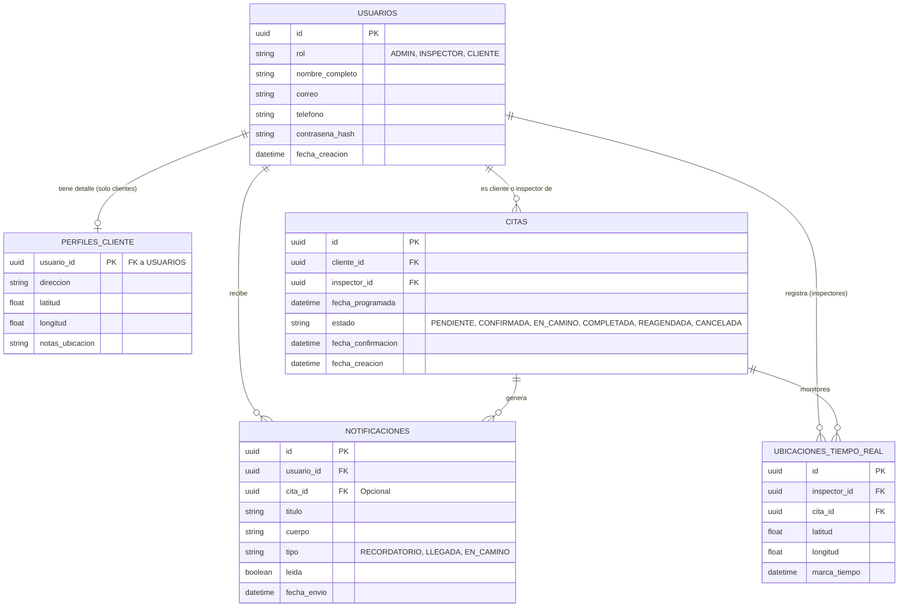

# Modelo de Datos — Vista Resumida
## Sistema de Alerta y Seguimiento de Inspecciones de Techo — Agave Roofing (AgaveAlerta)

**Universidad Autónoma de Nuevo León — FIME**
**Proyecto Integrador I — Equipo 01 — Agosto–Diciembre 2026**
**Entrega:** E03 — jueves 17 de septiembre de 2026 · **Responsable:** Jorge Alberto Barbosa García (BD)

> [!info] Alcance de este documento
> Esta es la **vista resumida** del modelo de datos: cinco entidades que explican el sistema completo en una sola página. Sirve para la exposición del avance y para que cualquier integrante entienda el flujo sin leer el diseño completo.
> El documento **normativo** —el que se implementa en Prisma y Supabase— es [[03_Diseno_Base_de_Datos]], con sus ~20 tablas, la máquina de estados de 11 estados, los índices y las políticas RLS. Si algo difiere entre ambos, **manda el 03**. La sección 5 da la equivalencia entre una vista y la otra.

---

## 1. Diagrama Entidad-Relación (ERD)

## 2. Diccionario de datos (vista resumida)

### 2.1 Tabla: `USUARIOS`
Almacena la información de acceso e identidad de todos los actores del sistema. Un solo modelo con un campo `rol` para simplificar la autenticación.

| Campo | Tipo | Descripción |
| :--- | :--- | :--- |
| `id` | UUID (PK) | Identificador único del usuario. |
| `rol` | Enum / String | Determina los permisos (`ADMIN`, `INSPECTOR`, `CLIENTE`). |
| `nombre_completo` | String | Nombre del usuario. |
| `correo` | String | Correo electrónico (único), usado para iniciar sesión. |
| `telefono` | String | Número de contacto para SMS o llamadas (importante para confirmaciones). |
| `contrasena_hash` | String | Contraseña encriptada por seguridad. |
| `fecha_creacion` | Timestamp | Fecha en que se registró el usuario. |

### 2.2 Tabla: `PERFILES_CLIENTE`
Tabla de extensión para los usuarios con el rol `CLIENTE`. Contiene datos específicos de los clientes, como la ubicación de la casa a inspeccionar.

| Campo | Tipo | Descripción |
| :--- | :--- | :--- |
| `usuario_id` | UUID (PK, FK) | ID del cliente (referencia a `USUARIOS`). |
| `direccion` | String | Dirección completa del techo a inspeccionar. |
| `latitud` | Float | Coordenada GPS exacta de la casa. |
| `longitud` | Float | Coordenada GPS exacta de la casa. |
| `notas_ubicacion` | String | Referencias extra ("Casa verde de dos pisos"). |

### 2.3 Tabla: `CITAS` (Appointments)
El núcleo del negocio. Relaciona a un inspector con un cliente en un momento específico en el tiempo.

| Campo | Tipo | Descripción |
| :--- | :--- | :--- |
| `id` | UUID (PK) | Identificador único de la cita. |
| `cliente_id` | UUID (FK) | Relación con el `CLIENTE` (`USUARIOS`). |
| `inspector_id` | UUID (FK) | Relación con el `INSPECTOR` (`USUARIOS`). |
| `fecha_programada` | Timestamp | Fecha y hora de la cita. |
| `estado` | Enum / String | `PENDIENTE`, `CONFIRMADA` (por el cliente), `EN_CAMINO`, `COMPLETADA`, `CANCELADA`. |
| `fecha_confirmacion` | Timestamp | Fecha exacta en que el cliente confirmó estar disponible. |
| `fecha_creacion` | Timestamp | Cuándo se creó la cita. |

### 2.4 Tabla: `NOTIFICACIONES`
Historial de alertas enviadas. Se usa para mostrar una "bandeja de notificaciones" en las apps móviles.

| Campo | Tipo | Descripción |
| :--- | :--- | :--- |
| `id` | UUID (PK) | Identificador de la notificación. |
| `usuario_id` | UUID (FK) | A quién va dirigida (generalmente al cliente). |
| `cita_id` | UUID (FK) | (Opcional) Cita a la que hace referencia. |
| `titulo` | String | Título corto ("El inspector va en camino"). |
| `cuerpo` | String | Mensaje detallado ("Tu inspector Juan llegará en aprox. 15 min"). |
| `tipo` | String | Categoría para mostrar íconos diferentes. |
| `leida` | Boolean | `true` si el cliente ya la vio en la app. |
| `fecha_envio` | Timestamp | Cuándo se detonó la alerta. |

### 2.5 Tabla: `UBICACIONES_TIEMPO_REAL` (Tracking Logs)
*Nota técnica: si se usa Firebase (Firestore / Realtime Database), esta tabla puede existir como un documento que se sobrescribe constantemente por cita, para no llenar la base de datos de registros inútiles. En SQL se guarda el histórico.*

| Campo | Tipo | Descripción |
| :--- | :--- | :--- |
| `id` | UUID (PK) | Identificador del registro. |
| `inspector_id` | UUID (FK) | Qué inspector generó la ubicación. |
| `cita_id` | UUID (FK) | Hacia qué cita se dirige. |
| `latitud` | Float | Ubicación actual del inspector. |
| `longitud` | Float | Ubicación actual del inspector. |
| `marca_tiempo` | Timestamp | Cuándo se tomó esta lectura de GPS. |

## 3. Flujo de datos de la solución propuesta

1. **Agendamiento:** el Administrador (panel web) crea un registro en `CITAS` asignando un cliente y un inspector. El estado inicial es `PENDIENTE`.
2. **Primera alerta:** el sistema detecta la nueva cita y genera un registro en `NOTIFICACIONES` para el cliente.
3. **Confirmación del cliente:** el cliente confirma desde su app. El estado de la `CITA` cambia a `CONFIRMADA`.
4. **En camino:** al salir, el inspector cambia su estado en la app. La `CITA` pasa a `EN_CAMINO`. Esto dispara otra `NOTIFICACION` al cliente y comienza el registro de `UBICACIONES_TIEMPO_REAL`.
5. **Seguimiento:** la app del cliente consume las coordenadas más recientes de `UBICACIONES_TIEMPO_REAL` para pintar el mapa.
6. **Llegada:** el inspector marca la llegada. La `CITA` pasa a `COMPLETADA` (o en inspección) y el rastreo de GPS se detiene.

## 4. Qué se entrega de este documento en E03

- ERD de las cinco entidades centrales (sección 1).
- Diccionario de datos resumido (sección 2).
- Flujo de datos de punta a punta (sección 3).
- Equivalencia con el modelo completo (sección 5), que acompaña al diccionario de datos detallado y al borrador de `schema.prisma` de [[03_Diseno_Base_de_Datos]].

## 5. Equivalencia con el modelo completo

El modelo que se implementa normaliza estas cinco entidades en tablas separadas. La correspondencia es directa:

| Vista resumida (este documento) | Modelo implementado ([[03_Diseno_Base_de_Datos]]) | Nota |
|---|---|---|
| `USUARIOS` (con campo `rol`) | `usuario` + `rol` + `cliente` + `inspector` | El rol se normaliza en catálogo y cada perfil tiene su propia tabla de extensión. |
| `PERFILES_CLIENTE` | `cliente` + `domicilio` (+ `zona`) | Un cliente puede tener más de un domicilio georreferenciado; por eso se separa. |
| `CITAS` | `inspeccion` + `inspeccion_historial` + `reprogramacion` | El `estado` crece de 6 a **11 estados** y **toda** transición se registra en el historial (RN-01). De ahí salen los indicadores. |
| `NOTIFICACIONES` | `notificacion` + `plantilla_notificacion` + `dispositivo` | El texto sale de plantillas y se envía a los dispositivos registrados, con reintentos y respaldo por SMS. |
| `UBICACIONES_TIEMPO_REAL` | `trayecto` + `punto_ubicacion` | El trayecto agrupa los puntos de una salida (índice único parcial: un solo trayecto activo por inspector). Retención de puntos: 30 días. |
| — | `resultado_inspeccion`, `evidencia`, `mensaje`, `configuracion`, `bitacora` | Bloques que la vista resumida no representa. |

> [!warning] Al implementar, usar los nombres del modelo completo
> El esquema Prisma, la API y las tres aplicaciones usan los nombres en singular y minúsculas de [[03_Diseno_Base_de_Datos]] (`usuario`, `inspeccion`, `notificacion`…). Esta vista resumida es material de exposición y análisis, no el contrato de implementación.

---

**Documentos relacionados:** [[01_Plan_de_Proyecto]] · [[02_SRS_Requerimientos]] · [[03_Diseno_Base_de_Datos]] · [[04_Diagramas_UML]] · [[05_Calendario_Entregas]] · [[Integracion]]
