# Diagramas UML
## Sistema de Alerta y Seguimiento de Inspecciones de Techo — Agave Roofing (AgaveAlerta)

**Universidad Autónoma de Nuevo León — FIME**
**Proyecto Integrador I — Equipo 01 — Agosto–Diciembre 2026**

Los diagramas se escriben en **Mermaid** para que se rendericen dentro de Obsidian y del repositorio. Los casos de uso corresponden a los definidos en `02_SRS_Requerimientos.md` §3.5 y las clases al modelo de `03_Diseno_Base_de_Datos.md`.

---

## 1. Diagrama de Casos de Uso

### 1.1 General del sistema

```mermaid
flowchart TB
    ADM(["Administrador<br/>(panel web)"])
    INS(["Inspector<br/>(app movil)"])
    CLI(["Cliente<br/>(app movil)"])
    SIS(["Sistema<br/>(temporizador)"])
    MAPS(["Google Directions<br/>(actor externo)"])
    PUSH(["Expo Push / Twilio<br/>(actor externo)"])

    subgraph S["Sistema AgaveAlerta"]
        CU01["CU-01 Iniciar sesion"]
        CU02["CU-02 Gestionar usuarios e inspectores"]
        CU03["CU-03 Gestionar clientes y domicilios"]
        CU04["CU-04 Gestionar zonas de servicio"]
        CU05["CU-05 Programar inspeccion"]
        CU06["CU-06 Reasignar / mover / cancelar"]
        CU07["CU-07 Consultar agenda y estados"]
        CU08["CU-08 Registrar dispositivo"]
        CU09["CU-09 Notificar dia programado"]
        CU10["CU-10 Confirmar disponibilidad"]
        CU11["CU-11 Solicitar reprogramacion"]
        CU12["CU-12 Aprobar / rechazar reprogramacion"]
        CU13["CU-13 Notificar recordatorio previo"]
        CU14["CU-14 Marcar sin confirmar"]
        CU15["CU-15 Consultar ruta del dia"]
        CU16["CU-16 Iniciar trayecto y avisar"]
        CU17["CU-17 Seguir la llegada en el mapa"]
        CU18["CU-18 Confirmar presencia en casa"]
        CU19["CU-19 Registrar llegada"]
        CU20["CU-20 Registrar resultado"]
        CU21["CU-21 Registrar cliente ausente"]
        CU22["CU-22 Sincronizar sin senal"]
        CU23["CU-23 Comunicarse"]
        CU24["CU-24 Consultar reporte"]
        CU25["CU-25 Consultar tablero"]
        CU26["CU-26 Configurar el sistema"]
    end

    ADM --- CU01
    ADM --- CU02
    ADM --- CU03
    ADM --- CU04
    ADM --- CU05
    ADM --- CU06
    ADM --- CU07
    ADM --- CU12
    ADM --- CU24
    ADM --- CU25
    ADM --- CU26

    INS --- CU01
    INS --- CU08
    INS --- CU15
    INS --- CU16
    INS --- CU19
    INS --- CU20
    INS --- CU21
    INS --- CU22
    INS --- CU23

    CLI --- CU01
    CLI --- CU08
    CLI --- CU10
    CLI --- CU11
    CLI --- CU17
    CLI --- CU18
    CLI --- CU23
    CLI --- CU24

    SIS --- CU09
    SIS --- CU13
    SIS --- CU14

    CU09 --- PUSH
    CU13 --- PUSH
    CU16 --- PUSH
    CU16 --- MAPS
    CU17 --- MAPS
```

### 1.2 Relaciones «include» / «extend»

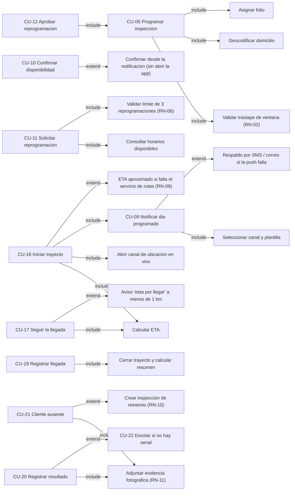

### 1.3 Descripción de actores

| Actor | Tipo | Descripción | Servicio que usa |
|-------|------|-------------|------------------|
| **Administrador** | Humano primario | Coordinador de operaciones de Agave Roofing. Programa, asigna, vigila y mide. | Panel web |
| **Inspector** | Humano primario | Personal de campo que revisa el techo. Trabaja de pie, a la intemperie y a veces sin señal. | App móvil del inspector |
| **Cliente** | Humano primario | Propietario de la vivienda. Alfabetización digital muy variable: debe poder confirmar con un toque. | App móvil del cliente |
| **Sistema (temporizador)** | Sistema interno | Tareas programadas de la API: dispara los avisos, marca las citas sin confirmar, purga los puntos GPS y cierra trayectos olvidados. | API |
| **Expo Push / FCM / APNs** | Sistema externo | Entrega las notificaciones al teléfono. No garantiza la entrega (RES-05). | API |
| **Twilio / Resend** | Sistema externo | Canales de respaldo: SMS y correo. | API |
| **Google Directions / Maps** | Sistema externo | Ruta y tiempo estimado de llegada; mapa en ambas apps. | API y apps |
| **Supabase Auth / Realtime / Storage** | Sistema externo | Identidad, canal de ubicación en vivo y almacenamiento de fotos y PDF. | Todos |

---

## 2. Diagrama de Clases

### 2.1 Modelo de dominio

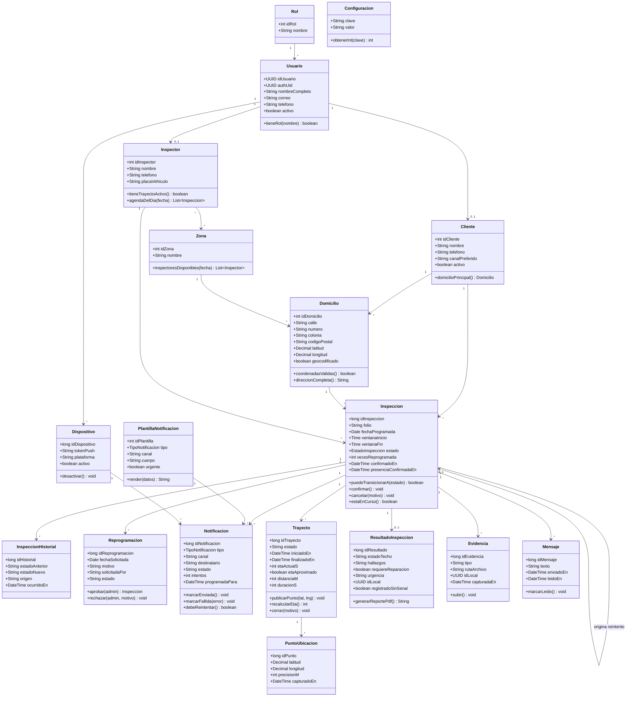

### 2.2 Arquitectura por capas

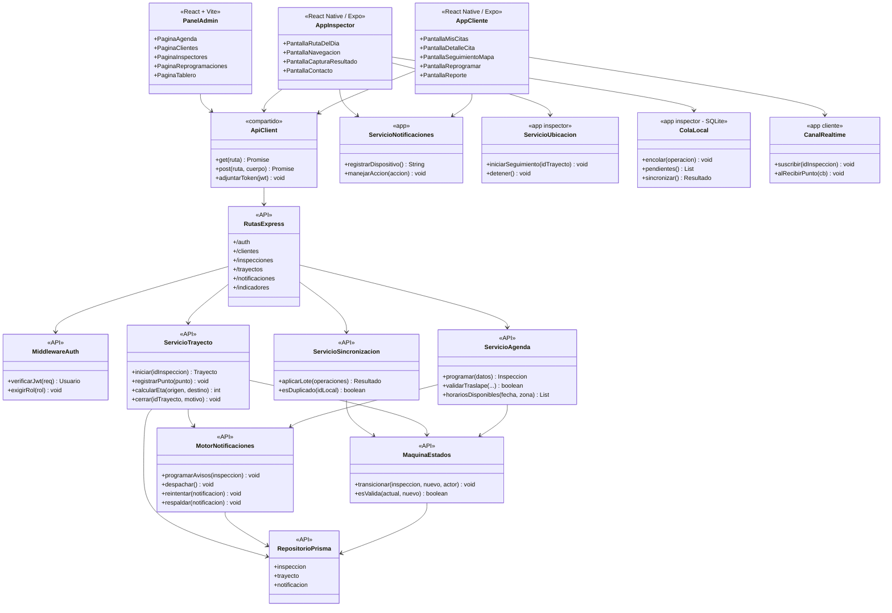

---

## 3. Diagramas de Secuencia

### 3.1 CU-09 Notificar el día programado y confirmar (el corazón de la propuesta)

```mermaid
sequenceDiagram
    autonumber
    participant T as Temporizador (API)
    participant MN as MotorNotificaciones
    participant BD as PostgreSQL
    participant EX as Expo Push
    participant TW as Twilio (SMS)
    participant AC as App Cliente
    participant C as Cliente

    T->>BD: SELECT inspecciones PROGRAMADA con fecha en 24 h
    BD-->>T: lista de citas
    loop por cada cita
        T->>MN: programarAviso(cita, DIA_PROGRAMADO)
        MN->>BD: INSERT notificacion (PENDIENTE, canal segun preferencia)
        MN->>BD: UPDATE inspeccion SET estado = 'NOTIFICADA'
        MN->>BD: INSERT inspeccion_historial
    end

    T->>MN: despachar()
    MN->>BD: SELECT notificaciones PENDIENTE con programada_para <= now()
    MN->>EX: enviar(token, titulo, cuerpo, acciones)
    alt entrega confirmada
        EX-->>MN: acuse de recibo
        MN->>BD: UPDATE notificacion SET estado='ENTREGADA'
        EX-->>AC: notificacion en pantalla
        AC-->>C: "Su inspeccion es el jueves 10 entre 10:00 y 12:00"
    else token invalido o sin acuse
        EX-->>MN: error / sin acuse
        MN->>BD: UPDATE notificacion SET estado='FALLIDA', error
        MN->>TW: enviar SMS de respaldo con enlace corto
        TW-->>C: SMS
        MN->>BD: INSERT notificacion (canal SMS)
    end

    C->>AC: toca "Si estare"
    AC->>BD: POST /inspecciones/:id/confirmar (via API)
    BD-->>AC: 200 estado CONFIRMADA
    AC-->>C: "Confirmado. Lo esperamos el jueves"
    Note over BD: confirmado_en = now(); la confirmacion no se deshace (RN-04)
```

### 3.2 CU-16 + CU-17 Iniciar trayecto y seguimiento en vivo

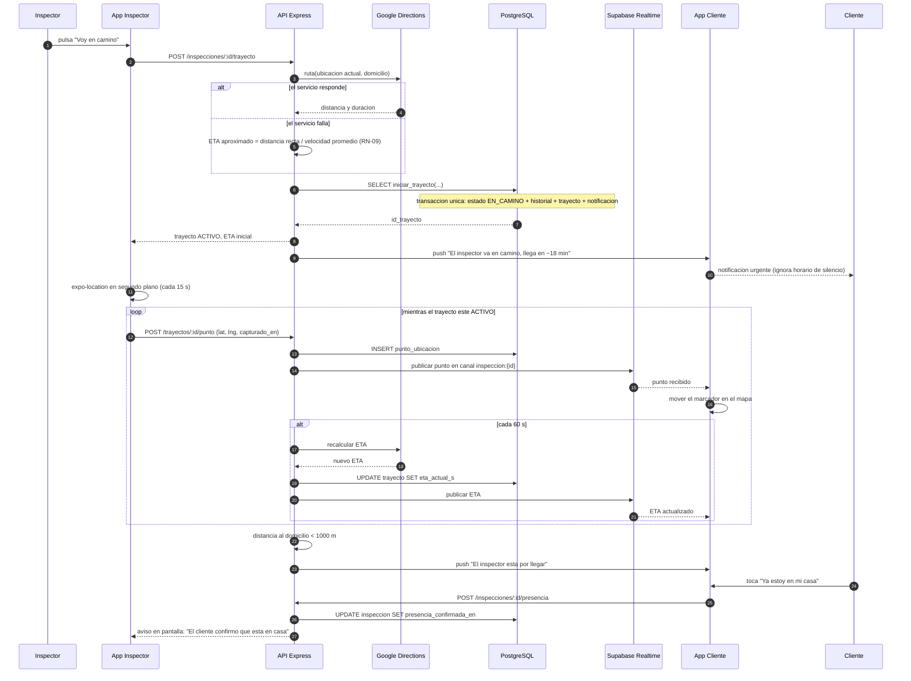

### 3.3 CU-11 + CU-12 Reprogramar la cita

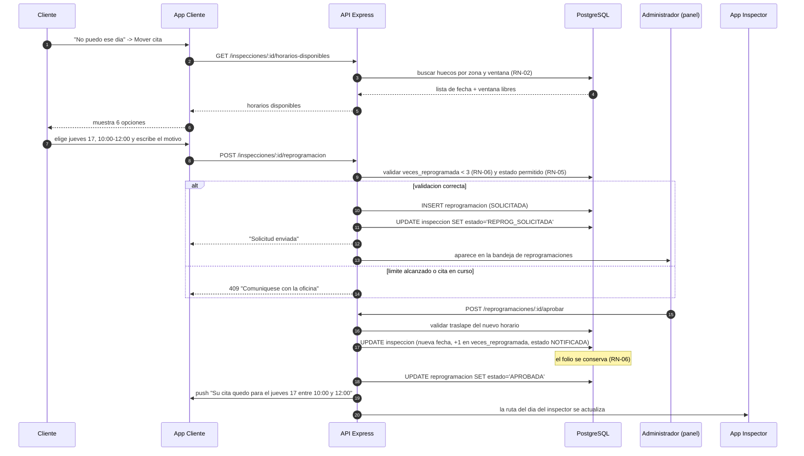

### 3.4 CU-20 + CU-22 Registrar el resultado sin señal y sincronizar

```mermaid
sequenceDiagram
    autonumber
    participant I as Inspector
    participant AI as App Inspector
    participant SQ as SQLite local
    participant API as API Express
    participant ST as Supabase Storage
    participant BD as PostgreSQL
    participant AC as App Cliente

    I->>AI: captura hallazgos y toma 4 fotos del techo
    AI->>AI: detecta que no hay conexion
    AI->>SQ: encolar resultado {id_local: UUID, registrado_en: hora real}
    AI->>SQ: encolar 4 evidencias con su id_local y la ruta del archivo
    AI-->>I: "Guardado. Se enviara al recuperar senal" (marcador visible)

    Note over AI,SQ: el inspector sigue con la siguiente casa de su ruta

    AI->>AI: recupera conexion
    AI->>API: POST /sincronizar {operaciones pendientes}
    API->>BD: SELECT por id_local (idempotencia, RN-12)
    alt ninguno existe
        API->>BD: INSERT resultado_inspeccion (registrado_sin_senal = true)
        API->>BD: UPDATE inspeccion SET estado='COMPLETADA'
        API->>BD: INSERT inspeccion_historial (origen APP_INSP)
    else ya se habia aplicado
        API-->>AI: 200 con el registro existente (no duplica)
    end
    AI->>ST: subir las 4 fotos
    ST-->>AI: rutas de los archivos
    AI->>API: POST /evidencias {id_local, ruta}
    API->>BD: INSERT evidencia
    API->>API: generar el reporte PDF
    API->>ST: guardar el PDF
    API->>AC: push "Ya esta disponible el resultado de su inspeccion"
    API-->>AI: sincronizacion completa; se vacia la cola
    AI->>SQ: borrar operaciones confirmadas
```

### 3.5 CU-21 Registrar cliente ausente

```mermaid
sequenceDiagram
    autonumber
    participant I as Inspector
    participant AI as App Inspector
    participant API as API Express
    participant BD as PostgreSQL
    participant AD as Panel del Administrador

    I->>AI: nadie abre; pulsa "Cliente ausente"
    AI-->>I: exige foto de la fachada y una nota (RN-10)
    I->>AI: toma la foto y escribe "Se toco 3 veces, sin respuesta, 10:40"
    AI->>API: POST /inspecciones/:id/ausente
    API->>BD: validar estado EN_CAMINO o EN_SITIO
    API->>BD: UPDATE inspeccion SET estado='CLIENTE_AUSENTE'
    API->>BD: INSERT evidencia (FOTO_AUSENCIA)
    API->>BD: SELECT cerrar_trayecto(id, 'LLEGADA')
    API->>BD: INSERT inspeccion_historial
    API-->>AI: registrado; siguiente parada de la ruta
    API->>AD: se suma a "visitas fallidas" del tablero
    AD->>API: POST /inspecciones {origen: id} para crear el reintento
    API->>BD: INSERT inspeccion con id_inspeccion_origen
```

### 3.6 CU-25 Consultar el tablero de indicadores

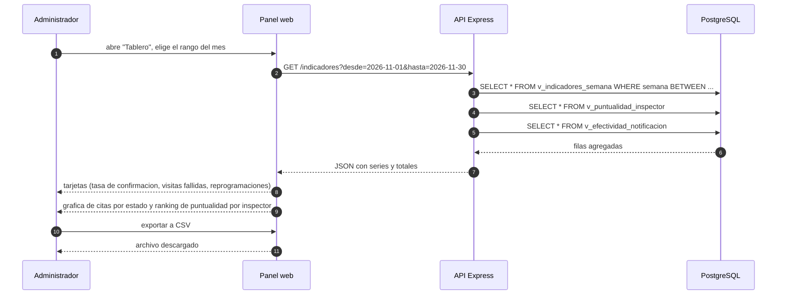

---

## 4. Diagrama de Actividades — De la programación a la inspección completada

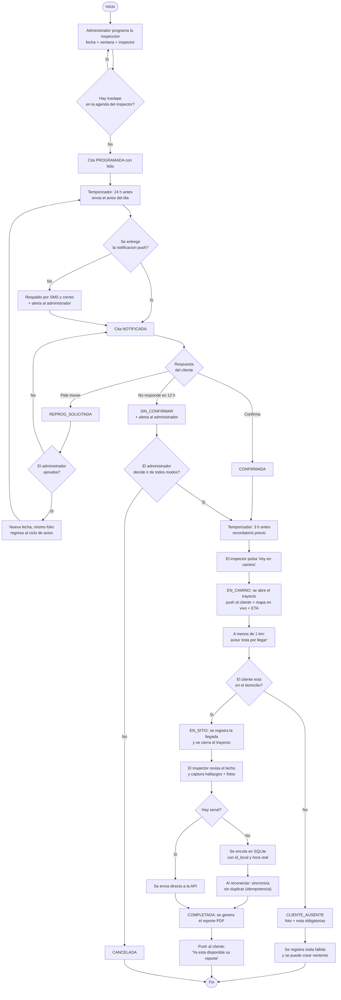

---

## 5. Diagrama de Estados — Trayecto

Complemento de la máquina de estados de la inspección (ver `03_Diseno_Base_de_Datos.md` §1.1).

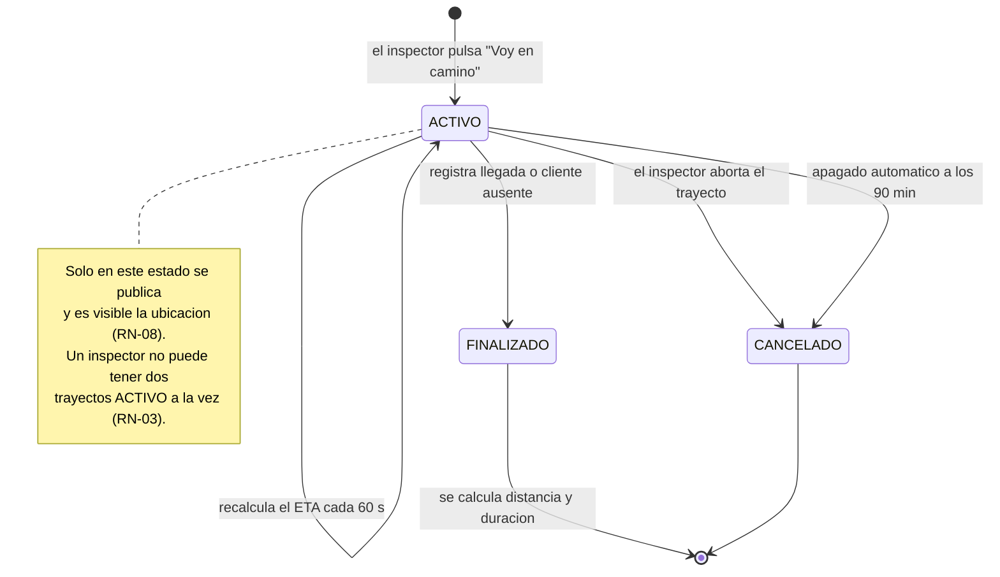

---

## 6. Diagrama de Componentes

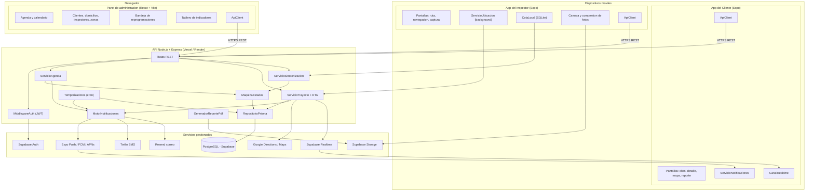

---

## 7. Diagrama de Despliegue

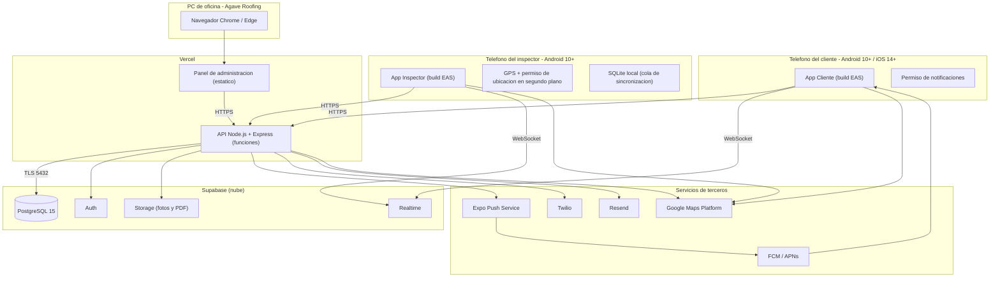

**Notas de despliegue**

- Las apps se distribuyen con **EAS Build** (APK directo y enlace de instalación) para la demostración; la publicación en tiendas queda fuera del alcance (riesgo R9).
- Los **temporizadores** de la API (avisos, marcado de sin confirmar, purga de puntos, cierre de trayectos) se ejecutan con *cron jobs* de Vercel o, si el plan lo limita, con `pg_cron` dentro de Supabase.
- Ambientes: `desarrollo` (Supabase local o proyecto de pruebas) y `produccion` (proyecto piloto con datos reales autorizados).

---

## 8. Trazabilidad diagramas ↔ requerimientos

| Diagrama | Casos de uso | Requerimientos |
|----------|--------------|----------------|
| §1.1 Casos de uso general | CU-01 a CU-26 | Todos |
| §1.2 Include / extend | CU-05, CU-09, CU-11, CU-16, CU-20, CU-21 | RF-16 a RF-24, RF-25 a RF-35, RF-37 a RF-41, RF-44 a RF-52, RF-53 a RF-58 |
| §2.1 Modelo de dominio | — | Modelo completo de `03_Diseno_Base_de_Datos.md` |
| §2.2 Arquitectura por capas | — | RNF de mantenibilidad y portabilidad |
| §3.1 Aviso y confirmación | CU-09, CU-10 | RF-26, RF-31 a RF-36, RF-43 |
| §3.2 Trayecto y seguimiento | CU-16, CU-17, CU-18 | RF-28, RF-29, RF-44 a RF-50 |
| §3.3 Reprogramación | CU-11, CU-12 | RF-37 a RF-41 |
| §3.4 Resultado sin señal | CU-20, CU-22 | RF-53 a RF-55, RF-57, RF-58 |
| §3.5 Cliente ausente | CU-21 | RF-56, RF-24 |
| §3.6 Tablero | CU-25 | RF-65 a RF-71 |
| §4 Actividades | CU-05 a CU-22 | Flujo completo de negocio |
| §5 Estados del trayecto | CU-16, CU-19, CU-21 | RF-44, RF-49, RF-51, RN-03, RN-08 |
| §6 Componentes | — | RES-01 a RES-07 |
| §7 Despliegue | — | RNF de disponibilidad y portabilidad |

---

**Documentos relacionados:** [[01_Plan_de_Proyecto]] · [[02_SRS_Requerimientos]] · [[03_Diseno_Base_de_Datos]] · [[05_Calendario_Entregas]]
