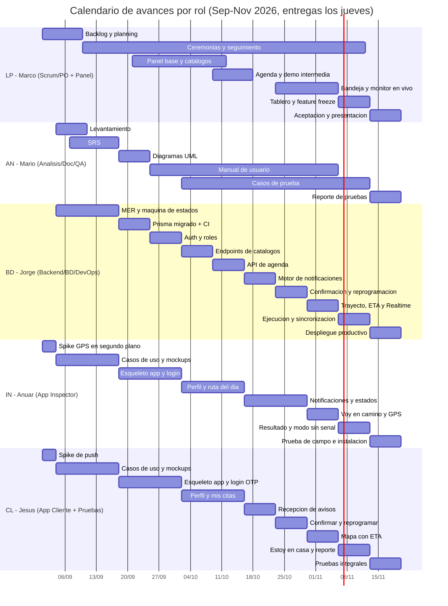

# Calendario de Entregas de Avance
## Sistema de Alerta y Seguimiento de Inspecciones de Techo — Agave Roofing (AgaveAlerta)

**Universidad Autónoma de Nuevo León — FIME**
**Proyecto Integrador I — Equipo 01 — Agosto–Diciembre 2026**
**Catedrática:** Raquel Martínez Martínez
**Metodología:** Scrum (6 sprints de 2 semanas)

---

> [!warning] Próxima entrega: **E03 — jueves 17 de septiembre de 2026 (mañana)**
> Cierre del Sprint 1. Además del SRS validado y los mockups, **se entrega el diseño de la base de datos**: el diccionario de datos y el borrador de `schema.prisma` de [[03_Diseno_Base_de_Datos]], acompañados de la vista resumida (ERD de cinco entidades + flujo de datos) en [[03b_Modelo_Datos_Resumen_E03]].
> Responsable: **Jorge (BD)**. Consolida y entrega: **Marco (LP)**.

## 1. Reglas de entrega

- Las entregas de avance son **semanales, todos los jueves**.
- **Primera entrega:** jueves **3 de septiembre de 2026**.
- **Última entrega (entrega final del proyecto):** jueves **19 de noviembre de 2026**.
- Total: **12 entregas** (E01 a E12), agrupadas en **6 sprints de 2 semanas**.
- Cada jueves se entrega: el incremento de software de la semana + la documentación asociada + la minuta del equipo (Daily / Review / Retro según corresponda).
- El **Sprint Review** se realiza el jueves que cierra cada sprint (E03, E05, E07, E09, E11, E12); ese día también se hace la **Retrospectiva** y el **Sprint Planning** del siguiente.
- El líder de proyecto (Product Owner / Scrum Master) consolida los avances y realiza la entrega única.
- Formato: documentos en Word/PDF y código en el repositorio (monorepo `api/`, `panel/`, `app-inspector/`, `app-cliente/`), con etiqueta por entrega (`entrega-01` … `entrega-12`).
- **Las pruebas de las apps se hacen en teléfono real**, no solo en emulador. A partir de E10, al menos una prueba por entrega es **de campo** (en la calle, con GPS y señal variable).
- Cada integrante trabaja **en paralelo** en su línea de trabajo; las dependencias se indican en la sección 6.

## 2. Responsables y líneas de trabajo

| Clave | Integrante | Rol | Línea de trabajo |
|-------|-----------|-----|------------------|
| LP | Marco Antonio Méndez Sánchez | Product Owner / Scrum Master + Panel de administración | Backlog, priorización, ceremonias, riesgos, comunicación con el cliente, presentación; **panel web**: agenda, asignación, bandeja de reprogramaciones y tablero |
| AN | Mario Martínez González | Analista / Documentación / QA | SRS, historias de usuario, casos de uso, diagramas UML, manual de usuario, casos de prueba, actas |
| BD | Jorge Alberto Barbosa García | Arquitecto / Backend + Base de datos + DevOps | API Express, esquema y migraciones Prisma, PostgreSQL/Supabase, máquina de estados, **motor de notificaciones push**, canal de seguimiento en vivo, despliegues, CI |
| IN | Anuar Guadalupe Hernández Hernández | Desarrollador Móvil — **App del Inspector** | Ruta del día, inicio de trayecto, ubicación en segundo plano, llegada, resultado con fotos, contacto con el cliente, **modo sin señal** |
| CL | Jesús Mario Bazaldúa Bustos | Desarrollador Móvil — **App del Cliente** + Pruebas | Notificaciones, confirmación, reprogramación, mapa de seguimiento con ETA, "estoy en casa", reporte de inspección, ejecución del plan de pruebas |

## 3. Resumen de las 12 entregas

| # | Fecha (jueves) | Sprint | Hito de la semana | Entregable integrador |
|---|----------------|--------|-------------------|-----------------------|
| E01 | 03 / sep / 2026 | Sprint 0 | Arranque y planeación | ADR de stack, Product Backlog, tablero, repos + Supabase + Vercel + Expo + Google Maps creados, spikes técnicos (push, GPS, mapa) |
| E02 | 10 / sep / 2026 | Sprint 1 | Análisis | SRS (borrador) e historias de usuario de los tres servicios; MER v1 centrado en la inspección |
| E03 | 17 / sep / 2026 | Sprint 1 (cierre) | Requerimientos cerrados + diseño de interfaz + **diseño de base de datos** | SRS validado con Agave Roofing, **diseño de la base de datos** (ERD, diccionario de datos y borrador de `schema.prisma`), mockups de las dos apps y del panel |
| E04 | 24 / sep / 2026 | Sprint 2 | Diseño técnico + infraestructura | Esquema Prisma migrado en Supabase, diagramas UML, CI configurada, esqueletos de las tres aplicaciones |
| E05 | 01 / oct / 2026 | Sprint 2 (cierre) | Autenticación y roles | Login con Supabase Auth (correo para admin/inspector, OTP para cliente) y autorización por rol en API y clientes |
| E06 | 08 / oct / 2026 | Sprint 3 | Clientes, domicilios, inspectores y zonas | Altas con geocodificación y ajuste del pin en el mapa; asignación de zonas |
| E07 | 15 / oct / 2026 | Sprint 3 (cierre) | Agenda de inspecciones y asignación | Programación con validación de traslape, calendario del panel y ruta del día en la app del inspector; demo intermedia |
| E08 | 22 / oct / 2026 | Sprint 4 | Notificaciones push | Registro de dispositivos, motor de envío, aviso del día programado y recordatorio previo, con respaldo por SMS |
| E09 | 29 / oct / 2026 | Sprint 4 (cierre) | Confirmación y reprogramación | Confirmar desde la notificación, horarios disponibles, solicitud del cliente y aprobación del administrador |
| E10 | 05 / nov / 2026 | Sprint 5 | Trayecto y seguimiento en vivo | "Voy en camino", ubicación en segundo plano, mapa del cliente con ETA, aviso "está por llegar" |
| E11 | 12 / nov / 2026 | Sprint 5 (cierre) | Llegada, resultado, tablero y modo sin señal | "Estoy en casa", registro de llegada, resultado con evidencia, cliente ausente, tablero de indicadores, cola de sincronización, manuales |
| E12 | 19 / nov / 2026 | Sprint 6 | Pruebas integrales, implantación y entrega final | Prueba de campo de una inspección completa, builds EAS instalados, capacitación, aceptación, presentación final |

## 4. Calendario detallado por integrante

> En cada entrega, las cinco líneas avanzan en paralelo. El "entregable concreto" es lo que cada integrante sube al repositorio o a la carpeta de documentación esa semana.

### E01 — Jueves 03 de septiembre — Arranque y planeación (Sprint 0)

| Clave | Tareas de la semana | Entregable concreto |
|-------|---------------------|---------------------|
| LP | Acta de equipo; Product Backlog inicial (épicas e historias a partir de la propuesta); tablero en GitHub Projects; Definición de Terminado; agendar ceremonias; este calendario. | Product Backlog + tablero + DoD |
| AN | Guion de entrevista con el responsable de operaciones de Agave Roofing; glosario del negocio (inspección, ventana, visita fallida); levantamiento del proceso actual por correo y su costo. | Documento de levantamiento inicial |
| BD | Decisión de stack y ADR-001; crear el monorepo (`api/`, `panel/`, `app-inspector/`, `app-cliente/`) con README de arranque; crear proyectos en **Supabase**, **Vercel**, **Expo (EAS)** y **Google Cloud** (Maps + Directions). | Repos + cuentas + ADR-001 |
| IN | Spike **Expo + ubicación en segundo plano**: app mínima que registra la posición cada 15 s con la pantalla apagada y mide el consumo de batería en 30 min. | Spike de GPS en segundo plano + notas de batería |
| CL | Spike **Expo Push Notifications**: app mínima que obtiene el token, recibe una notificación con botones de acción y responde sin abrir la app. Probar con permiso denegado. | Spike de notificaciones push + notas |

### E02 — Jueves 10 de septiembre — Análisis (Sprint 1, planning)

| Clave | Tareas de la semana | Entregable concreto |
|-------|---------------------|---------------------|
| LP | Sprint Planning 1; refinamiento y estimación del backlog en puntos; reunión con el cliente; minuta; riesgos v2 (entrega de push, batería, privacidad). | Sprint Backlog 1 + minuta |
| AN | SRS borrador: introducción, descripción general y RF de los módulos 1–5 (seguridad; clientes y zonas; agenda; notificaciones; confirmación y reprogramación). | SRS (borrador, secciones 1–3 parciales) |
| BD | Modelo conceptual y MER v1: `inspeccion` como máquina de estados, `notificacion`, `trayecto`, idempotencia por `id_local`. | MER v1 + máquina de estados |
| IN | Con AN: historias y casos de uso del inspector (CU-15, CU-16, CU-19, CU-20, CU-21, CU-22); primer boceto de la ruta del día y la pantalla de captura. | Casos de uso del inspector + bocetos |
| CL | Con AN: historias y casos de uso del cliente (CU-08, CU-10, CU-11, CU-17, CU-18, CU-24); primer boceto de la notificación, el detalle de la cita y el mapa. | Casos de uso del cliente + bocetos |

### E03 — Jueves 17 de septiembre — Requerimientos cerrados + diseño de interfaz + diseño de base de datos (Sprint 1, cierre)

| Clave | Tareas de la semana | Entregable concreto |
|-------|---------------------|---------------------|
| LP | Validar el SRS con el responsable de operaciones; congelar alcance; Sprint Review 1 + Retro + Planning 2; mockups del panel (agenda y tablero). | SRS validado + acta de congelación + mockups del panel |
| AN | SRS completo: RF de los módulos 6–10, RNF, reglas de negocio y matriz de trazabilidad. | SRS completo (versión 1.0) |
| BD | **Diseño de la base de datos**: ERD y vista resumida ([[03b_Modelo_Datos_Resumen_E03]]); diccionario de datos completo; borrador del esquema Prisma; diseño del motor de notificaciones (tabla, estados y despachador). | **Diseño de BD entregado**: [[03_Diseno_Base_de_Datos]] + [[03b_Modelo_Datos_Resumen_E03]] + Prisma borrador |
| IN | Mockups finales de la app del inspector: ruta del día, detalle de la parada, "voy en camino", captura de resultado, cliente ausente. | Mockups del inspector |
| CL | Mockups finales de la app del cliente: notificación con acciones, detalle de la cita, reprogramar, mapa con ETA, "estoy en casa", reporte. | Mockups del cliente |

### E04 — Jueves 24 de septiembre — Diseño técnico + infraestructura (Sprint 2, planning)

| Clave | Tareas de la semana | Entregable concreto |
|-------|---------------------|---------------------|
| LP | Plan de pruebas (criterios de aceptación por historia); esqueleto del panel React + Vite con layout y rutas. | Plan de pruebas + panel base |
| AN | Diagramas UML: casos de uso, clases de dominio y actividades del proceso completo. | Diagramas UML (parte 1) |
| BD | Migrar el esquema Prisma a Supabase; esqueleto de la API con rutas vacías; CI en GitHub Actions; primer despliegue. | BD migrada + API desplegada + CI |
| IN | Esqueleto de la app del inspector (Expo + TypeScript) con navegación y `ApiClient` compartido; base de datos SQLite local creada. | App del inspector base |
| CL | Esqueleto de la app del cliente (Expo + TypeScript) con navegación y `ApiClient`; diagramas de secuencia en Mermaid (apoyo a AN). | App del cliente base + secuencias |

### E05 — Jueves 01 de octubre — Autenticación y roles (Sprint 2, cierre)

| Clave | Tareas de la semana | Entregable concreto |
|-------|---------------------|---------------------|
| LP | Sprint Review 2 + Retro + Planning 3; login del panel y guardas de ruta para el rol Administrador. | Seguridad del panel + minuta |
| AN | Manual de usuario, capítulos 1–2 (introducción y acceso a cada uno de los tres servicios). | Manual cap. 1–2 |
| BD | Middleware de verificación de JWT de Supabase; autorización por rol; tabla `usuario` ligada a `auth_uid`; políticas RLS iniciales. | Módulo de seguridad de la API |
| IN | Login del inspector con correo y contraseña; almacenamiento seguro del token; pantalla "sin permiso" para otros roles. | Login del inspector |
| CL | Login del cliente **por teléfono con código OTP**; manejo de reenvío del código y de número no registrado. | Login del cliente (OTP) |

### E06 — Jueves 08 de octubre — Clientes, domicilios, inspectores y zonas (Sprint 3, planning)

| Clave | Tareas de la semana | Entregable concreto |
|-------|---------------------|---------------------|
| LP | Pantallas del panel: alta y edición de clientes, domicilios (con mapa para mover el pin), inspectores y zonas. | Módulo de catálogos del panel |
| AN | Manual capítulo 3 (alta de clientes y domicilios); casos de prueba de los módulos 1–2. | Manual cap. 3 + casos de prueba |
| BD | Endpoints de clientes, domicilios, inspectores, zonas e `inspector_zona`; geocodificación de direcciones; baja lógica. | Endpoints de catálogos |
| IN | Pantalla de perfil del inspector y sus zonas asignadas; registro del dispositivo para notificaciones. | Perfil + registro de dispositivo |
| CL | Pantalla de perfil del cliente, sus domicilios y su canal preferido; registro del dispositivo y solicitud del permiso de notificaciones explicada. | Perfil + registro de dispositivo |

### E07 — Jueves 15 de octubre — Agenda de inspecciones y asignación (Sprint 3, cierre)

| Clave | Tareas de la semana | Entregable concreto |
|-------|---------------------|---------------------|
| LP | Calendario del panel (vista por día, por inspector y por zona); programar, reasignar y cancelar; Sprint Review 3 + Retro + Planning 4; **demo intermedia al cliente**. | Agenda del panel + demo |
| AN | Manual capítulo 4 (programar y mover una cita); casos de prueba de la agenda. | Manual cap. 4 + casos de prueba |
| BD | Endpoints de inspección: crear con folio, validar traslape (RN-02), asignar inspector, cambiar estado por la máquina de estados, historial. | API de agenda + máquina de estados |
| IN | **Ruta del día**: lista ordenada de paradas con cliente, dirección, ventana y estado; detalle de la parada con botón para abrir el mapa. | Ruta del día del inspector |
| CL | **Mis citas**: próxima cita destacada e historial; pantalla de detalle con fecha, ventana, inspector asignado y estado. | Mis citas del cliente |

### E08 — Jueves 22 de octubre — Motor de notificaciones push (Sprint 4, planning)

| Clave | Tareas de la semana | Entregable concreto |
|-------|---------------------|---------------------|
| LP | Seguimiento del riesgo R4 (entrega de push): tabla de resultados de las pruebas de entrega; vista del panel con el estado de cada notificación. | Bitácora de entregabilidad + vista del panel |
| AN | Manual capítulo 5, borrador (qué avisos recibe el cliente y cuándo); casos de prueba de notificaciones. | Manual cap. 5 borrador + casos de prueba |
| BD | Tablas `dispositivo`, `plantilla_notificacion` y `notificacion`; despachador con reintentos; temporizadores de aviso del día y recordatorio; respaldo por SMS (Twilio). | Motor de notificaciones |
| IN | Notificaciones al inspector: cita asignada, cita reprogramada y aviso de que el cliente ya está en casa. | Notificaciones del inspector |
| CL | Recepción del aviso del día programado y del recordatorio, con los botones **Confirmar** y **Reprogramar** en la propia notificación; manejo con la app cerrada. | Recepción de avisos en el cliente |

### E09 — Jueves 29 de octubre — Confirmación y reprogramación (Sprint 4, cierre)

| Clave | Tareas de la semana | Entregable concreto |
|-------|---------------------|---------------------|
| LP | Bandeja de reprogramaciones en el panel (aprobar / rechazar con motivo); alerta de citas `SIN_CONFIRMAR`; Sprint Review 4 + Retro + Planning 5. | Bandeja de reprogramaciones + minuta |
| AN | Manual capítulo 5 final; casos de prueba de confirmación y reprogramación, incluido el límite de 3. | Manual cap. 5 + casos de prueba |
| BD | Endpoints de confirmación, horarios disponibles, solicitud y resolución de reprogramación; temporizador que marca `SIN_CONFIRMAR`. | API de confirmación y reprogramación |
| IN | La app del inspector refleja el estado de confirmación de cada parada y avisa cuando una cita se reprograma o se cancela. | Estados en la ruta del inspector |
| CL | Confirmar disponibilidad (desde la notificación y desde la app); solicitar mover la cita eligiendo entre horarios disponibles, con motivo. | Confirmación y reprogramación del cliente |

### E10 — Jueves 05 de noviembre — Trayecto y seguimiento en vivo (Sprint 5, planning)

| Clave | Tareas de la semana | Entregable concreto |
|-------|---------------------|---------------------|
| LP | Monitor en vivo del panel (quién va en camino, dónde y con qué ETA); capacitación inicial a los inspectores piloto. | Monitor del panel + sesión de capacitación |
| AN | Manual capítulo 6 (seguimiento en vivo); casos de prueba de campo del trayecto y del ETA. | Manual cap. 6 + pruebas de campo |
| BD | `iniciar_trayecto` transaccional; recepción de puntos; publicación en Supabase Realtime; cálculo de ETA con Google Directions y su respaldo aproximado; aviso "está por llegar"; cierre automático a los 90 min. | API de trayecto + ETA + Realtime |
| IN | Botón **"Voy en camino"**; ubicación en segundo plano cada 15 s; pantalla de navegación; corte del seguimiento al llegar. | Trayecto del inspector |
| CL | **Mapa de seguimiento**: posición del inspector en vivo, ETA que se actualiza, último punto conocido cuando se pierde la señal; aviso "está por llegar". | Mapa de seguimiento del cliente |

### E11 — Jueves 12 de noviembre — Llegada, resultado, tablero y modo sin señal (Sprint 5, cierre)

| Clave | Tareas de la semana | Entregable concreto |
|-------|---------------------|---------------------|
| LP | **Tablero de indicadores**: tasa de confirmación, visitas fallidas, reprogramaciones, puntualidad y efectividad por canal; **feature freeze**; Sprint Review 5 + Retro + Planning 6. | Tablero del panel + congelación de alcance |
| AN | Manuales terminados (los tres servicios); matriz de casos de prueba lista para ejecución; guion de la prueba de campo de E12. | Manuales + matriz de pruebas |
| BD | Endpoints de llegada, resultado, evidencia y cliente ausente; `/sincronizar` con idempotencia; generación del reporte PDF; vistas de indicadores; purga de puntos GPS. | API de ejecución + sincronización + indicadores |
| IN | Registro de llegada; captura del resultado con fotos; cliente ausente con evidencia obligatoria; **cola SQLite y sincronización al reconectar**; mensajería con el cliente. | Ejecución + modo sin señal |
| CL | **"Ya estoy en mi casa"**; aviso de llegada; consulta del reporte de inspección con fotos; mensaje y llamada al inspector; **ejecución de los casos de prueba** de los módulos 1–8. | Cierre de la app del cliente + resultados de pruebas |

### E12 — Jueves 19 de noviembre — Pruebas integrales, implantación y entrega final (Sprint 6)

| Clave | Tareas de la semana | Entregable concreto |
|-------|---------------------|---------------------|
| LP | Pruebas de aceptación con Agave Roofing; acta de aceptación; presentación final y demostración en vivo; cierre del proyecto. | Acta de aceptación + presentación |
| AN | Reporte de resultados de pruebas; documentación consolidada; manual de instalación de las apps. | Reporte de pruebas + documentación final |
| BD | Despliegue productivo de API y panel; respaldo de la base; builds de producción con EAS; monitoreo y bitácora. | Ambiente productivo + respaldos |
| IN | **Prueba de campo completa** de una inspección real de principio a fin (con tramo sin señal); correcciones; instalación en los teléfonos de los inspectores. | Evidencia de prueba de campo + app instalada |
| CL | Pruebas integrales del recorrido del cliente (notificación → confirmación → seguimiento → reporte); matriz de resultados; instalación con los clientes piloto. | Matriz de resultados + app instalada |

## 5. Vista de paralelismo (foco de cada línea por entrega)

| Entrega | LP (Scrum/PO + Panel) | AN (Análisis/Doc) | BD (Backend/BD/DevOps) | IN (App Inspector) | CL (App Cliente + Pruebas) |
|---------|----------------------|-------------------|------------------------|--------------------|----------------------------|
| E01 | Backlog y tablero | Levantamiento | ADR + repos + cuentas | Spike GPS en segundo plano | Spike de push |
| E02 | Planning 1 + estimación | SRS RF 1–5 | MER v1 + máquina de estados | CU inspector + bocetos | CU cliente + bocetos |
| E03 | Validar SRS + Review 1 | SRS completo | **Diseño de BD** (ERD + diccionario) + Prisma borrador | Mockups del inspector | Mockups del cliente |
| E04 | Plan de pruebas + panel base | UML clases/CU/actividad | Prisma migrado + CI + despliegue | Esqueleto app + SQLite | Esqueleto app + secuencias |
| E05 | Review 2 + login del panel | Manual cap. 1–2 | JWT + roles + RLS | Login del inspector | Login por OTP |
| E06 | Catálogos del panel | Manual cap. 3 | Endpoints de catálogos + geocodificación | Perfil + dispositivo | Perfil + permiso de notificaciones |
| E07 | Agenda + demo intermedia | Manual cap. 4 | API de agenda + estados | Ruta del día | Mis citas |
| E08 | Vista de entregabilidad | Manual cap. 5 borrador | Motor de notificaciones + SMS | Notificaciones al inspector | Recepción de avisos |
| E09 | Bandeja de reprogramaciones | Manual cap. 5 final | API confirmación/reprogramación | Estados en la ruta | Confirmar y mover cita |
| E10 | Monitor en vivo + capacitación | Manual cap. 6 | Trayecto + ETA + Realtime | "Voy en camino" + GPS | Mapa con ETA |
| E11 | Tablero + feature freeze | Manuales + matriz | Ejecución + sincronización + PDF | Resultado + modo sin señal | "Estoy en casa" + reporte + pruebas |
| E12 | Aceptación + presentación | Reporte de pruebas | Despliegue + builds EAS | Prueba de campo | Pruebas integrales + instalación |

## 6. Ruta crítica y dependencias

**Ruta crítica** (si una se retrasa, se recorre toda la entrega final):

```
E02 Análisis → E03 SRS validado → E04 Prisma migrado + infraestructura →
E05 Auth y roles → E06 Endpoints de catálogos → E07 API de agenda y máquina de estados →
E08 Motor de notificaciones → E09 Confirmación y reprogramación →
E10 Trayecto, Realtime y ETA → E11 Ejecución, sincronización e indicadores →
E12 Prueba de campo y entrega
```

Recae principalmente en **BD (Jorge)** —API, base de datos, notificaciones y seguimiento— y se apoya en **IN (Anuar)** y **CL (Jesús)**, que consumen cada endpoint en la semana en que se libera. **AN (Mario)** documenta y prueba en paralelo; **LP (Marco)** coordina y construye el panel sobre endpoints ya existentes.

| Dependencia | Bloquea a | Debe estar lista en |
|-------------|-----------|---------------------|
| SRS validado (LP/AN) | Todo el diseño y la construcción | E03 |
| Diseño de la base de datos: ERD y diccionario de datos (BD) | Esquema Prisma, diagrama de clases de AN y toda la construcción | E03 |
| Esquema Prisma migrado en Supabase (BD) | Todos los endpoints y pantallas con datos | E04 |
| Esqueletos de las tres aplicaciones + `ApiClient` (LP/IN/CL) | Cualquier desarrollo de pantallas | E04 |
| Middleware de auth y roles (BD) | Todos los endpoints protegidos | E05 |
| Endpoints de clientes, domicilios y zonas (BD) | Agenda y programación de citas | E06 |
| API de agenda y máquina de estados (BD) | Ruta del día, mis citas, notificaciones | E07 |
| Registro de dispositivos (IN/CL) | Envío de cualquier notificación push | E06 |
| Motor de notificaciones (BD) | Confirmación, recordatorio y aviso de "va en camino" | E08 |
| Endpoints de confirmación y horarios disponibles (BD) | Confirmar y mover la cita en la app del cliente | E09 |
| `iniciar_trayecto` + canal Realtime + ETA (BD) | Mapa de seguimiento del cliente | E10 |
| Publicación de ubicación en segundo plano (IN) | Mapa de seguimiento del cliente | E10 |
| `/sincronizar` con idempotencia (BD) | Modo sin señal de la app del inspector | E11 |
| Vistas de indicadores (BD) | Tablero del panel | E11 |
| Manuales y casos de prueba (AN) | Pruebas por módulo e integrales | E11 |

## 7. Cronograma por rol (diagrama de Gantt)



## 8. Notas

- Las fechas de septiembre a noviembre de 2026 corresponden al periodo de desarrollo; el mes de diciembre queda como margen para la evaluación final de la unidad de aprendizaje.
- Si una entrega se retrasa, **no se recorre el calendario**: la historia no terminada regresa al Product Backlog y el Product Owner decide si entra al siguiente sprint o sale del alcance.
- Las pruebas de campo (E10 a E12) requieren coordinación previa con Agave Roofing para acompañar a un inspector en su ruta real.
- Los datos de clientes reales solo se usan en la prueba piloto de E12, con autorización escrita y aviso de privacidad aceptado en ambas apps.

---

**Documentos relacionados:** [[01_Plan_de_Proyecto]] · [[02_SRS_Requerimientos]] · [[03_Diseno_Base_de_Datos]] · [[03b_Modelo_Datos_Resumen_E03]] · [[04_Diagramas_UML]] · [[Integracion]]
