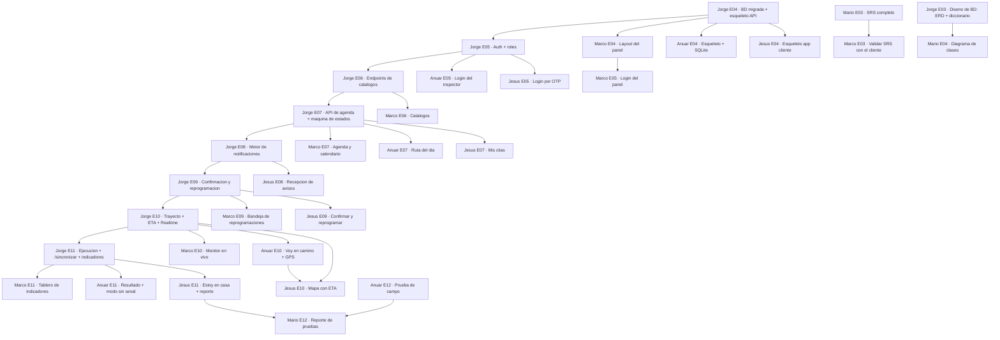

# ✅ Checklists por integrante

Cada integrante tiene un archivo con **todas sus tareas, entrega por entrega** (E01 a E12).
Marca cada `- [ ]` conforme avances. El 📦 de cada bloque es tu **entregable** de esa semana.

| Clave | Integrante | Rol | Checklist |
|-------|-----------|-----|-----------|
| LP | Marco Antonio Méndez Sánchez | Product Owner / Scrum Master + Panel de administración | [[Checklist-Marco-LP]] |
| AN | Mario Martínez González | Analista / Documentación / QA | [[Checklist-Mario-AN]] |
| BD | Jorge Alberto Barbosa García | Arquitecto / Backend + BD + DevOps | [[Checklist-Jorge-BD]] |
| IN | Anuar Guadalupe Hernández Hernández | Desarrollador Móvil — App del **Inspector** | [[Checklist-Anuar-IN]] |
| CL | Jesús Mario Bazaldúa Bustos | Desarrollador Móvil — App del **Cliente** + Pruebas | [[Checklist-Jesus-CL]] |

## 🎯 Qué estamos construyendo

**AgaveAlerta** sustituye el aviso por correo de la visita del inspector de techos por un sistema de **tres servicios**:

- **Panel del Administrador (web)** — programa y asigna las inspecciones, vigila la operación y mide.
- **App del Inspector (móvil)** — su ruta del día, "voy en camino", llegada y resultado con fotos, aun sin señal.
- **App del Cliente (móvil)** — notificación en el teléfono, confirmar, mover la cita, ver al inspector en el mapa con su tiempo estimado de llegada y confirmar "ya estoy en mi casa".

Los tres se apoyan en una **API** única y una **base de datos central**.

## 📅 Calendario de entregas (todas los jueves)

| # | Fecha | Sprint | Hito |
|---|-------|--------|------|
| E01 | jue 03 sep 2026 | Sprint 0 | Arranque y planeación |
| E02 | jue 10 sep 2026 | Sprint 1 | Análisis |
| E03 | jue 17 sep 2026 | Sprint 1 (cierre) | Requerimientos cerrados + diseño de interfaz + **diseño de base de datos** |
| E04 | jue 24 sep 2026 | Sprint 2 | Diseño técnico + infraestructura |
| E05 | jue 01 oct 2026 | Sprint 2 (cierre) | Autenticación y roles |
| E06 | jue 08 oct 2026 | Sprint 3 | Clientes, domicilios, inspectores y zonas |
| E07 | jue 15 oct 2026 | Sprint 3 (cierre) | Agenda de inspecciones y asignación |
| E08 | jue 22 oct 2026 | Sprint 4 | Motor de notificaciones push |
| E09 | jue 29 oct 2026 | Sprint 4 (cierre) | Confirmación y reprogramación |
| E10 | jue 05 nov 2026 | Sprint 5 | Trayecto y seguimiento en vivo |
| E11 | jue 12 nov 2026 | Sprint 5 (cierre) | Llegada, resultado, tablero y modo sin señal |
| E12 | jue 19 nov 2026 | Sprint 6 | Pruebas integrales, implantación y entrega final |

## 📌 Reglas de entrega

- Se entrega **cada jueves**: incremento de software + documentación de la semana + minuta.
- El **Sprint Review + Retrospectiva + Planning** del siguiente sprint se hace en E03, E05, E07, E09, E11 y E12.
- Marco (LP) consolida y hace la entrega única.
- Etiqueta en el repo por entrega: `entrega-01` … `entrega-12`.
- **Las apps se prueban en teléfono real**, no solo en emulador. A partir de E10, al menos una prueba por entrega es **de campo** (en la calle, con GPS y señal variable).
- Cada quien avanza **en paralelo**; los marcadores ⛔ y 🔸 indican qué necesitas de otro compañero antes de arrancar.

## 🧩 Leyenda

- `- [ ]` — tarea; se marca con clic en Obsidian.
- **→** (debajo de cada tarea) — explica **qué hacer** y **cuándo se considera terminada**.
- ⛔ **Requiere:** — **bloqueo duro**: no puedes empezar esta tarea hasta que lo indicado esté hecho. Dice de **quién** y de **qué entrega**.
- 🔸 **Mejor después de:** — puedes avanzar, pero la tarea solo queda completa cuando exista eso (típico: capturas de pantalla para el manual).
- 📦 — entregable de la semana (lo que se sube ese jueves).
- `#agave/E0X` — tag por entrega; en la búsqueda de Obsidian escribe `tag:#agave/E06` para ver todas las tareas de esa entrega.
- `> [!warning] Depende de` — resumen de los bloqueos de esa entrega (el detalle está en cada tarea con ⛔).
- `> [!info]` — nota o aclaración de rol.

## 🔗 Mapa de dependencias (cadena crítica)

> Casi todo depende de **Jorge (BD)**: primero la base de datos y la API, luego los endpoints por módulo. **Marco (Panel)**, **Anuar (Inspector)** y **Jesús (Cliente)** consumen esos endpoints. La dependencia más delicada es **E10**: el mapa de Jesús necesita que Anuar publique la ubicación y que Jorge tenga abierto el canal en vivo — las tres tareas caen la misma semana, así que Jorge publica un **punto simulado** el primer día del sprint para que nadie se quede parado.

## 📚 Documentos de referencia

- [[01_Plan_de_Proyecto]]
- [[02_SRS_Requerimientos]]
- [[03_Diseno_Base_de_Datos]]
- [[03b_Modelo_Datos_Resumen_E03]] — vista resumida del modelo de datos (ERD de 5 entidades), se entrega en E03
- [[04_Diagramas_UML]]
- [[05_Calendario_Entregas]]
- [[Integracion]]
