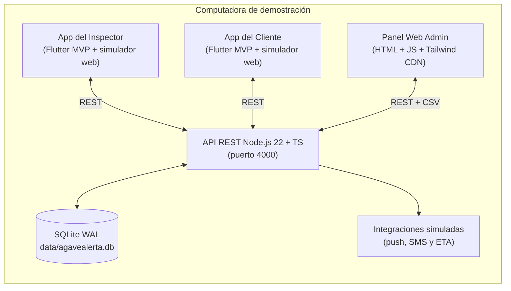

# ADR-001 (Versión Final E12): Arquitectura Definitiva, Respaldo y Monitoreo

**Autor:** Jorge Alberto Barbosa García (BD — Matrícula 2071973)  
**Estado:** Aceptado — validado en **entorno local de demostración** (actualizado el 13 nov 2026)  
**Relacionado con:** [02_SRS_Requerimientos.md §5 — Control de cambios](../../02_SRS_Requerimientos.md)

---

## 1. Contexto y decisión de arquitectura

Para atender el problema de visitas fallidas de **Agave Roofing** en San Antonio, Texas, se implementó un monorepo con tipos compartidos (`shared/`), una API REST (`api/`) y tres clientes (`panel/`, `app-inspector/`, `app-cliente/`).

1. **Apps móviles (`app-inspector` y `app-cliente`):**
   - Construidas en **Flutter (Dart)** con el patrón **MVP (Model–View–Presenter)**.
   - Cada app tiene además un **simulador web** (HTML + JavaScript) que se usa en la demostración para mostrar los flujos completos (mensajería, cola sin conexión, notificaciones simuladas) que aún no están en la versión Flutter.
2. **Panel web de administración (`panel/index.html`):**
   - Página única en **HTML + JavaScript** con estilos de **Tailwind CSS (CDN)** que consume la API por `fetch`.
   - Los archivos `panel/src/pages/*.tsx` son **prototipos en React** que no forman parte de la versión entregada (no hay proyecto Vite ni dependencias de React configuradas).
3. **Backend y persistencia (`api/`):**
   - Servidor REST en **Node.js 22 con TypeScript nativo** (`--experimental-strip-types`) usando el módulo `http` de Node, **sin Express**.
   - Base de datos **SQLite en modo WAL** (`node:sqlite`) con claves foráneas activas. El esquema sigue el diseño relacional de `docs/03_Diseno_Base_de_Datos.md`, pensado para PostgreSQL; `api/prisma/schema.prisma` y `docs/setup_rls.sql` quedan como **diseño de referencia para la migración**, no se usan en esta versión.

**Por qué SQLite y no Supabase en esta versión:** permitió ejecutar las pruebas de las reglas de negocio de forma determinista y sin depender de cuentas, cuotas ni red. La contraparte es que la autenticación, el canal en tiempo real y las políticas RLS de Supabase **no están en uso**.

---

## 2. Diagrama de despliegue (versión entregada)

### 2.1 Arquitectura objetivo (trabajo futuro)

La arquitectura del SRS v1.0 sigue siendo el destino: PostgreSQL en Supabase con RLS, Supabase Auth (correo y OTP), Supabase Realtime para la ubicación en vivo, Firebase Cloud Messaging para push, Twilio para SMS, Google Directions para el ETA y el panel desplegado en Vercel.

---

## 3. Integraciones externas

| Servicio | SRS v1.0 | Versión entregada |
| :--- | :--- | :--- |
| Autenticación | Supabase Auth (correo / OTP) + JWT validado en cada petición | `POST /api/auth/login` de demostración: no valida contraseña ni OTP y el token no se verifica en las demás rutas |
| Notificaciones push | FCM / APNs | Simuladas: el despachador registra estados, reintentos y respaldo, sin enviar al teléfono |
| SMS de respaldo | Twilio | Simulado (se registra el envío en la tabla `notificacion`) |
| Ruta y ETA | Google Directions | Estimación propia con distancia y velocidad promedio; respaldo en línea recta (RN-09) |
| Ubicación en vivo | Supabase Realtime | Consulta a `GET /api/inspecciones/:id/seguimiento` cada vez que la app se refresca (sin canal en tiempo real) |
| Fotos y reportes | Supabase Storage + PDF | URLs de imagen y reporte en HTML (`/api/inspecciones/:id/reporte-html`) |

---

## 4. Respaldo, pruebas y monitoreo

- **Datos reproducibles:** `npm run seed` regenera `data/agavealerta.db` con los datos de prueba de San Antonio (4 zonas, 2 inspectores, 4 clientes y 12 inspecciones). No hay respaldo automático programado (RF-76 pendiente).
- **Pruebas automatizadas:** `npm test` ejecuta 28 escenarios de E07 a E11; los 28 pasaron el 13 de noviembre de 2026.
- **Manejo de errores:** las violaciones de reglas de negocio se responden con códigos `400`, `403` o `409`; los errores no previstos devuelven `500` con el mensaje del error. Se puede revisar la bitácora en `GET /api/bitacora`.
