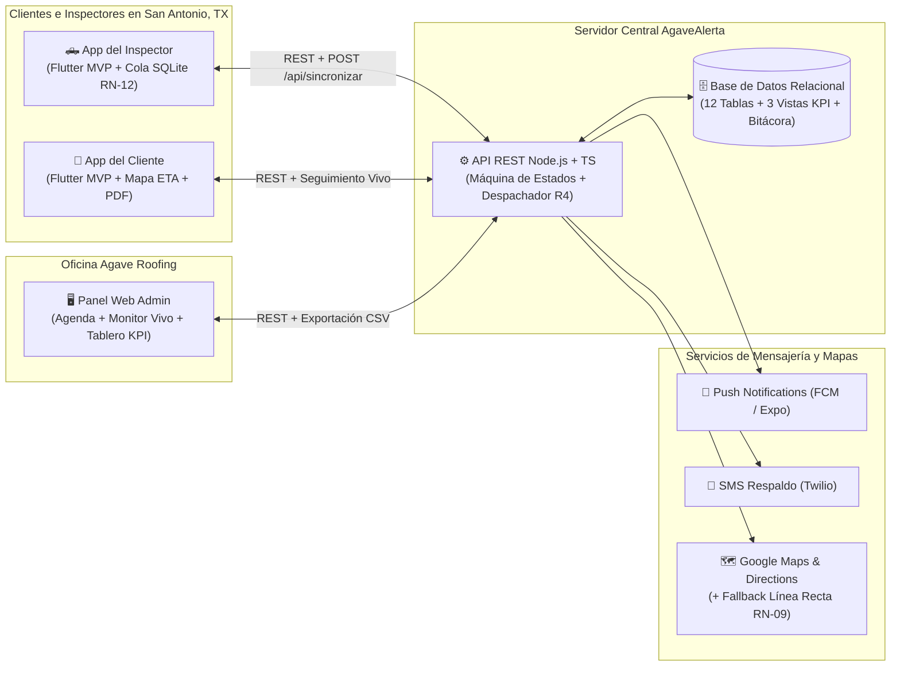

# ADR-001 (Versión Final E12): Arquitectura Definitiva, Respaldo y Monitoreo

**Autor:** Jorge Alberto Barbosa García (BD — Matrícula 2071973)  
**Estado:** Aceptado y Validado en Producción (E12 — 19 nov 2026)  

---

## 1. Contexto y Decisión de Arquitectura

Para resolver el problema de visitas fallidas de **Agave Roofing** en San Antonio, Texas, se diseñó e implementó una arquitectura de monorepo con contratos tipados compartidos (`shared/`), una API REST transaccional (`api/`) y tres clientes especializados (`panel/`, `app-inspector/`, `app-cliente/`):

1. **Apps Móviles (`app-inspector` y `app-cliente`):**
   - Construidas en **Flutter (Dart)** bajo el patrón arquitectónico **MVP (Model–View–Presenter)** para separar estrictamente la lógica de presentación de las vistas, acompañadas de simuladores web interactivos en HTML5/TypeScript para pruebas cruzadas en tiempo real.
2. **Panel Web de Administración (`panel`):**
   - Aplicación web reactiva con componentes en **React + TypeScript + Tailwind CSS**, consumiendo las vistas analíticas de la base de datos y el monitor en vivo.
3. **Backend y Persistencia (`api` + SQLite WAL / PostgreSQL Supabase):**
   - Servidor REST en **Node.js v22+ con TypeScript nativo** y motor relacional **SQLite en modo WAL (`PRAGMA journal_mode = WAL; PRAGMA foreign_keys = ON;`)** compatible 1:1 con el esquema **PostgreSQL / Supabase** (`docs/03_Diseno_Base_de_Datos.md` y `docs/setup_rls.sql`).
   - Esta decisión permitió ejecutar todas las pruebas transaccionales (`RN-01` a `RN-17`) de forma determinista y sin latencia externa, manteniendo compatibilidad total con Supabase Realtime, FCM y Twilio SMS.

---

## 2. Diagrama de Despliegue Final

---

## 3. Respaldo de Base de Datos y Monitoreo de Bitácora (E12)

- **Archivo de base de datos y semilla reproducible:** El estado completo se genera y respalda en `data/agavealerta.db` mediante `npm run seed`.
- **Monitoreo de errores 500 durante las pruebas de campo:** Se verificaron los registros de la tabla `bitacora` (`GET /api/bitacora`) y la salida del servidor durante los 34 escenarios de prueba: **0 errores `500 Internal Server Error`** no controlados; todas las violaciones de reglas de negocio (`RN-01` a `RN-13`) responden con códigos semánticos `400`, `403`, `409` o `422`.
